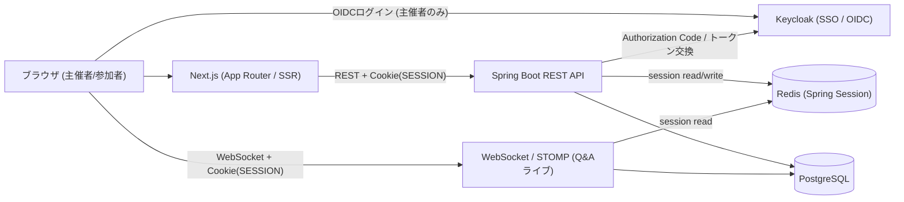

# live-qa-app

セミナー・勉強会向けの**リアルタイム ライブQ&A + 投票**アプリ（sli.do風）。参加者が質問を投稿し、「いいね」で人気の質問が上位に浮上、主催者がその場で回答を捌く。質問・いいね・ステータス変更はWebSocketでライブ反映される。前回のポートフォリオ「LibraShare」の学びを活かしつつ、3名それぞれが新規技術を主役として習得することを狙う学習/ポートフォリオ作品。

> このリポジトリは現時点では**方向性を定めたドキュメントとディレクトリ骨組みのみ**。実装はこれから進める（14日・3名）。

## 概要

| 項目 | 内容 |
|------|------|
| テーマ | リアルタイム ライブQ&A + 投票（sli.do風） |
| 想定利用者 | 主催者（イベントを開き質問を捌く） / 参加者（質問投稿・いいね） |
| 開発フロー | アジャイル（イテレーション型・約14日）。MVP-A → MVP-B の2段階でインクリメンタルにリリース |
| 構成 | Next.js(フロント) + Spring Boot(API) の分離構成 |
| 認証 | KeycloakのSSO(OIDC)でログイン → Cookieセッション管理（Spring Session + Redis）のハイブリッド |
| チーム | 3名（A=Next.js / B=Cookieセッション+Redis / C=WebSocket+Docker） |

## 前回LibraShareとの差分

- テーマ: 社内バックオフィス(BtoB) → **セミナー/勉強会向けライブQ&A**
- 人数: 2名 → **3名**
- 認証: Keycloak/JWT(stateless) → **KeycloakのSSO(OIDC)でログインのみ行い、以降はCookieセッションで管理するハイブリッド**（Spring Session + Redis）。前回のSSO資産を再利用しつつ、状態管理はステートフルなセッションへ
- フロント: React + Vite(SPA) → **Next.js(App Router / SSR)**
- 通信: WebSocket除外 → **WebSocket/STOMPを主役級で採用**（質問・いいねのライブ配信）
- CI/CD: 手動中心 → **GitHub ActionsでCI自動化**
- 期間: 30日構想 → **14日・アジャイル（学習フェーズ → MVP-A → MVP-B）**

## 学習テックの主役マッピング（1人1テーマ）

前回の実力（Spring Boot / 基本CRUD / React SPA / JWT / 静的検索）をベースに、各自が**新規技術1本を主役**として習得する。

- **A: Next.js** — イベント一覧/詳細をSSR、参加ページ、ライブ質問リストUI（クライアントでSTOMP受信）
- **B: Cookieセッション+Redis** — KeycloakのOIDCログイン連携（`oauth2Login`）→ セッションへ橋渡し、RBAC/CSRF、参加者の匿名セッションをRedisで保持
- **C: WebSocket+Docker** — STOMPで質問・いいね・ステータスをライブ配信、Docker Compose一括起動（Keycloak含む）、GitHub Actions CI

## 技術スタック

### Backend（Spring Boot + Java 21）

- `spring-boot-starter-web` — REST API
- `spring-boot-starter-security` — 認証・認可（RBAC / CSRF）
- `spring-boot-starter-oauth2-client` — KeycloakのOIDCログイン（`oauth2Login`）。ログイン成功後にセッションへ橋渡し
- `spring-session-data-redis` — Cookieセッションのストア
- `spring-boot-starter-websocket` — WebSocket / STOMP（質問・いいねのライブ配信）
- QueryDSL — 軽めの動的クエリ（質問の並び替え / フィルタ）
- Flyway — DBマイグレーション
- springdoc-openapi — Swagger UI / OpenAPI 3

### Frontend（Next.js）

- Next.js（App Router / SSR） + TypeScript
- TanStack Query（データ取得）
- Tailwind CSS + shadcn/ui
- Zod（バリデーション）
- STOMPクライアント（質問・いいねのリアルタイム受信）

### Infra

- PostgreSQL 15+
- Redis（Spring Session）
- Keycloak（SSO / OIDCプロバイダ。前回LibraShareの資産を再利用）
- Docker Compose（`nextjs` / `api` / `postgres` / `redis` / `keycloak`）
- GitHub Actions（CI）

## アーキテクチャ



- 認証: 主催者は Keycloak の SSO(OIDC) でログイン。Spring Boot の `oauth2Login` がログイン成功時にセッションを作成し、以降は`SESSION` Cookieだけで認証（JWT再検証はしない）
- フロント: Next.jsがイベント一覧/詳細をSSRで表示。ログイン後は`SESSION` Cookieを付けてRESTを呼ぶ
- バックエンド: Spring SecurityがCookieセッションを検証し、`@PreAuthorize`等でRBAC。stateful化に伴いCSRF保護を有効化
- WebSocket: ハンドシェイク時に同じセッションCookieで認証し、STOMPで質問・いいねをライブ配信
- 参加者: ログイン不要（匿名セッション）。SSOは主催者にのみ適用
- STOMPトピック: `/topic/events/{eventId}/questions`（配信イベント: `QUESTION_CREATED` / `QUESTION_UPVOTED` / `QUESTION_ANSWERED`）

## MVP スコープ（アジャイル: MVP-A → MVP-B）

アジャイル開発で「動くもの」を小さくリリースしながら価値を積み増す。**MVP-A が死守ライン**、MVP-B は価値拡張のイテレーション。詳細は [docs/scope.md](docs/scope.md)。

機能ごとに担当を明示する。列の担当は **主担当**。`—` は直接の担当なし（レビュー / ペアは随時）。担当詳細は [docs/roles.md](docs/roles.md)。

- **Member A** = Next.js（フロント）
- **Member B** = Cookieセッション+Redis（バックエンド・セキュリティ）
- **Member C** = WebSocket+Docker（リアルタイム・環境構築）

### MVP-A（第1イテレーション・死守ライン）: ライブQ&Aが動く

| ID | 機能 | Member A（Next.js） | Member B（Session+API） | Member C（WS+Docker） |
|----|------|--------------------|------------------------|----------------------|
| F-01 | Keycloak SSO(OIDC)ログイン + Cookieセッション認証(RBAC/CSRF) | ログイン導線 / HOST メール登録 UI / 認証状態UI | `oauth2Login`→セッション橋渡し / JIT / **HOST 登録 API（Admin API）** / RBAC・CSRF | Keycloak・RedisのCompose |
| F-02 | イベント(ルーム)作成・参加コード/URL発行・名称更新・物理削除 | 作成画面 / 主催者ダッシュボード（名称変更・削除） | イベント作成・名称更新・削除 API・`joinCode`発行 | — |
| F-03 | ルーム状態遷移 `DRAFT → OPEN ⇔ CLOSED` | 開始/締切/再開のUI | ステータス変更API・遷移バリデーション | — |
| F-04 | 参加者の匿名参加（コード/URL・匿名セッション） | 参加ページ / 参加コード入力（SSR） | 匿名セッション発行・`voter_key`識別 | — |
| F-05 | 質問投稿・いいね（1人1票） | 投稿フォーム / いいねUI | 質問・いいねAPI / 一意制約・原子的カウント | いいね整合性のバックエンド支援 |
| F-06 | 人気順 / 新着順 表示 | 一覧UI・並び替え切替 | QueryDSL動的クエリ | — |
| F-07 | WebSocket(STOMP)ライブ反映 | STOMP受信・ライブ更新UI（再ソート） | — | STOMP配信 / ハンドシェイクCookie認証 |
| F-08 | 質問ステータス変更（回答済み / アーカイブ） | 運営操作UI | ステータス変更API | 変更イベントの配信 |
| F-09 | Docker一括起動 + GitHub Actions CI | フロントdev / build手順 | — | Compose全体・Flyway基盤・CI・Testcontainers |

- **ゴール**: 実際のイベントでライブQ&Aとして使える状態（Potentially Shippable）

### MVP-B（第2イテレーション・価値拡張）: 投票(Poll)と運用強化

| ID | 機能 | Member A（Next.js） | Member B（Session+API） | Member C（WS+Docker） |
|----|------|--------------------|------------------------|----------------------|
| F-10 | ライブ投票(Poll) 作成・開閉（アンケート型・単一/複数選択・`DRAFT→OPEN→CLOSED`） | Poll作成 / 結果分布UI | Poll作成・状態変更API | `POLL_OPENED`/`POLL_CLOSED`配信 |
| F-11 | Poll回答・得票分布ライブ更新 | 回答UI / 棒グラフ（ライブ） | 回答API・集計 | `POLL_UPDATED`配信 |
| F-12 | 質問フィルタ（未回答 / 回答済み / アーカイブ） | フィルタUI | QueryDSL拡充 | — |
| F-13 | 簡易モデレーション（不適切質問のアーカイブ） | モデレーション操作UI | アーカイブAPI | — |

- **ゴール**: Q&Aに投票を加えた双方向イベント運営

### さらなるストレッチ（余力があれば）

| ID | 機能 | Member A（Next.js） | Member B（Session+API） | Member C（WS+Docker） |
|----|------|--------------------|------------------------|----------------------|
| F-14 | 参加者数プレゼンス表示 | プレゼンス表示UI | — | プレゼンス配信 |
| F-15 | QR参加 | QRコード表示 | — | — |

## チームと役割

3名。割り振りはできるだけ均等に。上記の機能ID（F-01…）を各メンバーの主担当に対応づける。詳細は [docs/roles.md](docs/roles.md)。

| メンバー | 主役技術 / 領域 | 主担当（MVP-A） | 主担当（MVP-B・ストレッチ） |
|---------|----------------|----------------|---------------------------|
| **Member A** | Next.js（フロント） | 全画面UI / SSR / STOMP受信（F-01〜F-08のUI） | Poll UI・棒グラフ / フィルタUI（F-10〜F-13, F-14/F-15） |
| **Member B** | Cookieセッション+Redis（バック・セキュリティ） | 認証・セッション橋渡し / 主要CRUD API / QueryDSL（F-01〜F-06, F-08） | Poll API・集計 / フィルタAPI / モデレーション（F-10〜F-13） |
| **Member C** | WebSocket+Docker（リアルタイム・環境） | STOMP配信 / Cookie認証 / Compose・CI（F-05, F-07, F-09） | Poll配信（`POLL_*`）/ プレゼンス配信（F-10・F-11, F-14） |

## 開発スケジュール（アジャイル・14日）

短いイテレーションで2つのMVPを段階リリースする。各イテレーション末に**デモ + ふりかえり**を行い、毎朝15分の進捗共有で軌道修正する。詳細は [docs/schedule.md](docs/schedule.md)（**2026-08 実施日は [カレンダー版](docs/schedule.md#2026-08-カレンダー版) が正**）。

| フェーズ | 期間（概念） | 2026-08 | 内容 |
|---------|--------------|---------|------|
| 学習フェーズ | Day1-4 | **8/4〜8/6**（ゲート 8/6） | 各自が主役技術をJIT学習しつつ基盤構築（Docker一括起動 / CI緑 / 認証疎通 / STOMPエコー = **基盤疎通ゲート**） |
| 休暇 | — | **8/8〜8/17** | 開発オフ（8/7 は休暇前スプリント） |
| MVP-A（Sprint 1） | Day5-9 | **8/18〜8/26**／**Go/No-Go 8/27** | **機能 F-01〜F-09**: 認証 / ルーム(`DRAFT→OPEN⇔CLOSED`) / 匿名参加 / 質問投稿・いいね・人気順 / WebSocketライブ配信 / 質問ステータス変更 / Docker＋CI |
| MVP-B（Sprint 2） | Day10-13 | **8/28〜**（Go 時） | **機能 F-10〜F-13**: ライブ投票(Poll) / 質問フィルタ / 簡易モデレーション |
| 仕上げ | Day14 | Go/No-Go 後 | E2E / README・スクショ / 相互デモ / バグ修正・UX |

- 各Sprint末に「動くインクリメント」をデモできる状態にする（Potentially Shippable Increment）
- **MVP-Aが未達なら MVP-B には進まず、仕上げを優先**する
- **8/27 は動かさない**。遅延はスコープで吸収（[scope.md の削る順番](docs/scope.md)）

## ドキュメント

- [AGENTS.md](AGENTS.md) — AI Agent 向け共通ガイド（LibraShareから共通方針を継承）
- [docs/README.md](docs/README.md) — ドキュメント索引
- [docs/scope.md](docs/scope.md) — MVP-A / MVP-B / ストレッチ（F-xx）
- [docs/roles.md](docs/roles.md) — 役割分担・機能 ID 対応
- [docs/schedule.md](docs/schedule.md) — 14日アジャイルスケジュール（**[2026-08 カレンダー版](docs/schedule.md#2026-08-カレンダー版)**）
- [docs/architecture.md](docs/architecture.md) — アーキテクチャ・技術マッピング

## リポジトリ構成

```
live-qa-app/
├── backend/           # Spring Boot API（実装はこれから）
├── frontend/          # Next.js（実装はこれから）
├── .cursor/rules/     # Cursor AI ルール
├── .github/
│   ├── ISSUE_TEMPLATE/  # Bug / Feature / Task
│   ├── pull_request_template.md
│   └── workflows/       # GitHub Actions（これから）
├── docs/              # 方向性・設計ドキュメント
├── AGENTS.md          # AI Agent 向けガイド
└── README.md
```
