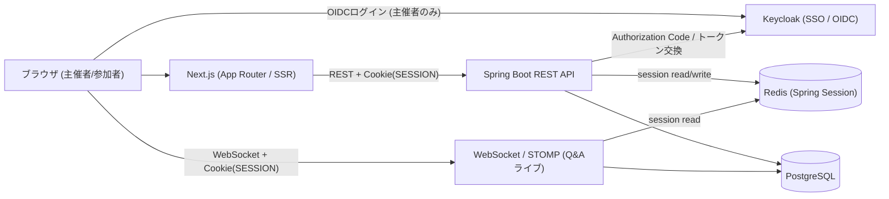

# live-qa-app

セミナー・勉強会向けの**リアルタイム ライブQ&A + 投票**アプリ。
参加者が質問を投稿し、「いいね」で人気の質問が上位に浮上、主催者がその場で回答を捌く。
質問・いいね・ステータス変更はWebSocketでライブ反映される

## 概要

| 項目 | 内容 |
|------|------|
| テーマ | リアルタイム ライブQ&A + 投票 |
| 想定利用者 | 主催者（イベントを開き質問を捌く） / 参加者（質問投稿・いいね） |
| 構成 | Next.js(フロント) + Spring Boot(API) の分離構成 |
| 認証 | KeycloakのSSO(OIDC)でログイン → Cookieセッション管理（Spring Session + Redis|

## 技術スタック

### Backend（Spring Boot + Java 21）

- `spring-boot-starter-web` — REST API
- `spring-boot-starter-security` — 認証・認可（RBAC / CSRF）
- `spring-boot-starter-oauth2-client` — KeycloakのOIDCログイン（`oauth2Login`）。ログイン成功後にセッションへ橋渡し
- `spring-session-data-redis` — Cookieセッションのストア
- `spring-boot-starter-websocket` — WebSocket / STOMP（質問・いいねのライブ配信）
- QueryDSL — 軽めの動的クエリ（質問の並び替え / フィルタ）
- Flyway — DBマイグレーション
- springdoc-openapi — Swagger UI / OpenAPI 3

### Frontend（Next.js）

- Next.js（App Router / SSR） + TypeScript
- TanStack Query（データ取得）
- Tailwind CSS + shadcn/ui
- Zod（バリデーション）
- STOMPクライアント（質問・いいねのリアルタイム受信）

### Infra

- PostgreSQL 15+
- Redis（Spring Session）
- Keycloak（SSO / OIDCプロバイダ。前回LibraShareの資産を再利用）
- Docker Compose（`nextjs` / `api` / `postgres` / `redis` / `keycloak`）
- GitHub Actions（CI）

## アーキテクチャ



- 認証: 主催者は Keycloak の SSO(OIDC) でログイン。Spring Boot の `oauth2Login` がログイン成功時にセッションを作成し、以降は`SESSION` Cookieだけで認証（JWT再検証はしない）
- フロント: Next.jsがイベント一覧/詳細をSSRで表示。ログイン後は`SESSION` Cookieを付けてRESTを呼ぶ
- バックエンド: Spring SecurityがCookieセッションを検証し、`@PreAuthorize`等でRBAC。stateful化に伴いCSRF保護を有効化
- WebSocket: ハンドシェイク時に同じセッションCookieで認証し、STOMPで質問・いいねをライブ配信
- 参加者: ログイン不要（匿名セッション）。SSOは主催者にのみ適用

### MVP-A（第1イテレーション・死守ライン）: ライブQ&Aが動く
| ID | 機能 | Member A（Next.js） | Member B（Session+API） | Member C（WS+Docker） |
|----|------|--------------------|------------------------|----------------------|
| F-01 | Keycloak SSO(OIDC)ログイン + Cookieセッション認証(RBAC/CSRF) | ログイン導線 / HOST メール登録 UI / 認証状態UI | `oauth2Login`→セッション橋渡し / JIT / **HOST 登録 API（Admin API）** / RBAC・CSRF | Keycloak・RedisのCompose |
| F-02 | イベント(ルーム)作成・参加コード/URL発行・名称更新・物理削除 | 作成画面 / 主催者ダッシュボード（名称変更・削除） | イベント作成・名称更新・削除 API・`joinCode`発行 | — |
| F-03 | ルーム状態遷移 `DRAFT → OPEN ⇔ CLOSED` | 開始/締切/再開のUI | ステータス変更API・遷移バリデーション | — |
| F-04 | 参加者の匿名参加（コード/URL・匿名セッション） | 参加ページ / 参加コード入力（SSR） | 匿名セッション発行・`voter_key`識別 | — |
| F-05 | 質問投稿・いいね（1人1票） | 投稿フォーム / いいねUI | 質問・いいねAPI / 一意制約・原子的カウント | いいね整合性のバックエンド支援 |
| F-06 | 人気順 / 新着順 表示 | 一覧UI・並び替え切替 | QueryDSL動的クエリ | — |
| F-07 | WebSocket(STOMP)ライブ反映 | STOMP受信・ライブ更新UI（再ソート） | — | STOMP配信 / ハンドシェイクCookie認証 |
| F-08 | 質問ステータス変更（回答済み / アーカイブ） | 運営操作UI | ステータス変更API | 変更イベントの配信 |
| F-09 | Docker一括起動 + GitHub Actions CI | フロントdev / build手順 | — | Compose全体・Flyway基盤・CI・Testcontainers |

### MVP-B（第2イテレーション・価値拡張）: 投票(Poll)と運用強化

| ID | 機能 | Member A（Next.js） | Member B（Session+API） | Member C（WS+Docker） |
|----|------|--------------------|------------------------|----------------------|
| F-10 | ライブ投票(Poll) 作成・開閉（アンケート型・単一/複数選択・`DRAFT→OPEN→CLOSED`） | Poll作成 / 結果分布UI | Poll作成・状態変更API | `POLL_OPENED`/`POLL_CLOSED`配信 |
| F-11 | Poll回答・得票分布ライブ更新 | 回答UI / 棒グラフ（ライブ） | 回答API・集計 | `POLL_UPDATED`配信 |
| F-12 | 質問フィルタ（未回答 / 回答済み / アーカイブ） | フィルタUI | QueryDSL拡充 | — |
| F-13 | 簡易モデレーション（不適切質問のアーカイブ） | モデレーション操作UI | アーカイブAPI | — |

## リポジトリ構成

```
live-qa-app/
├── backend/           # Spring Boot API
├── frontend/          # Next.js
├── .cursor/rules/     # Cursor AI ルール
├── .github/
│   ├── ISSUE_TEMPLATE/  # Bug / Feature / Task
│   ├── pull_request_template.md
│   └── workflows/       # GitHub Actions
├── docs/              # 方向性・設計ドキュメント
├── AGENTS.md          # AI Agent 向けガイド
└── README.md
``