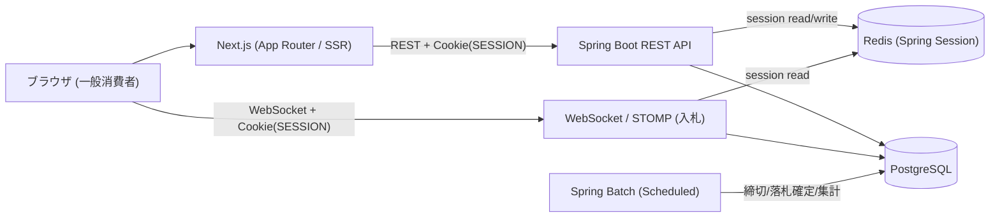

# auction-app

一般消費者向け（BtoC）の**リアルタイムオークション / フリマ**アプリ。誰でも会員登録して出品・入札でき、入札はWebSocketでライブ反映される。前回のポートフォリオ「LibraShare」の学びを活かし、3名チームで **WebSocket・Cookieセッション・Spring Boot・Next.js・Spring Batch・動的クエリ・Docker・GitHub Actions** を一通り使い切ることを狙う学習/ポートフォリオ作品。

> このリポジトリは現時点では**方向性を定めたドキュメントとディレクトリ骨組みのみ**。実装はこれから進める。

## 概要

| 項目 | 内容 |
|------|------|
| テーマ | BtoCリアルタイムオークション / フリマ |
| 想定利用者 | 一般会員（出品者にも入札者にもなれる） / 運営管理者 |
| 開発フロー | 学習 → 共有 → 設計 → 実装（約30日） |
| 構成 | Next.js(フロント) + Spring Boot(API) の分離構成 |
| 認証 | Cookieベースのセッション管理（Spring Session + Redis） |
| チーム | 3名（A=フロント・インフラ / B=バックエンド・セキュリティ / C=WebSocket・バックエンド・環境構築） |

## 前回LibraShareとの差分

- 対象: 社内バックオフィス(BtoB) → **一般消費者向け(BtoC)**
- 人数: 2名 → **3名**
- 認証: Keycloak/JWT(stateless) → **Cookieベースのセッション管理**（Spring Session + Redis）
- フロント: React + Vite(SPA) → **Next.js(App Router / SSR)**
- 通信: WebSocket除外 → **WebSocket/STOMPを主役級で採用**
- バッチ: 除外 → **Spring Batch採用**
- 検索: 静的 → **動的クエリ（条件に応じたSQL組み立て）**
- CI/CD: 手動中心 → **GitHub Actionsで自動化**

## 技術スタック

### Backend（Spring Boot + Java 21）

- `spring-boot-starter-web` — REST API
- `spring-boot-starter-security` — 認証・認可（RBAC / CSRF）
- `spring-session-data-redis` — Cookieセッションのストア
- `spring-boot-starter-websocket` — WebSocket / STOMP（入札のライブ配信）
- `spring-boot-starter-batch` — Spring Batch（締切・集計）※MVP-B
- QueryDSL — 動的クエリ（検索）
- Flyway — DBマイグレーション
- springdoc-openapi — Swagger UI / OpenAPI 3

### Frontend（Next.js）

- Next.js（App Router / SSR） + TypeScript
- TanStack Query（データ取得）
- Tailwind CSS + shadcn/ui
- Zod（バリデーション）
- STOMPクライアント（入札のリアルタイム受信）

### Infra

- PostgreSQL 15+
- Redis（Spring Session）
- Docker Compose（`nextjs` / `api` / `postgres` / `redis`）
- GitHub Actions（CI / 任意でCD）
- 任意: Nginx（リバースプロキシ）、MinIO（S3互換の画像ストレージ）

## アーキテクチャ



- フロント: Next.jsが商品一覧/詳細をSSRで表示。ログイン後は`SESSION` Cookieを付けてRESTを呼ぶ
- バックエンド: Spring SecurityがCookieセッションを検証し、`@PreAuthorize`等でRBAC。stateful化に伴いCSRF保護を有効化
- WebSocket: ハンドシェイク時に同じセッションCookieで認証し、STOMPで入札をライブ配信
- バッチ: オークション締切・落札確定・集計を担当（MVP-B）

## MVP スコープ

コミットラインは **MVP-A**。詳細は [docs/scope.md](docs/scope.md)。

- **MVP-A（必須）**: セキュリティ関連（Cookieセッション/RBAC/CSRF） + WebSocket入札 + 主要CRUD（出品・商品・入札・動的検索）
- **MVP-B（ストレッチ）**: Spring Batch（締切/集計）+ サーバーサイドページング + 通知/ウォッチリスト 等

## チームと役割

3名。割り振りはできるだけ均等に。詳細は [docs/roles.md](docs/roles.md)。

- **A: フロント・インフラ**
- **B: バックエンド・セキュリティ**
- **C: WebSocket・バックエンド・環境構築**

## 開発スケジュール

学習 → 共有 → 設計 → 実装 の4フェーズ（約30日）。詳細は [docs/schedule.md](docs/schedule.md)。

## ドキュメント

- [docs/README.md](docs/README.md) — ドキュメント索引
- [docs/scope.md](docs/scope.md) — MVP-A / MVP-B スコープ
- [docs/roles.md](docs/roles.md) — 役割分担
- [docs/schedule.md](docs/schedule.md) — 30日スケジュール
- [docs/architecture.md](docs/architecture.md) — アーキテクチャ・技術マッピング

## リポジトリ構成

```
auction-app/
├── backend/           # Spring Boot API（実装はこれから）
├── frontend/          # Next.js（実装はこれから）
├── .github/workflows/ # GitHub Actions（これから）
├── docs/              # 方向性ドキュメント
└── README.md
```
