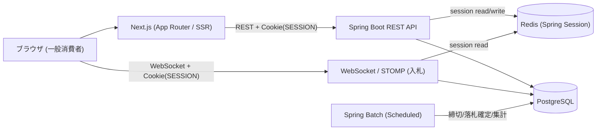

# アーキテクチャ・技術方針

## 全体構成

## 技術要件のマッピング

- **WebSocket** → `spring-boot-starter-websocket` + STOMP（+ SockJS fallback）。入札のライブ反映・通知
- **Cookieセッション** → `spring-boot-starter-security` + `spring-session-data-redis`。会員ログイン状態をRedisに保存し `SESSION` Cookieで識別。WebSocketハンドシェイクも同じCookieセッションで認証
- **Spring Boot** → REST API本体
- **Next.js** → App Router + SSRで商品一覧/詳細、クライアントコンポーネントで入札WebSocket接続
- **Spring Batch** → オークション締切/落札確定ジョブ、集計レポート、CSV出力（`@Scheduled`でトリガ）※MVP-B
- **動的クエリ** → QueryDSL（型安全に条件を組み立て）を推奨。MyBatis動的SQLも可
- **Docker** → `docker compose` で `nextjs / api / postgres / redis` を一括起動
- **GitHub Actions** → PRごとのbuild/test/lint、Dockerイメージビルド、（任意で）デプロイ

## 相性の良い追加技術

- **Redis**: Spring Sessionのストア。WebSocketの複数インスタンス配信(pub/sub)にも将来拡張可
- **QueryDSL**（動的クエリの型安全化） / 代替: MyBatis Dynamic SQL
- **PostgreSQL 15+** + **Flyway**（マイグレーション）
- **STOMP + SockJS**（WebSocketの標準化とフォールバック）
- フロント: **TypeScript / TanStack Query / Tailwind CSS + shadcn/ui / Zod**
- **springdoc-openapi**（Swagger UI）
- **Testcontainers**（PostgreSQL / Redisの統合テスト）
- 任意: **Nginx**（リバースプロキシ）、画像は **S3互換ストレージ(MinIO)**

## 動的クエリの設計方針

- QueryDSLで `BooleanBuilder`（または `Predicate` 合成）を使い、null条件はスキップして動的にWHERE / ORDER BYを構築
- レスポンスはページング形式（`content` / `page` / `totalElements`）に統一（サーバーサイドページングはMVP-B）
- 代替案: MyBatisの `<where>` / `<if>` 動的SQL

## セキュリティ / 整合性方針

- stateful（Cookie + Redisセッション）になるため **CSRF保護を有効化**（前回はstateless JWTで無効化していた点の対）
- Cookieは `HttpOnly` / `Secure` / `SameSite` を設定
- WebSocketハンドシェイク時にセッションCookieで認証し、STOMP接続でロール認可
- 入札の同時実行制御: 現在価格の更新は楽観ロック / 悲観ロックで整合性を担保（BtoCで競合が起きる要点・アピールポイント）

## CI/CD（GitHub Actions）

- **CI（PRトリガ・MVP-A / 主担当C）**: backend=Maven `test`（Testcontainersでpostgres/redis）、frontend=`lint` / `type-check` / `build`
- **イメージビルド**: backend/frontendのDockerイメージをビルド、（任意で）GHCRへpush
- **CD（任意・mainマージ・MVP-B / 主担当A）**: Render / Fly.io / 自前VPS などへデプロイ
- ブランチ保護 + PRテンプレート
- ワークフロー配置: `.github/workflows/ci.yml`（build/test）、`.github/workflows/deploy.yml`（任意）
