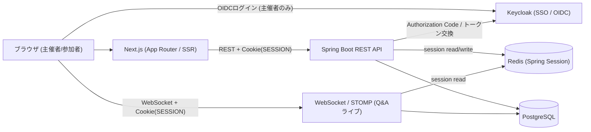
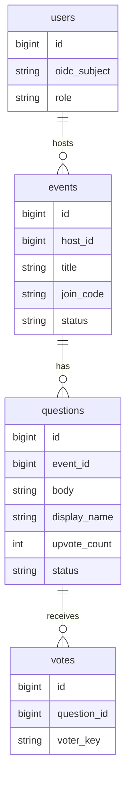
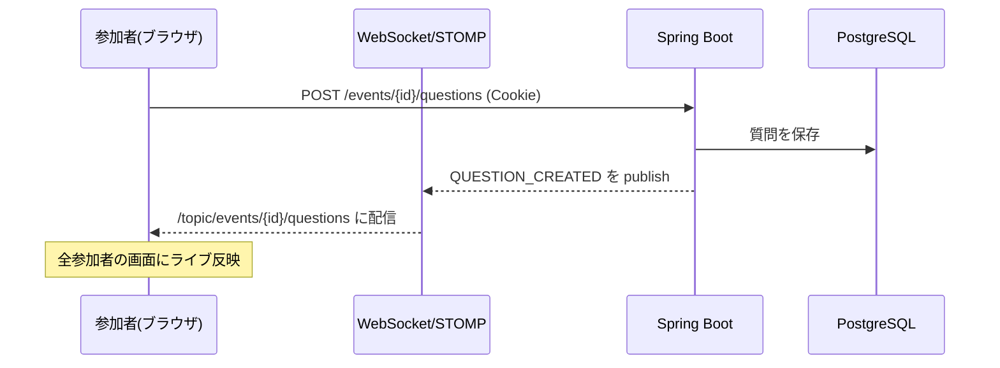

# アーキテクチャ・技術方針

テーマはリアルタイム ライブQ&A + 投票（sli.do風）。主催者がイベントを開き、参加者が質問を投稿・いいねし、人気の質問がライブで浮上する。

## 全体構成

- 認証は「入口だけSSO、その後はセッション」のハイブリッド。主催者は Keycloak(OIDC) でログインし、`oauth2Login` がログイン成功時にセッションを作成。以降のREST/WebSocketは `SESSION` Cookieだけで認証する（JWTを毎回検証するstatelessではない）
- 参加者はログイン不要（匿名セッション）。SSOは主催者にのみ適用

## 技術要件のマッピング（担当）

- **WebSocket（担当C）** → `spring-boot-starter-websocket` + STOMP（+ SockJS fallback）。質問・いいね・ステータス変更のライブ配信
- **SSO / OIDCログイン（担当B）** → `spring-boot-starter-oauth2-client` の `oauth2Login()` で Keycloak にAuthorization Codeフロー。ログイン成功後は `SecurityContext` をセッションに格納し、以降はセッションで認証。トークンはログイン以降不要なら破棄可
- **Cookieセッション（担当B）** → `spring-boot-starter-security` + `spring-session-data-redis`。ログイン状態をRedisに保存し `SESSION` Cookieで識別。参加者は匿名セッションで「1人1票」を判定。WebSocketハンドシェイクも同じCookieセッションで認証
- **Keycloak** → SSO / OIDCプロバイダ（前回LibraShareの資産を再利用）。主催者ユーザーはOIDCクレーム(`sub`)から初回ログイン時にJITプロビジョニング
- **Spring Boot** → REST API本体
- **Next.js（担当A）** → App Router + SSRでイベント一覧/詳細、クライアントコンポーネントでSTOMP接続しライブ受信
- **動的クエリ（担当B）** → QueryDSL（型安全に条件を組み立て）で質問の並び替え/フィルタを軽めに実装
- **Docker（担当C）** → `docker compose` で `nextjs / api / postgres / redis / keycloak` を一括起動
- **GitHub Actions（担当C）** → PRごとのbuild/test/lint

## ドメインモデル（最小）

- `users`: 主催者。Keycloakの `sub` を `oidc_subject`(UNIQUE)として保持し初回ログイン時に自動作成。**メール・表示名・パスワードはKeycloakに統合**し、ローカルには保持しない（必要時はクレームから取得）。RBACは `HOST` / `PARTICIPANT`
- ポール（アンケート）機能は **MVP-B（F-10/F-11）**。`polls` / `poll_options` / `poll_responses` を追加し、Q&Aと同一ルームで共存する（詳細は [design/er-diagram.md](design/er-diagram.md)）
- `events`: 主催者が作成。参加コード(`join_code`)またはURLで参加。名称更新と論理削除（`status=DELETED`）あり。`deleted_at` は持たない。名称更新と論理削除の衝突は `version`（楽観ロック）で 409
- `questions`: `status` = `OPEN` / `ANSWERED` / `ARCHIVED`、`upvote_count` を保持。`display_name` は任意ニックネーム（**現行は未入力を `"匿名"` で格納**）
- `votes`: `question_id × voter_key` に一意制約を張り「1人1票」を担保。`voter_key` の命名規則はログインユーザー `u:{userId}` / 匿名ゲスト `g:{guestId}`

> 上記は概要図。カラム定義・制約・インデックス・Flyway初期DDL案を含む詳細版は [design/er-diagram.md](design/er-diagram.md) を参照。
>
> サービスの具体仕様・画面遷移・シーケンス図・API仕様は [design/service-spec.md](design/service-spec.md) / [design/screen-transition.md](design/screen-transition.md) / [design/websocket-sequence.md](design/websocket-sequence.md) / [api/openapi-notes.md](api/openapi-notes.md) を参照。

## リアルタイム設計（STOMP）

- トピック: `/topic/events/{eventId}/questions`
- 送信先（クライアント→サーバ）: `/app/events/{eventId}/questions`（投稿）、`/app/events/{eventId}/upvote`（いいね）
- 配信イベント種別:
  - `QUESTION_CREATED` — 新しい質問が追加された
  - `QUESTION_UPVOTED` — いいね数が更新された（人気順の再ソートに使用）
  - `QUESTION_ANSWERED` — 主催者がステータスを変更した（回答済み/アーカイブ）
- ポール（MVP-B）: トピック `/topic/events/{eventId}/polls`、配信種別 `POLL_OPENED` / `POLL_UPDATED`（得票分布のライブ更新） / `POLL_CLOSED`

## 動的クエリの設計方針

- QueryDSLで `BooleanBuilder`（または `Predicate` 合成）を使い、null条件はスキップして動的にWHERE / ORDER BYを構築（人気順=`upvote_count DESC`、新着順=`created_at DESC`）。status フィルタは F-12（未指定は `ARCHIVED` 以外）
- 代替案: MyBatisの `<where>` / `<if>` 動的SQL

## セキュリティ / 整合性方針

- **SSOログイン + セッション**: 主催者は Keycloak(OIDC) の Authorization Code フローでログイン。`oauth2Login` がログイン成功時にセッションを作成し、以降はセッションで認証（JWTのAPI都度検証はしない）。アクセス/リフレッシュトークンはログイン後に不要なら破棄する
- **ログアウト**: 既定はRP-initiated logout（Keycloak連動でSSOセッションも破棄）。ローカルセッション破棄のみの簡易版も選択可
- stateful（Cookie + Redisセッション）になるため **CSRF保護を有効化**（前回はstateless JWTで無効化していた点の対）
- Cookieは `HttpOnly` / `Secure` / `SameSite` を設定
- WebSocketハンドシェイク時にセッションCookieで認証し、STOMP接続でロール認可（主催者のみステータス変更可）
- いいねの整合性: `votes` の一意制約で二重投票を防止。`upvote_count` は原子的インクリメント（`UPDATE ... SET upvote_count = upvote_count + 1`）で整合を担保し、read-modify-writeを避けるため楽観ロック用の `version` は持たない
- ポールの整合性（MVP-B）: 得票は `poll_responses` に集約。`SINGLE` は同一ポールへの再回答を 409（置換しない）。`MULTI` は `UNIQUE(poll_option_id, voter_key)` で同一選択肢の重複を防止

## CI/CD（GitHub Actions）

- **CI（PRトリガ・主担当C）**: backend=Maven `test`（Testcontainersでpostgres/redis）、frontend=`lint` / `type-check` / `build`
- **イメージビルド**: backend/frontendのDockerイメージをビルド（任意でGHCRへpush）
- ブランチ保護 + PRテンプレート
- ワークフロー配置: `.github/workflows/ci.yml`（build/test）

## 相性の良い追加技術

- **Redis**: Spring Sessionのストア。WebSocketの複数インスタンス配信(pub/sub)にも将来拡張可
- **PostgreSQL 15+** + **Flyway**（マイグレーション）
- **STOMP + SockJS**（WebSocketの標準化とフォールバック）
- フロント: **TypeScript / TanStack Query / Tailwind CSS + shadcn/ui / Zod**
- **springdoc-openapi**（Swagger UI）
- **Testcontainers**（PostgreSQL / Redisの統合テスト）
