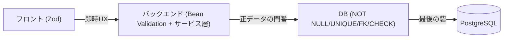
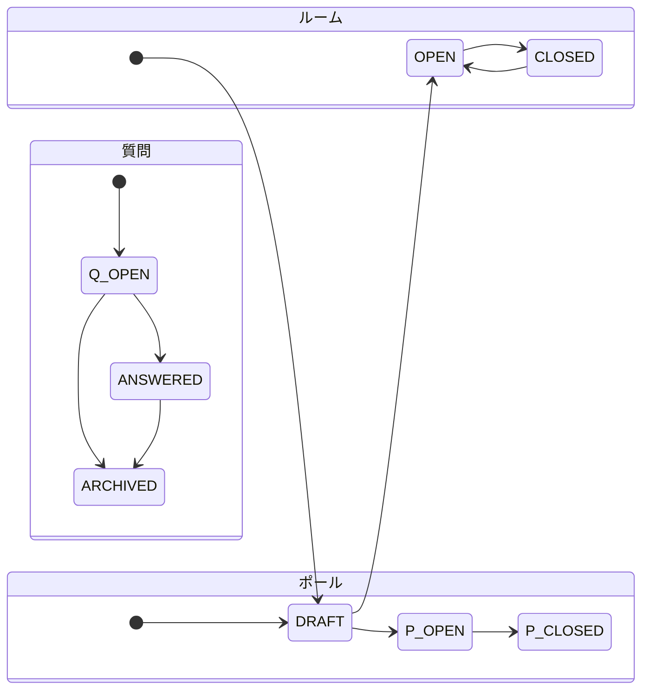

# 制約仕様（バリデーション・ビジネスルール・DB制約）

ライブQ&A + ポールアプリの制約を集約。[er-diagram.md](er-diagram.md) / [../api/openapi-notes.md](../api/openapi-notes.md) / [service-spec.md](service-spec.md) と整合させる。値は現時点の確定案。

## 3層モデル（どこで担保するか）



- **フロント（Zod）**: 送信前に必須/桁数/選択数を弾く。UXのための一次防御
- **バックエンド（`@NotBlank`/`@Size`/`@Pattern` + サービス層）**: 正データの門番。桁数に加え、状態・権限・1票などのビジネス判定
- **DB（NOT NULL / UNIQUE / FK / CHECK）**: 競合や不正リクエストでも壊れない最後の砦

原則、**入力バリデーションはフロント＋バックエンドの二重**、**不変条件はDB制約**でも担保する。

## 1. 入力バリデーション（フィールド別）

| 対象 | フィールド | 必須 | 制約 | 主な担保層 |
|------|-----------|------|------|-----------|
| events | title | 必須 | trim後 1〜100文字、空白のみ不可 | Front + Back |
| events | join_code | 系生成 | `[A-Za-z0-9]{8}`、UNIQUE | Back + DB |
| events | status | 必須 | `DRAFT` / `OPEN` / `CLOSED` | Back + DB(CHECK) |
| questions | body | 必須 | trim後 1〜500文字、空白のみ不可 | Front + Back |
| questions | display_name | 任意 | 0〜50文字。**未入力は `"匿名"` を格納**（JSON も `"匿名"`。列は NULL 可だがアプリは書かない） | Front + Back |
| questions | status | 必須 | `OPEN` / `ANSWERED` / `ARCHIVED` | Back + DB(CHECK) |
| polls | question_text | 必須 | trim後 1〜200文字 | Front + Back |
| polls | type | 必須 | `SINGLE` / `MULTI` | Back + DB(CHECK) |
| poll_options | label | 必須 | 1〜100文字、**同一ポール内で重複禁止** | Front + Back |
| polls | 選択肢数 | 必須 | 2〜10個 | Front + Back |
| poll_responses | optionIds | 必須 | `SINGLE`=ちょうど1件 / `MULTI`=1〜選択肢数。全て当該ポールの選択肢であること | Front + Back |
| （参加コード入力） | joinCode | 必須 | `[A-Za-z0-9]{8}`。存在しなければ404 | Front + Back |

- 参加者のニックネーム以外は原則 `@NotBlank`。文字数は `@Size`、形式は `@Pattern` で表現
- サーバ側は前後空白を `trim` してから桁数判定する

## 2. ビジネスルール

### 状態による可否

- ルームが `OPEN` のときのみ、**質問投稿・いいね**が可能。`DRAFT`（受付前）/ `CLOSED`（締切）は閲覧のみ（違反は 409 Conflict）
- ポール回答は `polls.status = OPEN` **かつ** ルームが `OPEN` のときのみ可。`DRAFT` / `CLOSED`（ポールまたはルーム）は 409
- ポールの作成・開閉はルーム状態を問わない（イベントが無ければ 404）

### 1人1票

- 質問いいね: `votes(question_id, voter_key)` の UNIQUE で1人1票。二重は 409
- ポール `SINGLE`: 1ポール1票。同一 `poll_id` に既存があれば **409**（置換しない。いいねと同じ）
- ポール `MULTI`: `UNIQUE(poll_option_id, voter_key)` で同一選択肢の重複のみ防止。同じポールへの追加選択は可（まだ選んでいない option のみ）
- `voter_key`: ログインユーザー `u:{userId}` / ゲスト `g:{guestId}`。参加者は匿名セッション必須（未確立なら投票不可 → 401相当）
- 自分の質問へのいいねは許可（想定内）

### 権限（所有者チェック）

- 次は **HOST かつ対象イベントの所有者のみ**:
  - イベント詳細 / 名称更新 / 削除 / 開閉（`GET|PATCH|DELETE /api/events/{id}` …）
  - ポール作成 / 開閉（`POST /api/events/{id}/polls`、`PATCH /api/polls/{pollId}/status`）
  - 質問ステータス変更（`PATCH /api/questions/{qid}/status`）
- 所有者判定は **SQL 条件（例: `id` + `host_id`）** で行い、0件なら **404**（存在しない／他人所有を区別しない。存在漏洩を避ける）。削除済みは行が無いので同じ 404
- 質問投稿・いいね・ポール回答は参加者（匿名セッション）でも可
- 名称更新同士が同じ `events` 行を同時に書くときは楽観ロック（`events.version`）。衝突は **409**。削除は物理 DELETE。消えたあとの PATCH は 404。質問投稿の `question_count + 1` は版を進めない

### 状態遷移



- ルーム: `DRAFT → OPEN ⇔ CLOSED`（`OPEN`/`CLOSED` は往復可、`DRAFT` へは戻さない）。削除は物理 DELETE（`DELETE /api/events/{id}`。状態ではない。`PATCH /status` では扱わない）
- 質問: `OPEN → ANSWERED → ARCHIVED`（`OPEN → ARCHIVED` 可）。`ARCHIVED` からは戻さない
- ポール: `DRAFT → OPEN → CLOSED`。`CLOSED` は終端、`DRAFT` へは戻さない（`PATCH /status` に `DRAFT` は 400。開閉は `OPEN` / `CLOSED` のみ）
- 上記以外の遷移リクエストは 409（不正な状態遷移）

## 3. DB制約（CHECK等）

既存の NOT NULL / UNIQUE / FK（[er-diagram.md](er-diagram.md)）に加え、列挙値と数値下限をCHECKで固める。

```sql
ALTER TABLE users        ADD CONSTRAINT ck_users_role   CHECK (role IN ('HOST','PARTICIPANT'));
ALTER TABLE events       ADD CONSTRAINT ck_events_status CHECK (status IN ('DRAFT','OPEN','CLOSED'));
ALTER TABLE events       ADD CONSTRAINT ck_events_question_count CHECK (question_count >= 0);
ALTER TABLE questions    ADD CONSTRAINT ck_questions_status CHECK (status IN ('OPEN','ANSWERED','ARCHIVED'));
ALTER TABLE questions    ADD CONSTRAINT ck_questions_upvote CHECK (upvote_count >= 0);
ALTER TABLE polls        ADD CONSTRAINT ck_polls_type   CHECK (type IN ('SINGLE','MULTI'));
ALTER TABLE polls        ADD CONSTRAINT ck_polls_status CHECK (status IN ('DRAFT','OPEN','CLOSED'));
ALTER TABLE poll_options ADD CONSTRAINT ck_poll_options_order CHECK (display_order >= 0);
```

- 文字長はカラム長（`varchar(n)`）＋アプリ層で担保
- Flyway 現行は `ck_events_question_count`。他の CHECK は上の SQL どおり足す
- 「選択肢2〜10個」「同一ポール内のラベル重複禁止」「SINGLEは1票」などの複合ルールはDBでは表現しづらいため **サービス層で担保**
- 一意制約: `votes(question_id, voter_key)` / `poll_responses(poll_option_id, voter_key)`

## 4. HTTPステータス対応

| コード | 発生条件 |
|--------|---------|
| 400 Bad Request | 入力バリデーション違反（必須・桁数・形式・選択数） |
| 401 Unauthorized | 未ログイン（HOST操作） / 匿名セッション未確立での投票 |
| 403 Forbidden | ROLE 不足・CSRF 失敗など（認可フィルタ） |
| 404 Not Found | 無効な `joinCode`、存在しないリソース、他人所有のイベント等 |
| 409 Conflict | ルーム/ポールが受付状態でない、二重投票・二重回答、不正な状態遷移、楽観ロック衝突 |

- エラーボディは共通形式 `{ status, error, message }` の3項目を基本とする。400では任意で `fields`（フィールド別メッセージ）を付与（[../api/openapi-notes.md](../api/openapi-notes.md)）

## スコープ外（今回）

- レート制限・連投抑制・スパム/不正投稿対策（将来検討）
- 実装（Entityのアノテーション、Zodスキーマ、Flyway CHECKマイグレーション、サービス層の判定コード）

## 関連ドキュメント

- ER図: [er-diagram.md](er-diagram.md)
- API仕様: [../api/openapi-notes.md](../api/openapi-notes.md)
- サービス仕様: [service-spec.md](service-spec.md)
