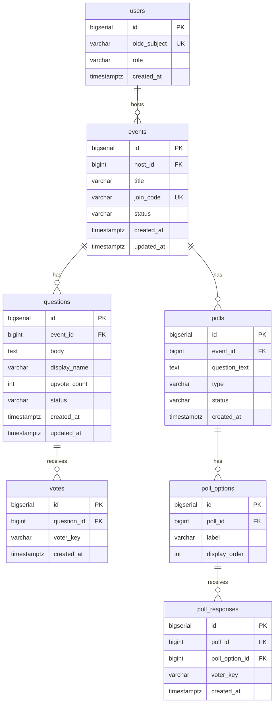

# ER図・データモデル

ライブQ&A + 投票アプリのデータモデル。画面遷移（[screen-transition.md](screen-transition.md)）・サービス仕様（[service-spec.md](service-spec.md)）・API仕様（[../api/openapi-notes.md](../api/openapi-notes.md)）と整合。PostgreSQL 15+ / Flyway 前提。

## ER図

Q&A（参加者主導）とポール（主催者主導のアンケート）が同一 `events`（ルーム）内で共存する。



## テーブル定義

### users（会員 = 主催者）

| カラム | 型 | 制約 | 説明 |
|--------|----|------|------|
| id | bigserial | PK | 主キー |
| oidc_subject | varchar(255) | UNIQUE, NOT NULL | Keycloakの `sub`（OIDC subject）。ログイン識別子 |
| role | varchar(20) | NOT NULL | `HOST`（将来 `PARTICIPANT` 拡張用に保持） |
| created_at | timestamptz | NOT NULL DEFAULT now() | 作成日時 |

- 認証・プロフィールは Keycloak(OIDC/SSO) が単一の真実。**メール・表示名はKeycloakに統合**し、ローカルには保持しない（必要時はIDトークン/userinfoのクレームから取得）
- パスワードもKeycloak側で管理するため `password_hash` は持たない
- 初回ログイン時に `oidc_subject`（Keycloakの `sub`）をキーにユーザーをJITプロビジョニング（自動作成）する
- ユーザー属性はほぼ更新されないため `updated_at` は持たない（監査が必要になれば追加）
- 参加者はログインしないため users には登録されない（匿名セッションで識別）

### events（ルーム）

| カラム | 型 | 制約 | 説明 |
|--------|----|------|------|
| id | bigserial | PK | 主キー |
| host_id | bigint | FK→users(id), NOT NULL | 主催者 |
| title | varchar(200) | NOT NULL | イベント名 |
| join_code | varchar(12) | UNIQUE, NOT NULL | 参加コード（推測困難なランダム文字列） |
| status | varchar(20) | NOT NULL DEFAULT 'DRAFT' | `DRAFT`（開始前・受付前） / `OPEN`（受付中） / `CLOSED`（締切） |
| created_at | timestamptz | NOT NULL DEFAULT now() | 作成日時 |
| updated_at | timestamptz | NOT NULL DEFAULT now() | 更新日時 |

- 作成直後は `DRAFT`（部屋はあるが質問受付前）。主催者が開始で `OPEN`、締切で `CLOSED`
- `updated_at` は `status`（`DRAFT`→`OPEN`⇔`CLOSED`）やタイトル編集で変化するため保持する

### questions（質問）

| カラム | 型 | 制約 | 説明 |
|--------|----|------|------|
| id | bigserial | PK | 主キー |
| event_id | bigint | FK→events(id), NOT NULL | 所属イベント |
| body | text | NOT NULL | 質問本文 |
| display_name | varchar(100) | NULL | 任意ニックネーム（未入力時はUI上「匿名」） |
| upvote_count | int | NOT NULL DEFAULT 0 | いいね数（votesの集計値のキャッシュ） |
| status | varchar(20) | NOT NULL DEFAULT 'OPEN' | `OPEN` / `ANSWERED` / `ARCHIVED` |
| created_at | timestamptz | NOT NULL DEFAULT now() | 作成日時 |
| updated_at | timestamptz | NOT NULL DEFAULT now() | 更新日時 |

- `upvote_count` は `votes` の件数の非正規化キャッシュ。整合は原子的インクリメント（`UPDATE ... SET upvote_count = upvote_count + 1`）で担保するため、楽観ロック用の `version` は持たない

### votes（いいね）

| カラム | 型 | 制約 | 説明 |
|--------|----|------|------|
| id | bigserial | PK | 主キー |
| question_id | bigint | FK→questions(id), NOT NULL | 対象質問 |
| voter_key | varchar(64) | NOT NULL | 投票者識別。`u:{userId}` / `g:{guestId}` |
| created_at | timestamptz | NOT NULL DEFAULT now() | 作成日時 |

### polls（ポール = 主催者が作る設問。MVP-B）

主催者が設問と選択肢を作り、参加者が選択肢から回答する「アンケート型」ポール（正解なし）。Q&Aと同一ルームで共存する。

| カラム | 型 | 制約 | 説明 |
|--------|----|------|------|
| id | bigserial | PK | 主キー |
| event_id | bigint | FK→events(id), NOT NULL | 所属イベント |
| question_text | text | NOT NULL | 設問文 |
| type | varchar(20) | NOT NULL DEFAULT 'SINGLE' | `SINGLE`（単一選択） / `MULTI`（複数選択） |
| status | varchar(20) | NOT NULL DEFAULT 'DRAFT' | `DRAFT` / `OPEN` / `CLOSED` |
| created_at | timestamptz | NOT NULL DEFAULT now() | 作成日時 |

- アンケート型のため正解フラグ（`is_correct`）や採点は持たない（将来クイズ化する際に追加）

### poll_options（選択肢）

| カラム | 型 | 制約 | 説明 |
|--------|----|------|------|
| id | bigserial | PK | 主キー |
| poll_id | bigint | FK→polls(id), NOT NULL | 所属ポール |
| label | varchar(200) | NOT NULL | 選択肢ラベル |
| display_order | int | NOT NULL DEFAULT 0 | 表示順 |

### poll_responses（回答）

| カラム | 型 | 制約 | 説明 |
|--------|----|------|------|
| id | bigserial | PK | 主キー |
| poll_id | bigint | FK→polls(id), NOT NULL | 所属ポール（集計・一意判定の単位） |
| poll_option_id | bigint | FK→poll_options(id), NOT NULL | 選んだ選択肢 |
| voter_key | varchar(64) | NOT NULL | 回答者識別。`u:{userId}` / `g:{guestId}`（votesと同じ匿名セッション） |
| created_at | timestamptz | NOT NULL DEFAULT now() | 作成日時 |

## 制約・インデックス

- `events.join_code` に UNIQUE 制約（参加URL/コードの一意性）
- `events(host_id)` に INDEX（主催者のイベント一覧）
- `questions(event_id, status)` に INDEX（一覧のステータスフィルタ）
- `questions(event_id, upvote_count DESC, created_at DESC)` に INDEX（人気順の並び替え）
- `votes(question_id, voter_key)` に UNIQUE 制約（**1人1票**の担保）
- `votes(question_id)` に INDEX（集計・削除）
- `poll_options(poll_id)` に INDEX
- `poll_responses(poll_id)` / `poll_responses(poll_option_id)` に INDEX（得票集計）
- `poll_responses(poll_option_id, voter_key)` に UNIQUE 制約（同一選択肢への二重投票防止）
- FKは全て `ON DELETE CASCADE`（イベント削除 → 質問/いいね・ポール/選択肢/回答 を連鎖削除）

## 整合性方針

- **いいねの二重投票防止**: `votes` の UNIQUE `(question_id, voter_key)` で担保。INSERT時に制約違反なら409を返す
- **upvote_count の整合**: いいね追加/取消時に `questions.upvote_count` を原子的インクリメント（`UPDATE ... SET upvote_count = upvote_count + 1`）で更新。read-modify-writeにしないため楽観ロック（`version`）は不要
- **ポールの1票判定**: `SINGLE`（単一選択）は「1ポール1票」をアプリ層で担保（同一 `poll_id` に既存回答があれば置換 or 409）。`MULTI`（複数選択）は `UNIQUE(poll_option_id, voter_key)` で同一選択肢の重複のみ防止
- **得票分布**: `poll_responses` を `poll_option_id` で `GROUP BY COUNT`。件数が多くなれば `poll_options.response_count` の非正規化を追加（`upvote_count` と同じ発想）
- **ステータス遷移**: 質問は `OPEN → ANSWERED → ARCHIVED`（`OPEN → ARCHIVED` も可）。ルームは `DRAFT → OPEN ⇔ CLOSED`（`DRAFT` へは戻さない）。ポールは `DRAFT → OPEN → CLOSED`

## データ保持方針

- **MVP-A/B: 削除しない**（この規模では `votes`/`poll_responses` の行数は小さくDB負担は無視できる）。イベント削除時は `ON DELETE CASCADE` で関連データが連鎖削除される
- **将来（負担が問題化したら）**: イベント終了（終端状態）時に選択肢ごとの最終集計を確定保存し、明細（`poll_responses`）のみを定期バッチ（Spring Batch）で削除。即時同期削除にはせず、`OPEN⇔CLOSED` の往復とも衝突させない

## Flyway初期DDL案

`backend/src/main/resources/db/migration/V1__init.sql` 相当。

```sql
CREATE TABLE users (
    id           BIGSERIAL PRIMARY KEY,
    oidc_subject VARCHAR(255) NOT NULL UNIQUE,
    role         VARCHAR(20)  NOT NULL DEFAULT 'HOST',
    created_at   TIMESTAMPTZ  NOT NULL DEFAULT now()
);

CREATE TABLE events (
    id         BIGSERIAL PRIMARY KEY,
    host_id    BIGINT       NOT NULL REFERENCES users(id) ON DELETE CASCADE,
    title      VARCHAR(200) NOT NULL,
    join_code  VARCHAR(12)  NOT NULL UNIQUE,
    status     VARCHAR(20)  NOT NULL DEFAULT 'DRAFT',
    created_at TIMESTAMPTZ  NOT NULL DEFAULT now(),
    updated_at TIMESTAMPTZ  NOT NULL DEFAULT now()
);
CREATE INDEX idx_events_host_id ON events(host_id);

CREATE TABLE questions (
    id           BIGSERIAL PRIMARY KEY,
    event_id     BIGINT      NOT NULL REFERENCES events(id) ON DELETE CASCADE,
    body         TEXT        NOT NULL,
    display_name VARCHAR(100),
    upvote_count INT         NOT NULL DEFAULT 0,
    status       VARCHAR(20) NOT NULL DEFAULT 'OPEN',
    created_at   TIMESTAMPTZ NOT NULL DEFAULT now(),
    updated_at   TIMESTAMPTZ NOT NULL DEFAULT now()
);
CREATE INDEX idx_questions_event_status ON questions(event_id, status);
CREATE INDEX idx_questions_event_popular ON questions(event_id, upvote_count DESC, created_at DESC);

CREATE TABLE votes (
    id          BIGSERIAL PRIMARY KEY,
    question_id BIGINT      NOT NULL REFERENCES questions(id) ON DELETE CASCADE,
    voter_key   VARCHAR(64) NOT NULL,
    created_at  TIMESTAMPTZ NOT NULL DEFAULT now(),
    CONSTRAINT uq_votes_question_voter UNIQUE (question_id, voter_key)
);
CREATE INDEX idx_votes_question_id ON votes(question_id);
```

ポール（MVP-B）は別マイグレーション（例 `V2__polls.sql`）で追加する想定。

```sql
CREATE TABLE polls (
    id            BIGSERIAL PRIMARY KEY,
    event_id      BIGINT      NOT NULL REFERENCES events(id) ON DELETE CASCADE,
    question_text TEXT        NOT NULL,
    type          VARCHAR(20) NOT NULL DEFAULT 'SINGLE',
    status        VARCHAR(20) NOT NULL DEFAULT 'DRAFT',
    created_at    TIMESTAMPTZ NOT NULL DEFAULT now()
);
CREATE INDEX idx_polls_event_id ON polls(event_id);

CREATE TABLE poll_options (
    id            BIGSERIAL PRIMARY KEY,
    poll_id       BIGINT       NOT NULL REFERENCES polls(id) ON DELETE CASCADE,
    label         VARCHAR(200) NOT NULL,
    display_order INT          NOT NULL DEFAULT 0
);
CREATE INDEX idx_poll_options_poll_id ON poll_options(poll_id);

CREATE TABLE poll_responses (
    id             BIGSERIAL PRIMARY KEY,
    poll_id        BIGINT      NOT NULL REFERENCES polls(id) ON DELETE CASCADE,
    poll_option_id BIGINT      NOT NULL REFERENCES poll_options(id) ON DELETE CASCADE,
    voter_key      VARCHAR(64) NOT NULL,
    created_at     TIMESTAMPTZ NOT NULL DEFAULT now(),
    CONSTRAINT uq_poll_responses_option_voter UNIQUE (poll_option_id, voter_key)
);
CREATE INDEX idx_poll_responses_poll_id ON poll_responses(poll_id);
CREATE INDEX idx_poll_responses_option_id ON poll_responses(poll_option_id);
```

## 関連ドキュメント

- サービス仕様: [service-spec.md](service-spec.md)
- API仕様メモ: [../api/openapi-notes.md](../api/openapi-notes.md)
- アーキテクチャ: [../architecture.md](../architecture.md)
