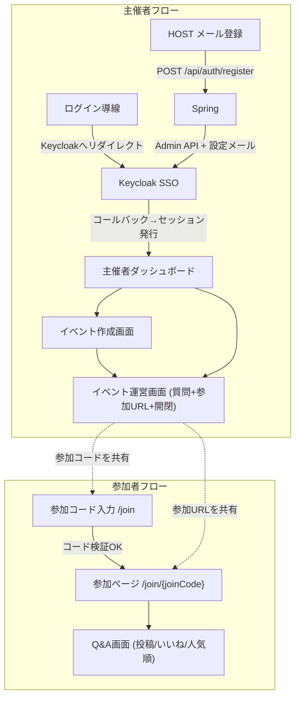
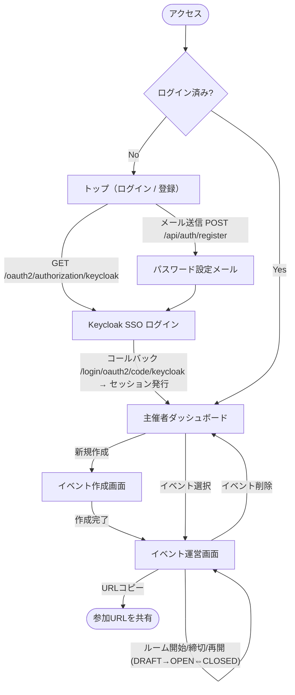
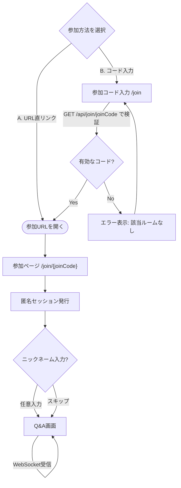

# 画面遷移図

ライブQ&Aアプリの画面一覧と遷移。主催者フローと参加者フローに分かれる。詳細な仕様は [service-spec.md](service-spec.md) を参照。

## 全体像

## 主催者フロー

- ログイン導線: 未ログイン時のみ表示。「主催者としてログイン」でKeycloak(SSO)へリダイレクト。**パスワード入力フォームは持たない**（メールだけの HOST 登録は `POST /api/auth/register`）
- コールバック後にCookieセッションが発行され、以降はセッションで認証
- 主催者ダッシュボード: 自分のイベント一覧（`GET /api/events`）。名称変更（`PATCH /api/events/{id}`）と削除（`DELETE /api/events/{id}`）もここまたは運営画面から行う
- イベント作成画面: タイトル入力 → `POST /api/events` → joinCode発行（`DRAFT`）→ 運営画面へ
- イベント運営画面: 質問リスト（ライブ）+ ステータス操作 + 参加URL表示 + ルーム開始/締切/再開 + 名称変更・削除。作成直後は `DRAFT` なので「開始」で `OPEN` にして受付を始める。削除は確認ダイアログ必須。成功後はダッシュボードへ戻る
- **MVP-B**: 同じ運営画面にポール作成 / 開始 / 締切。参加者 Q&A に OPEN ポールの回答と棒グラフ。購読は `/topic/events/{eventId}/polls`

## 参加者フロー（ログインなし）

- 参加方法は2通りから選択可能: **A. 参加URL直リンク** / **B. 参加コード入力**（`/join` のフォームに手入力）
- 参加コード入力: `GET /api/join/{joinCode}` でコードの有効性を検証し、有効なら `/join/{joinCode}` へ遷移。無効ならエラー表示
- 参加ページ: `GET /api/join/{joinCode}` でイベント情報を取得（SSR）。任意ニックネーム入力
- Q&A画面: 質問投稿・いいね・人気順ライブ表示。STOMPで `/topic/events/{eventId}/questions` を購読
- ルームが `DRAFT`（受付前）/ `CLOSED`（締切）の場合は閲覧のみ（投稿・いいね不可）
- **MVP-B**: OPEN なポールがあれば回答 UI と得票分布。`/topic/events/{eventId}/polls` も購読
