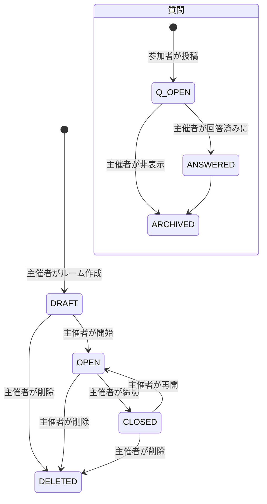

# サービス仕様（ライブQ&A + 投票）

リアルタイム ライブQ&A + 投票（sli.do風）の具体的なサービス内容。想定フローは「主催者がログイン → ルーム作成でURL発行 → 参加者へ共有 → 参加者はログインなしで利用」。技術スタックは [../../README.md](../../README.md) を逸脱しない。

## 登場人物

- **主催者（HOST）**: Keycloak(SSO/OIDC)でログインして、イベント（ルーム）を作成・運営する。質問のステータス変更やルームの開始・締切ができる。ログイン後はCookieセッションで管理される
- **参加者（PARTICIPANT）**: ログイン不要。共有された参加URLからルームに入り、質問投稿・いいねができる。任意でニックネームを入力できる

## 想定フロー（全体）

1. 主催者が Keycloak(SSO/OIDC) でログイン → 成功後にCookieセッション（`SESSION` + Redis）が作成される
2. ルーム（イベント）を作成 → 参加URL `/join/{joinCode}` と参加コード `joinCode` が発行される
3. 主催者がURLまたは参加コードを参加者へ共有
4. 参加者が **URL直リンク** または **参加コード入力** のいずれかで参加 → 匿名セッション（`SESSION` Cookie）が発行される。任意でニックネーム入力
5. 参加者が質問を投稿・いいね → WebSocketで全参加者にライブ反映
6. 主催者が質問を「回答済み / 非表示」に変更 → ライブ反映

## 参加方法（2通り・参加者が選択可能）

参加者は以下のどちらでもルームに参加できる。どちらも最終的に同じQ&A画面（`/join/{joinCode}`）へ到達する。

- **A. 参加URL直リンク**: 主催者が共有した `/join/{joinCode}` を直接開く。ワンクリックで参加できる
- **B. 参加コード入力**: 参加トップ `/join`（コード未指定）を開き、フォームに `joinCode` を手入力して参加する。URLをコピーできない口頭共有・スライド掲示などのケースに有効

- コード入力時は `GET /api/join/{joinCode}` で有効性を検証し、存在すれば `/join/{joinCode}` へ遷移。無効なコードはエラー表示（該当ルームなし）

## 参加者識別方式（ログインなし）

- 参加者にはログインを求めず、参加時に **Spring Session + Redis による匿名セッション**（`SESSION` Cookie）を発行する
- セッションには `guestId`（UUID）と任意の `nickname` を保持する
- 「1人1票」は `votes` テーブルの一意制約 `(question_id, voter_key)` で担保する
  - `voter_key` = ログインユーザーは `u:{userId}`、ゲストは `g:{guestId}`
- ニックネームは任意。**未入力は `questions.display_name` に `"匿名"` を保存**し、API も `"匿名"` を返す

## ルームライフサイクル / 質問ステータス

- ルーム状態: `DRAFT`（開始前・受付前、閲覧のみ） / `OPEN`（質問受付中） / `CLOSED`（締切・閲覧のみ、投稿といいねは不可） / `DELETED`（論理削除。一覧・参加から消える。復元しない）
- 質問状態: `OPEN`（受付中） / `ANSWERED`（回答済み） / `ARCHIVED`（非表示）

## 画面一覧

### 主催者

- ログイン導線（「主催者としてログイン」→ Keycloakへリダイレクト。専用ログインフォームは持たない）
- 主催者ダッシュボード（自分のイベント一覧。名称変更・削除可）
- イベント作成画面
- イベント運営画面（質問リスト + ステータス操作 + 参加URL表示 + ルーム開閉 + 名称変更・削除）

### 参加者

- 参加コード入力ページ（`/join`、参加コードを手入力して参加）
- 参加ページ（`/join/{joinCode}`、任意ニックネーム入力）
- Q&A画面（質問投稿・いいね・人気順ライブ表示）

## 主要エンドポイント

### REST API（担当B）

| 種別 | メソッド / パス | 説明 | 認可 |
|------|----------------|------|------|
| 認証 | `GET /oauth2/authorization/keycloak` | KeycloakへOIDCログイン開始（リダイレクト） | 公開 |
| 認証 | `GET /login/oauth2/code/keycloak` | OIDCコールバック（トークン交換→JIT作成→セッション発行） | 公開 |
| 認証 | `GET /api/me` | ログインユーザー情報 | HOST |
| 認証 | `POST /api/auth/logout` | ログアウト（既定はKeycloak連動） | HOST |
| イベント | `POST /api/events` | イベント作成（joinCode発行） | HOST |
| イベント | `GET /api/events` | 自分のイベント一覧 | HOST |
| イベント | `GET /api/events/{id}` | イベント詳細（運営用） | HOST |
| イベント | `PATCH /api/events/{id}` | イベント名の更新（joinCode は不変） | HOST |
| イベント | `DELETE /api/events/{id}` | イベント論理削除（`status=DELETED`。配下は残す） | HOST |
| イベント | `GET /api/join/{joinCode}` | 参加用イベント情報取得（参加コードの有効性検証にも使用） | 公開 |
| イベント | `PATCH /api/events/{id}/status` | ルーム開始/締切/再開（DRAFT→OPEN⇔CLOSED） | HOST |
| 質問 | `GET /api/events/{id}/questions` | 質問一覧（`sort`＝F-06、`status`＝F-12） | 公開 |
| 質問 | `POST /api/events/{id}/questions` | 質問投稿 | 参加者/HOST |
| 質問 | `PATCH /api/questions/{qid}/status` | ステータス変更（F-08。F-13 のアーカイブもここ） | HOST |
| いいね | `POST /api/questions/{qid}/vote` | いいね（1人1票） | 参加者/HOST |
| いいね | `DELETE /api/questions/{qid}/vote` | いいね取り消し | 参加者/HOST |
| ポール | `POST /api/events/{id}/polls` | 設問＋選択肢を作成（F-10） | HOST |
| ポール | `GET /api/events/{id}/polls` | ポール一覧（参加者は OPEN のみ）（F-10） | 公開/HOST |
| ポール | `PATCH /api/polls/{pollId}/status` | 開始/締切（DRAFT→OPEN→CLOSED。終端）（F-10） | HOST |
| ポール | `POST /api/polls/{pollId}/responses` | 選択肢へ回答（F-11） | 参加者/HOST |
| ポール | `GET /api/polls/{pollId}/results` | 得票集計（F-11） | 公開 |

- 質問一覧: F-06 は `sort`。F-12 で `status` を `BooleanBuilder` に足す（未指定は `ARCHIVED` 以外）

### WebSocket / STOMP（担当C）

- SUBSCRIBE: `/topic/events/{eventId}/questions`
- 配信イベント種別:
  - `QUESTION_CREATED` — 新しい質問が追加された
  - `QUESTION_UPVOTED` — いいね数が更新された（人気順の再ソートに使用）
  - `QUESTION_ANSWERED` — 主催者がステータスを変更した
- ポール（MVP-B）: SUBSCRIBE `/topic/events/{eventId}/polls`、配信種別 `POLL_OPENED` / `POLL_UPDATED`（得票分布） / `POLL_CLOSED`

## ポール機能（アンケート型・MVP-B・Q&Aと共存）

Q&A（参加者が質問→いいね）に加え、主催者が設問を作り参加者が選択肢から回答する「アンケート型ポール」を同一ルーム内で提供する（sli.do型の共存）。

- **主役の違い**: 質問は参加者主導、ポールは主催者主導。ポールは正解なしで得票分布をライブ表示する（Mentimeter風）
- **フロー**: 主催者が設問＋選択肢を作成（`DRAFT`）→ 開始（`OPEN`）で参加者画面に回答UIがライブ表示 → 参加者が選択して投票 → 得票分布がライブ更新 → 主催者が締切（`CLOSED`）
- **1票の担保**: 単一選択（`SINGLE`）は1ポール1票（既存があれば 409。置換しない）。複数選択（`MULTI`）は選択肢ごと重複不可。回答者は参加者と同じ匿名セッション（`voter_key`）
- **画面**: 主催者=運営画面にポール作成/開始/締切/結果分布。参加者=Q&A画面に OPEN なポールの回答UIと結果分布。詳細は [screen-transition.md](screen-transition.md)
- **データ保持**: 票・ポール明細の個別 DELETE は持たない。イベント削除は `DELETED`（論理。行は残す）。将来は終了時に集計確定＋明細のみバッチ削除

## ドメイン補足

- 既存ER（[../architecture.md](../architecture.md)）に対し、`questions` に **`display_name`（任意ニックネーム）** を追加する
- `votes.voter_key` は `u:{userId}` / `g:{guestId}` の命名規則で識別する
- ポールは `polls` / `poll_options` / `poll_responses` を追加（詳細は [er-diagram.md](er-diagram.md)）

## 関連ドキュメント

- 画面遷移図: [screen-transition.md](screen-transition.md)
- シーケンス図: [websocket-sequence.md](websocket-sequence.md)
