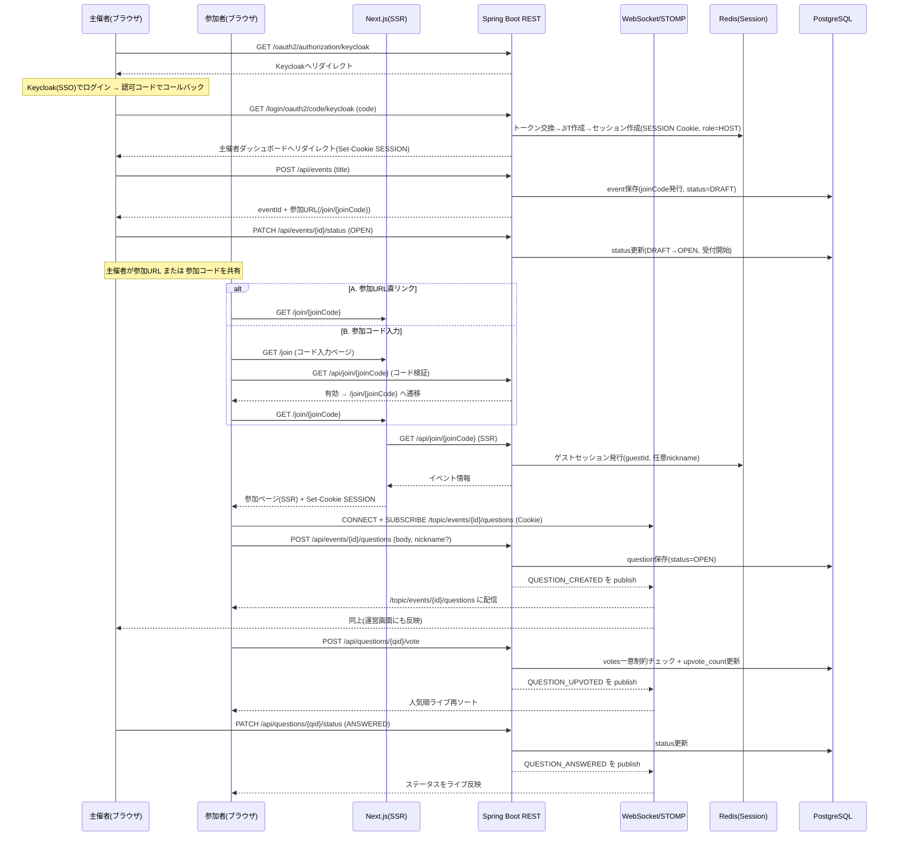
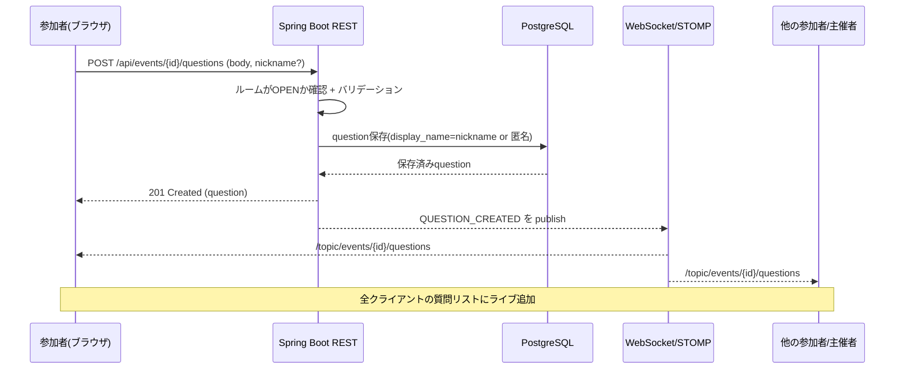
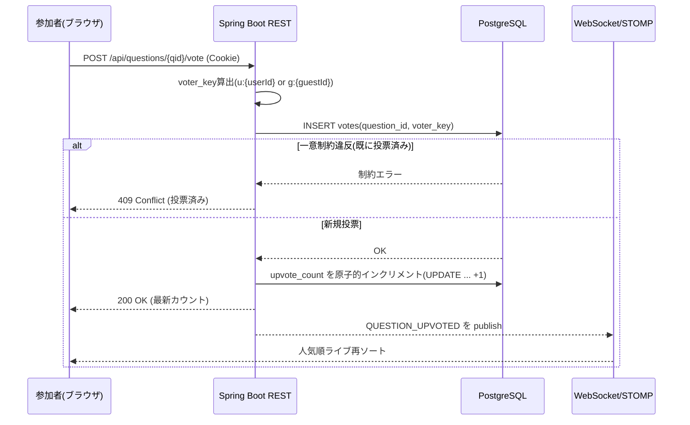
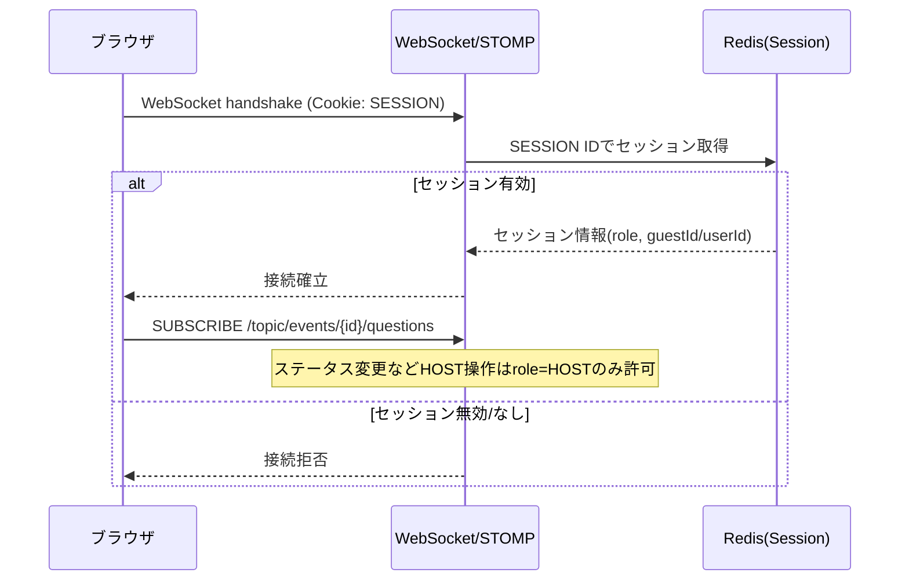
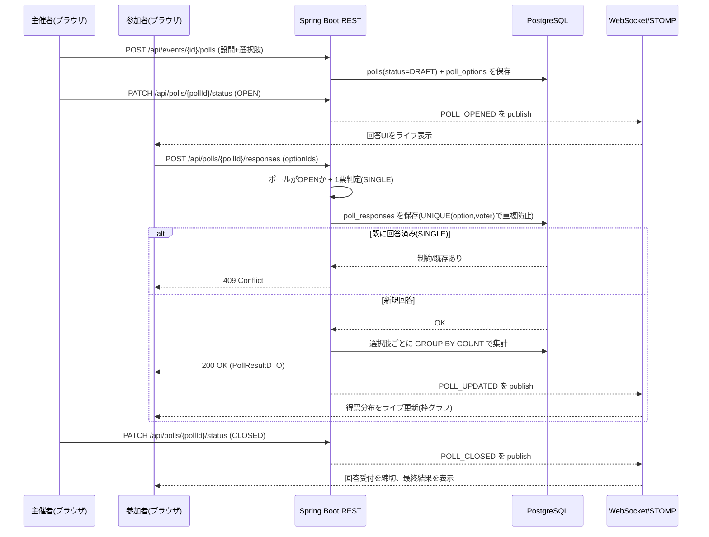

# シーケンス図（WebSocket / REST）

ライブQ&Aの主要フローをシーケンス図で示す。サービス仕様は [service-spec.md](service-spec.md)、画面遷移は [screen-transition.md](screen-transition.md) を参照。

## 1. E2E全体フロー

主催者ログイン → ルーム作成（`DRAFT`）→ 開始（`OPEN`）→ 参加者参加 → 質問 → いいね → ステータス変更まで。

## 2. 質問投稿シーケンス

REST保存 → STOMP publish → 全参加者へ配信。投稿者自身も配信経由でUIを更新する（楽観的更新も可）。

## 3. いいねシーケンス（二重投票防止）

`votes` の一意制約 `(question_id, voter_key)` で1人1票を担保し、カウント更新後に人気順をライブ再ソート。

## 4. WebSocketハンドシェイクのCookie認証

WebSocket接続時に、RESTと同じ `SESSION` Cookieでセッションを検証する。

## 5. ポールのライブ集計（MVP-B・アンケート型）

主催者が設問を開始し、参加者が選択肢へ回答 → 得票分布をライブ配信する。購読先は `/topic/events/{eventId}/polls`。

