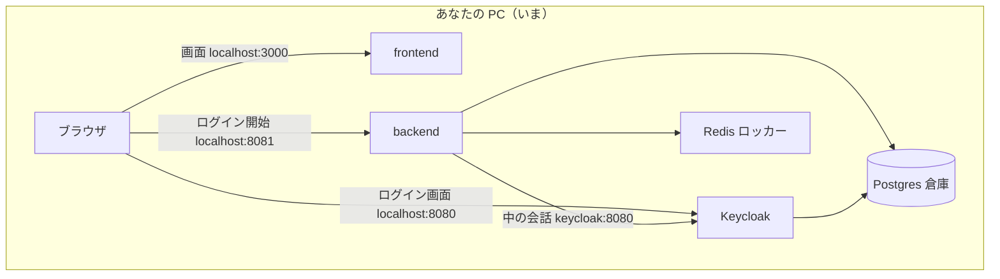
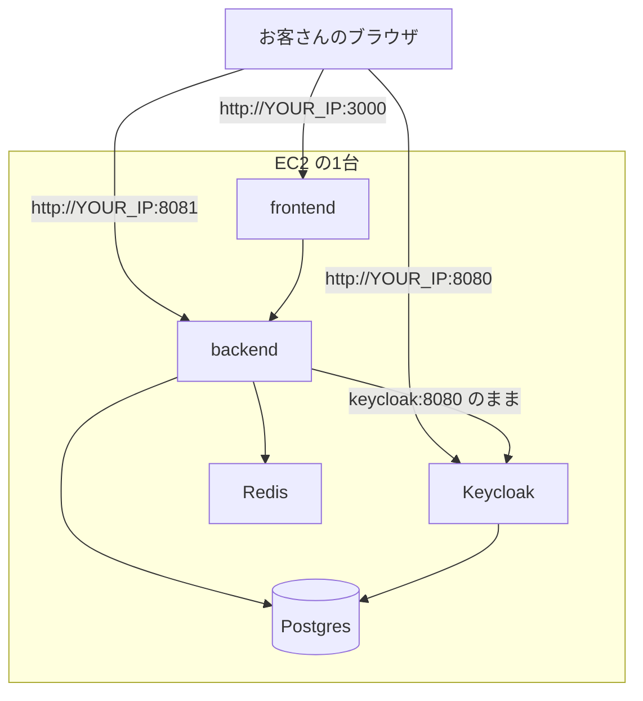
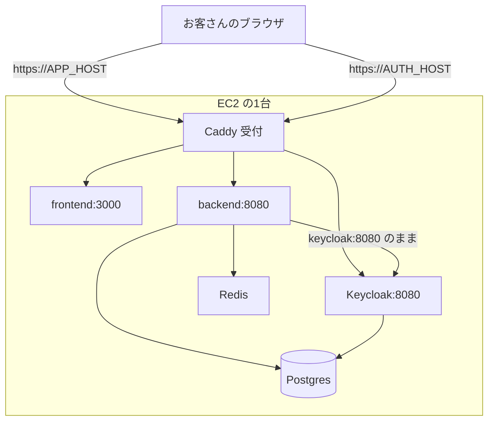
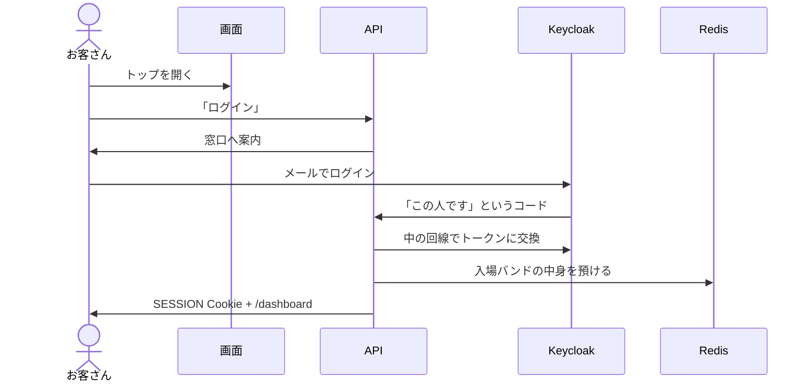

# Compose をクラウド1台へ載せる（かみ砕き）

> **正は [GitHub #44](https://github.com/muscat2356/live-qa-app/issues/44)。クラウドは AWS（EC2 + Compose）。**  
> このファイルは以前 OCI 向けに書いた読み替えメモ。食い違ったら **#44 を採る。**  
> 読み替え: VM = EC2 ／ 門 = Security Group ／ 内鍵 = その OS の firewall。Ampere・OCI コンソールの固有手順は使わない。

設定の短い対応は [ops.md](ops.md)。

## AWS 読み替え（このファイルの OCI 名）

| このファイルに書いてある | AWS での正 |
|--------------------------|------------|
| OCI コンソール / Ampere A1 | EC2（#44 は `t3.medium` 目安） |
| Security List / VCN | **Security Group**（門）。VPC は机の区画 |
| Oracle Linux + firewalld | Amazon Linux なら firewalld が無いことがある。門は SG が本体 |
| sslip.io | ドメインが無ければ使ってよい（OCI 専用ではない） |

下の「0-A インスタンスを作る」は OCI 画面のまま残っている。**手は #44 と AWS コンソールに合わせる。** Compose・Caddy・ブラウザ URL と箱の中の話はこのファイルのまま使える。

## 3分で地図（先にここ）

**やること:** 今の Compose を AWS の EC2 1台に置く。中の呼び名（`backend` / `keycloak` / `redis`）は変えない。変えるのは **ブラウザが見る住所** だけ。

覚えなくていい: Kubernetes、マネージド DB、フロントと API でホストを分けること。

| 番号 | 何をする | たとえ | 主 |
|------|----------|--------|-----|
| **0** | 机を借りる（VM・門・内鍵・Docker） | 弁当箱を置く場所 | C |
| **1** | お客さんの住所を公開側にする | 名刺と名簿を同じ店名にする | C、B は Spring の URL |
| **2** | DB と Redis をインターネットに出さない | 倉庫の裏口を通りに出さない | C |
| **3** | HTTPS の受付1つにする | 部屋番号直打ちをやめて受付 | C、B は Cookie Secure |

**本線:** `https://APP_HOST`（画面）と `https://AUTH_HOST`（Keycloak）。`http://YOUR_IP:3000` は逃げだけ。完成扱いにしない。

**9:00 に Issue へ3行:**

```text
YOUR_IP   =
APP_HOST  = qa.x.x.x.x.sslip.io   （ドメインがあればそれを）
AUTH_HOST = auth.x.x.x.x.sslip.io
```

**触ってよい URL / 触ってはいけない URL**

| 誰が見る | 変える |
|----------|--------|
| ブラウザ（ログインボタン、Keycloak 画面、戻り先、CORS） | 公開ホストへ |
| 箱の中（token / JWK / Redis / Postgres） | **変えない**（`keycloak` / `redis` / `postgres`） |

**B の先回り（VM 待ちのあいだ）:** `authorization-uri` の env 化（1-C）、Cookie Secure の env 化（3-G）。いま両方とも localhost / `false` 固定。

**失敗の見方（短い）**

| 見た目 | 先に見る |
|--------|----------|
| 接続タイムアウト | 門（Security Group）と内鍵（OS の firewall。Amazon Linux は SG だけで足りることが多い） |
| ログインが自分の PC の localhost | お客さんの住所が残っている（1 / 3-E） |
| `invalid redirect` | Keycloak Admin の許可リスト（1-D / 3-I） |
| SESSION が乗らない | HTTP のまま Cookie Secure=true にした |
| 証明書が取れない | DNS / sslip.io の書き方、門の 80 |

下の「デプロイ手順」はコピペ用の詳細。地図と食い違ったら **地図の本線（https）を採る**。

## デプロイ手順（詳細・コピペ）

**読み順:** 上の地図 → 時間割 → たとえ → 図 → ステップ 0 → 1 → 2 → 3 → やらなくていい → 役割。  
方針は **1日で 0〜3 全部**。番号は依存の順（箱 → 住所 → 裏口を閉じる → 受付）。日付を分けない。

| ステップ | 一言 | 1日コースでの扱い |
|----------|------|-------------------|
| **0** | 箱を置く VM を借りる | 朝一。ここが遅れると全部ずれる |
| **1** | お客さん向けの住所（コードと Keycloak 名簿） | **最初から https のホスト名で書く。** IP:3000 の本番運用はしない |
| **2** | 倉庫とロッカーを外に出さない | 初回 `compose.yml` から `ports` を外した状態で上げる |
| **3** | Caddy + 本番フロント + Cookie Secure | 初回 `up` に含める。証明書待ちが昼のメイン |

### 1日の時間割（目安）

並行できるところは同時にやる。C が VM を待っている間に B/A はファイルを用意する。

| 時刻 | 誰 | 手 |
|------|----|----|
| 8:00–9:00 | **C** | 0-A〜0-E（インスタンス・門・内鍵・clone・`.env`） |
| 8:00–9:00 | **B** | 1-C の env 化、3-G の Cookie Secure。PR しなくても VM に直接載せてよい |
| 8:00–9:00 | **A** | 3-H の Dockerfile 草案。ログイン URL はホスト名が決まり次第 ARG に書く |
| 9:00 | **全員** | Issue に `YOUR_IP`。**この瞬間に `APP_HOST` / `AUTH_HOST` を決める** |
| 9:00–11:00 | **C** 軸 | 2-A、3-B、3-C、3-D、3-E、3-F をファイルに書く。門に 80/443 を足す |
| 11:00–13:00 | **C** | `docker compose up -d --build`（初回ビルド＋Keycloak＋証明書）。ログを見る |
| 13:00–15:00 | **B/C** | 3-I Admin の https redirect。3-J で全員ログイン |
| 15:00–17:00 | **C** | 門から 3000/8081/8080 を閉じる。落ちたら下の「逃げ」 |

**ホスト名の決め方（9:00、3分）:**

1. 本物のドメインがある → `APP_HOST=qa.example.com`、`AUTH_HOST=auth.example.com`。A レコード 2 本を `YOUR_IP` へ  
2. **無い** → 買わなくてよい。`sslip.io`（IP をホスト名にする無料の名前）

```text
# 例 YOUR_IP が 203.0.113.10 のとき
APP_HOST  = qa.203.0.113.10.sslip.io
AUTH_HOST = auth.203.0.113.10.sslip.io
```

Let's Encrypt はこういう名前でも取れることが多い。DNS 浸透を待たなくてよいので、1日コース向き。

**逃げ（Caddy / 証明書が午後になってもダメなとき）:** 門の 3000/8081/8080 は午前中だけ開けておく。ダメならステップ 1-E の HTTP 煙（`http://YOUR_IP:3000` でログイン）で「箱は生きている」を示す。logs を Issue に貼る。

置き換え用の記号（9:00 に Issue へ実値を書く）:

| 記号 | 意味 | いつ決める |
|------|------|------------|
| `YOUR_IP` | EC2 の公開 IP | 0-B（朝） |
| `APP_HOST` | 画面のホスト | 9:00（ドメイン or sslip.io） |
| `AUTH_HOST` | Keycloak のホスト | 9:00（上と同じ方式） |

---

### たとえ集（○○のようなもの）

| 用語 | たとえ |
|------|--------|
| **Compose** | 弁当箱。中にフロント・API・DB・Redis・Keycloak が仕切って入っている |
| **コンテナ** | 仕切りの中の1品。中からは隣を名前で呼ぶ（`backend` / `keycloak`） |
| **ブラウザ** | 外から来るお客さん。箱の中の名前は知らない。**公開 IP とポート**（のちドメイン）だけ見る |
| **Keycloak** | 学校の学生証窓口。ログイン画面を出し、「この人は HOST」と証明する |
| **SSO / OIDC** | 学生証1枚で学食にも図書館にも入れる仕組み。手順の規格が OIDC |
| **Spring（backend）** | 学食の窓口。学生証を確認して、トレー（SESSION）を渡す |
| **Redis** | コインロッカー。SESSION Cookie は鍵。中身（誰がログイン中か）はロッカー側 |
| **SESSION Cookie** | 手首の入場バンド。次のリクエストで「中に入っていい人」と分かる |
| **Postgres** | 倉庫（質問・ポール・ユーザーの永続データ） |
| **Caddy** | マンションの受付＋自動ドア。外は鍵付き（HTTPS）、中の部屋は普通の廊下（HTTP） |
| **reverse_proxy** | 受付が「この廊下の何号室へ」と案内すること |
| **HTTPS / TLS** | 封筒に封をする。中身を覗きにくくする |
| **証明書 / Let's Encrypt** | 「この建物は本物です」という印。**ドメイン名が必要** |
| **`X-Forwarded-Proto`** | 受付が後ろの部屋へ「お客さんは封をした入口から来た」と伝える紙 |
| **Security Group** | クラウド側の門。どの番号の呼び鈴をインターネットに出すか。このファイルの「Security List」は同じ意味 |
| **firewalld / ufw** | VM 自身の内鍵。門を開けても内鍵が閉まっていると届かない |
| **ポート** | 部屋番号。3000=画面、8081=API、8080=窓口、80/443=受付、5432=倉庫 |
| **`localhost`** | 「このパソコン自身」。クラウドに載せてブラウザから見ると、お客さんの PC を指す |
| **Cookie `Secure`** | 「封をした店でしかバンドを出さない」印。HTTP のまま付けるとバンドが乗らない |
| **`NEXT_PUBLIC_*`** | ログインボタンに焼き付く住所。本番ビルドでは **作った瞬間の値**が残る |
| **rewrite** | 画面サーバが `/api` を裏の Spring へ取り次ぐ。お客さんには API の部屋番号が見えない |
| **realm / client** | Keycloak の「この学校」と「このアプリ用の許可リスト」。`live-qa` / `live-qa-app` |
| **volume** | 弁当箱を開け直しても残る保存容器。Postgres にはある。Redis は今は無い |

---

### 全体像

**いま（ローカル）:** お客さんは全部 `localhost`。



**ステップ 1 のゴール:** 箱の中は同じ。お客さんの住所だけ `YOUR_IP`。



**ステップ 3 のゴール:** お客さんは受付（443）だけ見る。中は今どおり名前で話す。



ログインの順番（ステップ 1 でも 3 でも同じ。住所のスキームだけ変わる）:



---

## ステップ 0 — 箱を置く場所を用意する

**たとえ:** 弁当箱を置く机を借りる。中身のレシピはまだ変えない。  
**誰:** C。他の人は `YOUR_IP` が Issue に載るまで待つ。

### 0 の前. アカウントと SSH 鍵

インスタンス作成の画面に入る前に、これだけ用意する。

1. **AWS アカウント**（チームのアカウントに入れてもらう）
2. **自分の PC で SSH 鍵**（EC2 のキーペアに登録。秘密鍵は git / Issue に出さない）

```bash
ssh-keygen -t ed25519 -C "live-qa-aws" -f ~/.ssh/live-qa-aws
```

公開鍵は `~/.ssh/live-qa-aws.pub`。秘密鍵は `live-qa-aws`（`.pub` が付いていない方）。

### 0-A. インスタンスを作る（AWS では EC2。下の Ampere 手順は使わない）

**AWS の手:** EC2 → インスタンスを起動。目安は #44 の `t3.medium`。パブリック IP あり。OS は Ubuntu か Amazon Linux。Ampere / Always Free / Oracle Linux の画面は使わない。

**画面（参考・OCI 当時）:** Compute → インスタンスの作成

**手:**

1. コンパートメントはチームのものを選ぶ  
2. 名前は任意（例 `live-qa`）  
3. イメージ: Oracle Linux または Ubuntu  
4. シェイプ: **Ampere** の `VM.Standard.A1.Flex`  
   - **選ばない:** `VM.Standard.E2.1.Micro`（1GB）。弁当箱が乗らない  
   - **目安:** OCPU **2**、メモリ **12GB 以上**（無料枠の上限は 4 OCPU / 24GB）  
5. ネットワーク: パブリックサブネット、**パブリック IP を割り当てる**  
6. SSH 鍵を登録して作成  

**完了の合図:** インスタンスが「実行中」。詳細にパブリック IP がある。

**失敗:** 「Always Free の容量が足りない」→ リージョンを変えるか、既存の Always Free を消す。シェイプが AMD Micro になっていないか確認。

### 0-B. 公開 IP を共有する

**手:** インスタンス詳細の「パブリック IP アドレス」をコピーし、[#44](https://github.com/muscat2356/live-qa-app/issues/44) にコメントする。

```text
YOUR_IP = x.x.x.x
SSH ユーザー = opc    （Ubuntu なら ubuntu）
```

**完了の合図:** Issue に数字が見える。A/B は次を待たなくてよい（ステップ 1 のファイル準備は先にできる）。

### 0-C. クラウドの門（Security Group）

**たとえ:** マンションの門の呼び鈴。  
**画面（AWS）:** その EC2 の Security Group。インバウンドに TCP を足す。

**手:** イングレス（入ってくる通信）に TCP を足す。ソースは学習デモなら `0.0.0.0/0`（誰でも）。22 だけ自分の IP に絞れるとよい。

| ポート | 用途 | 朝（1日コース） | 15時以降（3-J が通ったら） |
|--------|------|------------------|---------------------------|
| 22 | SSH | 開ける | 開ける |
| 80 | 受付 HTTP（証明書用） | **開ける** | 開ける |
| 443 | 受付 HTTPS | **開ける** | 開ける |
| 3000 | 画面（逃げの煙） | 午前だけ開ける | **閉じる** |
| 8081 | API（逃げ） | 午前だけ開ける | **閉じる** |
| 8080 | Keycloak（逃げ） | 午前だけ開ける | **閉じる** |
| 5432 | Postgres | **開けない** | 開けない |
| 6379 | Redis | **開けない** | 開けない |

**完了の合図:** ルールに 22 / 80 / 443 がある。5432 が無い。逃げ用の 3000 番台は午前中だけ。

### 0-D. VM の内鍵（OS ファイアウォール）

**たとえ:** 門は開いたが、部屋のドアチェーンが掛かっている状態。Amazon Linux は firewalld が無いことが多い。Ubuntu なら ufw。門（SG）だけで足りるか先に見る。

SSH で入る:

```bash
ssh opc@YOUR_IP
```

**手（firewalld があるとき）:**

```bash
sudo firewall-cmd --permanent --add-port=80/tcp
sudo firewall-cmd --permanent --add-port=443/tcp
sudo firewall-cmd --permanent --add-port=3000/tcp
sudo firewall-cmd --permanent --add-port=8080/tcp
sudo firewall-cmd --permanent --add-port=8081/tcp
sudo firewall-cmd --reload
sudo firewall-cmd --list-ports
```

Ubuntu で ufw が active なら、同じポートを `allow` する。

**完了の合図:** `list-ports` に 80, 443 が出る（逃げ用の 3000 番台も午前はあってよい）。

**失敗:** 門は開けたのにブラウザが真っ白／接続タイムアウト → 十中八九ここ。

### 0-E. Docker とリポと `.env`

**手:**

```bash
# Docker Engine と Compose プラグインを入れる（OS の公式手順）
docker --version
docker compose version

git clone <live-qa-app の URL>
cd live-qa-app
cp .env.example .env
nano .env
```

`.env` に埋める（**git に載せない・Issue に貼らない**）:

- `POSTGRES_*` … アプリの倉庫  
- `KC_DB_*` … Keycloak 用の倉庫ユーザー  
- `KEYCLOAK_ADMIN` / `KEYCLOAK_ADMIN_PASSWORD` … 窓口の管理者  

**1日コースでは、ここで長く待たない。** 9:00 にホスト名が決まったら、1〜3 のファイルを書いてから **一度だけ** `up` する（HTTP 用と HTTPS 用で二度上げない）。

**完了の合図:** `docker compose version` が通る。`.env` が埋まっている。Issue に `YOUR_IP` がある。

**ステップ 0 の完了:** 上全部。次はステップ 1。

---

## ステップ 1 — お客さん向け住所を YOUR_IP にする

**1日コース:** お客さんの住所は最初から `https://APP_HOST`（3-E の表）。この節の `http://YOUR_IP:3000` は **逃げの煙**用。本線では 1-C の env 化と 1-D のやり方だけ先に覚え、値は 3-E / 3-I を使う。

**これが SSO の本体。** 中の同僚同士の呼び名（`keycloak`）は変えない。

中の名前は **触らない:** `token-uri` / `jwk-set-uri` の `http://keycloak:8080`、`SPRING_DATA_REDIS_HOST: redis`、Postgres の JDBC ホスト `postgres`。

### 1-A. フロント（ログインボタン）

**ファイル:** ルート `compose.yml`（frontend の environment）  
**いま:** `NEXT_PUBLIC_KEYCLOAK_LOGIN_URL: http://localhost:8081/oauth2/authorization/keycloak`

**手:**

```yaml
NEXT_PUBLIC_KEYCLOAK_LOGIN_URL: http://YOUR_IP:8081/oauth2/authorization/keycloak
```

※ ステップ 1 はまだ `npm run dev` なので、compose の environment が効きやすい。ステップ 3 の本番ビルドでは **焼き付き**になる（3-H）。

**誰:** A または C。  
**完了の合図:** ファイルに `localhost:8081` のログイン URL が残っていない（このサービスについて）。

### 1-B. Keycloak が名刺に書く住所

**ファイル:** 同じ `compose.yml` の keycloak  
**いま:** `KC_HOSTNAME: http://localhost:8080`

**手:**

```yaml
KC_HOSTNAME: http://YOUR_IP:8080
```

`KC_HOSTNAME_STRICT: "false"` はステップ 1 ではそのままでよい。

**誰:** C。  
**完了の合図:** ログイン画面へ飛んだとき、アドレスバーが `YOUR_IP:8080` になる（1-E で確認）。

### 1-C. Spring がブラウザを窓口へ案内する URL

**ファイル 1:** `backend/src/main/resources/application-docker.yml`  
**いま:** `authorization-uri` が localhost 固定。

**手:** デフォルトは localhost のまま env 化する（ローカル Compose が壊れない）。

```yaml
authorization-uri: ${KEYCLOAK_AUTHORIZATION_URI:http://localhost:8080/realms/live-qa/protocol/openid-connect/auth}
```

`token-uri` / `jwk-set-uri` / `user-info-uri` は `http://keycloak:8080/...` のまま。

**ファイル 2:** `compose.yml` の backend `environment` に足す（**VM 上**。git に実 IP をベタ書きしたくなければ VM の `.env` や override）:

```yaml
KEYCLOAK_AUTHORIZATION_URI: http://YOUR_IP:8080/realms/live-qa/protocol/openid-connect/auth
LOGIN_SUCCESS_REDIRECT_URI: http://YOUR_IP:3000/dashboard
POST_LOGOUT_REDIRECT_URI: http://YOUR_IP:3000/
CORS_ALLOWED_ORIGINS: http://YOUR_IP:3000
```

※ 成功後の戻りと CORS は、すでに `application.yml` がこの env 名を読んでいる。

**誰:** B が yml の env 化、C が VM の値。  
**完了の合図:** コードのデフォルトは localhost、VM の実行時だけ YOUR_IP。

### 1-D. Keycloak の許可リスト（ブラウザ操作）

**たとえ:** 学校が「帰りはどの校門まで許すか」の名簿。名刺を書き換えても名簿が古いと門前払い（`invalid redirect`）。

**いつ:** コンテナを一度上げたあと（1-E の `up` の直後でも可）。

**手:**

1. ブラウザで `http://YOUR_IP:8080`  
2. `.env` の管理者でログイン  
3. realm **live-qa** → **Clients** → **live-qa-app**  
4. Valid redirect URIs に追加:  
   - `http://YOUR_IP:8081/*`  
   - `http://YOUR_IP:3000/*`  
5. Web origins と Valid post logout redirect URIs にも同じ公開 URL を追加  
6. localhost の行は残してよい（自分の PC 開発用）

※ `--import-realm` は **Postgres volume の初回だけ**。二度目は JSON を編集しても入らない。

**誰:** C または B。  
**完了の合図:** Client 画面に `YOUR_IP` の URI が見える。Save する。

### 1-E. 起動と確認（全員）

**手（VM）:**

```bash
cd live-qa-app
docker compose up -d --build
docker compose ps
docker compose logs -f backend    # 上がるまで。Ctrl+C で抜ける
```

全部 `running`、keycloak / postgres は healthy を目指す。初回 Keycloak は数分かかることがある。

**手（自分の PC のブラウザ）:**

1. `http://YOUR_IP:3000` → トップが出る  
2. 主催者ログインを押す  
3. アドレスバーが **`http://YOUR_IP:8080/...`**（自分の PC の localhost に飛ばない）  
4. `admin_test@example.com` で入る（realm に入っているテスト HOST）  
5. `http://YOUR_IP:3000/dashboard` に戻る  
6. イベント一覧が見える  

**失敗したときの見方:**

| 見た目 | 手を入れる場所 |
|--------|----------------|
| 接続タイムアウト | 0-C 門、0-D 内鍵、`compose ps` が死んでいる |
| ログインしたら自分の PC の localhost | 1-A / 1-B / 1-C |
| `invalid redirect_uri` | 1-D |
| 画面は出るがダッシュボードが 401 | IP と別名を混ぜた。全部 YOUR_IP か |
| コンテナが再起動を繰り返す / OOM | 0-A のメモリ |
| backend が Waiting（keycloak unhealthy） | Keycloak 起動待ち。logs を見る |

**ステップ 1 の完了:** チームの誰かの自宅ブラウザで 1〜6 が通る。これが次の前提。

---

## ステップ 2 — 倉庫とロッカーの呼び鈴を外す

**たとえ:** 学食は公開してよいが、倉庫とコインロッカーの裏口を通りに出してはいけない。  
**いつ:** ステップ 1 が通った直後。所要は短い。  
**誰:** C。

箱の中ではサービス名で繋がっている。`ports:` は「VM の番号で外（とホスト）から叩けるようにする」だけ。

### 2-A. compose から publish を外す

**ファイル:** ルート `compose.yml`

**いま:**

```yaml
  postgres:
    ports:
      - "5432:5432"
  redis:
    ports:
      - "6379:6379"
```

**手:** その `ports` ブロックを削除する（コメントアウトでも可）。`volumes` や `environment` は消さない。

**完了の合図:** `compose.yml` に `5432` と `6379` の publish が無い。

### 2-B. 門にも穴を開けない

**手:** Security List に 5432 / 6379 が無いか見る。誤って足していたら削除。

**完了の合図:** 門の一覧に倉庫・ロッカーが無い。

### 2-C. 外から届かないことを確認する

**手（自分の PC）:**

```bash
# 接続できてはいけない（タイムアウトや拒否が正解）
nc -vz YOUR_IP 5432
nc -vz YOUR_IP 6379
```

アプリ側はもう一度 `http://YOUR_IP:3000` でログインできることを確認（ステップ 1-E と同じ）。

**失敗:** ログインまで死んだ → `ports` 以外（environment や volume）まで消していないか。コンテナ間は `postgres:5432` のままのはず。

### 2-D.（任意）ロッカーに保存容器を付ける

**たとえ:** いまの Redis は電源を落とすと入場バンドの中身が消える。デモが続くなら容器を付ける。

**ファイル:** `compose.yml`

**手:**

```yaml
  redis:
    image: redis:7-alpine
    command: ["redis-server", "--appendonly", "yes"]
    volumes:
      - redis_data:/data
    # ports は付けない

volumes:
  postgres_data:
  redis_data:
```

**誰:** C。必須ではない。

**ステップ 2 の完了:** 外から 5432/6379 に届かない。ログインは通る。

---

## ステップ 3 — 受付で封をする（HTTPS）＋画面を本番ビルド

**たとえ:** 部屋番号つきのバラックをやめて、受付1つ＋封筒。画面は「開発の厨房」から「作り置きの提供」に替える。  
**いつ:** 1日コースでは **午前の初回 `up` に含める。** ホスト名は 9:00 に決めてある前提。  
**誰:** C が軸。B は Cookie。A はボタン確認。

お客さんは最初から `https://APP_HOST` で来る。HTTP のまま `Secure=true` にはしない。

### 3-A. ドメインを IP に向ける

**たとえ:** 「qa.example.com はこの机です」と電話帳に書く。

**手:**

- 本物のドメイン: DNS に A レコード 2 本（`APP_HOST` と `AUTH_HOST` → `YOUR_IP`）。浸透が遅いと証明書が午後まで取れない  
- **sslip.io（1日コース向け）:** レコード作業なし。`qa.YOUR_IP.sslip.io` と `auth.YOUR_IP.sslip.io` をそのまま使う  

フロントと API を別ホストにするのは **やらない**。画面と窓口の qa / auth 分けはよい。

**完了の合図:** `nslookup APP_HOST` が `YOUR_IP` を返す（sslip.io はほぼすぐ）。

**失敗:** 証明書が取れない（3-J）の原因の大半は、DNS がまだ古い／sslip.io の IP の書き方（ドット付き）を間違えたこと。

### 3-B. 門と内鍵を 80/443 にする

**手:** 朝の 0-C / 0-D で開けていれば確認だけ。無ければここで足す。3-J が通ったら 3000/8081/8080 を門から消す（22 は残す）。

### 3-C. Caddyfile を置く

**たとえ:** 受付の「どの廊下へ回すか」メモ。  
**ファイル（新規）:** リポルート `Caddyfile`

**手:**

```caddy
APP_HOST {
	encode gzip
	handle /oauth2/* {
		reverse_proxy backend:8080
	}
	handle /login/oauth2/* {
		reverse_proxy backend:8080
	}
	handle {
		reverse_proxy frontend:3000
	}
}

AUTH_HOST {
	encode gzip
	reverse_proxy keycloak:8080
}
```

`APP_HOST` / `AUTH_HOST` は本物のホスト名に置き換える（引用符なし）。

※ `/api` は Next の rewrite が `http://backend:8080` へ取り次ぐので、Caddy で `/api` を書かなくても、お客さんは `https://APP_HOST/api/...` で足りる。  
※ Caddy の `reverse_proxy` は `X-Forwarded-Proto` を付ける。Spring の `forward-headers-strategy: framework` が「世間向けは https」と復元する。

**誰:** C。  
**完了の合図:** ファイルがあり、ホスト名が DNS と一致している。

### 3-D. compose に受付を足し、生の呼び鈴をやめる

**ファイル:** `compose.yml`

**手 1:** サービスを追加する。

```yaml
  caddy:
    image: caddy:2
    ports:
      - "80:80"
      - "443:443"
    volumes:
      - ./Caddyfile:/etc/caddy/Caddyfile:ro
      - caddy_data:/data
      - caddy_config:/config
    depends_on:
      - frontend
      - backend
      - keycloak

volumes:
  postgres_data:
  caddy_data:
  caddy_config:
```

（ステップ 2-D で `redis_data` を付けていればそれも残す。）

**手 2:** 次の `ports` を **削除**する（箱の中だけで話す）。

- frontend の `"3000:3000"`  
- backend の `"8081:8080"`  
- keycloak の `"8080:8080"`  

**誰:** C。  
**完了の合図:** お客さんが踏む publish は 80 と 443 と 22 だけ。

### 3-E. お客さん向け URL を全部 https にする

ステップ 1 と同じ箇所。値だけ `https://ホスト`（**ポート番号を付けない**。443 は省略される）。

| 場所 | ステップ 1 の値 | ステップ 3 の値 |
|------|-----------------|-----------------|
| フロントのログイン URL | `http://YOUR_IP:8081/oauth2/...` | `https://APP_HOST/oauth2/authorization/keycloak` |
| `KC_HOSTNAME` | `http://YOUR_IP:8080` | `https://AUTH_HOST` |
| `KEYCLOAK_AUTHORIZATION_URI` | `http://YOUR_IP:8080/realms/...` | `https://AUTH_HOST/realms/live-qa/protocol/openid-connect/auth` |
| `LOGIN_SUCCESS_REDIRECT_URI` | `http://YOUR_IP:3000/dashboard` | `https://APP_HOST/dashboard` |
| `POST_LOGOUT` / CORS | `http://YOUR_IP:3000` | `https://APP_HOST` |
| token / jwk / redis | 変えない | **変えない** |

**誰:** C が compose / VM env。A はログイン URL が `APP_HOST` か見る。  
**完了の合図:** VM の実行時設定に `http://YOUR_IP` が残っていない（中の `http://keycloak:8080` は残ってよい）。

### 3-F. Keycloak を受付の後ろで起動する

**ファイル:** `compose.yml` の keycloak

**手:** ステップ 1 の `start-dev` から、受付前提の起動に替える。

```yaml
  keycloak:
    command: ["start", "--import-realm"]
    environment:
      KC_HOSTNAME: https://AUTH_HOST
      KC_PROXY_HEADERS: xforwarded
      KC_HTTP_ENABLED: "true"
      # 既存の KC_DB_* / ADMIN / HEALTH はそのまま
```

※ TLS は Caddy。Keycloak 自身は箱の中で HTTP。  
※ `--import-realm` は初回 volume だけ。すでにステップ 1 で起動済みなら、redirect は 3-I の Admin 画面で足す。

**誰:** C。  
**完了の合図:** logs に hostname が `https://AUTH_HOST`。起動失敗なら `start-dev` に戻して logs を読む（学習デモの逃げ）。

### 3-G. 入場バンドに「封をした店だけ」を付ける

**たとえ:** HTTPS なのに `Secure=false` のままだと、設計とズレる。HTTP のステップ 1 で `true` にするとバンドが乗らない。

**ファイル 1:** `backend/src/main/resources/application.yml` の `app:` に足す。

```yaml
app:
  cookie:
    secure: ${SESSION_COOKIE_SECURE:false}
```

**ファイル 2:** `SessionConfig.java`  
`setUseSecureCookie(false)` を、注入した boolean にする。

```java
    public SessionConfig(@Value("${app.cookie.secure:false}") boolean cookieSecure) {
        this.cookieSecure = cookieSecure;
    }
    // cookieSerializer 内:
    serializer.setUseSecureCookie(cookieSecure);
```

（フィールドとコンストラクタを足す。既存の Bean メソッドから `this.cookieSecure` を読む。）

**ファイル 3:** VM の backend environment:

```yaml
SESSION_COOKIE_SECURE: "true"
```

ローカル HTTP はデフォルト `false` のまま。

**誰:** B。  
**完了の合図:** VM だけ true。自分の PC の `docker compose` は false。

### 3-H. フロントを本番ビルドにする

**たとえ:** `next dev` は厨房でその場調理（重い）。`next build` + `next start` は作り置き。  
**ファイル:** `frontend/Dockerfile`（いまは最後が `CMD ["npm", "run", "dev"]`）

**手:**

```dockerfile
FROM node:22-alpine AS deps
WORKDIR /app
COPY package*.json ./
RUN npm ci

FROM node:22-alpine AS build
WORKDIR /app
COPY --from=deps /app/node_modules ./node_modules
COPY . .
ARG NEXT_PUBLIC_KEYCLOAK_LOGIN_URL
ENV NEXT_PUBLIC_KEYCLOAK_LOGIN_URL=$NEXT_PUBLIC_KEYCLOAK_LOGIN_URL
RUN npm run build

FROM node:22-alpine AS runner
WORKDIR /app
ENV NODE_ENV=production
COPY --from=build /app/.next ./.next
COPY --from=build /app/public ./public
COPY --from=build /app/node_modules ./node_modules
COPY --from=build /app/package.json ./
EXPOSE 3000
CMD ["npm", "run", "start"]
```

**ファイル:** `compose.yml` の frontend

```yaml
  frontend:
    build:
      context: ./frontend
      args:
        NEXT_PUBLIC_KEYCLOAK_LOGIN_URL: https://APP_HOST/oauth2/authorization/keycloak
    # ports は 3-D で外済み
    # environment の NEXT_PUBLIC_ は本番では焼き付き。ARG が正
```

URL を変えたら **イメージを作り直す**（`docker compose build frontend --no-cache`）。environment だけ変えてもボタンは古いまま。

`next.config.ts` の rewrite はそのまま（サーバ側の内部 HTTP）。

**誰:** A が Dockerfile 方針、C が compose ARG。  
**完了の合図:** コンテナのコマンドが `next start`。ログインボタンのリンクが `https://APP_HOST/oauth2/...`。

### 3-I. Keycloak 許可リストを https にする

**手:** `https://AUTH_HOST` の管理画面（受付経由）で、client `live-qa-app` に追加:

- Valid redirect URIs: `https://APP_HOST/*`  
- Web origins / post logout: `https://APP_HOST`  

ステップ 1 の `http://YOUR_IP:...` は、IP 直打ちをやめるなら消してよい。

**誰:** B または C。  
**完了の合図:** Save 済み。ログインして `invalid redirect` が出ない。

### 3-J. 起動と確認（全員）

**手（VM）:**

```bash
docker compose up -d --build
docker compose ps
docker compose logs -f caddy
```

Caddy のログに Let's Encrypt の成功（証明書を取れた）が出るまで待つ。

**手（自分の PC のブラウザ）:**

1. `https://APP_HOST` → 鍵マーク、トップが出る  
2. ログイン → アドレスバーが **`https://AUTH_HOST`**  
3. テスト HOST で入る  
4. `https://APP_HOST/dashboard` に戻る  
5. 開発者ツール → Cookie `SESSION` に **Secure** が付いている  
6. （任意）ゲスト参加 URL も `https://APP_HOST/join/...` で開く  

通ったら門から 3000 / 8081 / 8080 を閉じる（3-B の「あとで」）。

**失敗したときの見方:**

| 見た目 | 手を入れる場所 |
|--------|----------------|
| 証明書エラー・NET::ERR_CERT | 3-A DNS、門の 80、Caddy logs |
| ログインが localhost や YOUR_IP の http | 3-E / 3-H の焼き付き（作り直し忘れ） |
| `invalid redirect` | 3-I |
| ダッシュボード 401、SESSION が乗らない | 3-G を HTTP のまま true にした／まだ http で開いている |
| 画面は https なのに Keycloak が http | 3-F `KC_HOSTNAME`、混合コンテンツ |
| `/api` が 404 | rewrite と Caddy の handle。frontend が生きているか |
| `{baseUrl}` が `http://backend:8080` | Caddy の Forwarded ヘッダ。`forward-headers-strategy` |

**ステップ 3 の完了:** 鍵マークでログイン〜ダッシュボード。Swagger をインターネットに出すかは別判断（いま UI は permitAll）。

---

## 「いまやらなくていい」

- Keycloak / Postgres を AWS のマネージド（RDS など）にする。今はやらなくてよい  
- OpenAPI yaml の手書き  
- フロントと API でホストを分ける  
- ステップ 1 の途中で `Secure=true`  
- フロントと API でホストを分ける（qa / auth の分けはよい）  
- HTTP の IP 直打ちを「完成形」にする（1日コースでは煙の逃げだけ）  

---

## 役割の早見

| 番号 | ファイル / 画面 | 主 |
|------|-----------------|----|
| 0-A〜0-E | EC2、門（SG）、内鍵、Docker、`.env` | C |
| 1-A | `compose.yml` の `NEXT_PUBLIC_…` | A / C |
| 1-B | `KC_HOSTNAME` | C |
| 1-C | `application-docker.yml` + env | B / C |
| 1-D | Keycloak Admin | B / C |
| 1-E / 3-J | ブラウザ確認 | **全員** |
| 2-A〜2-C | postgres/redis の `ports` | C |
| 3-A〜3-F, 3-D | DNS、Caddy、生ポート削除、Keycloak `start` | C |
| 3-G | Cookie Secure の env 化 | B |
| 3-H | フロント Dockerfile / ARG | A / C |
| 3-I | https の redirect | B / C |

---

## 次の1手（その日のうち）

朝、Issue に 3 行書く:

```text
YOUR_IP   =
APP_HOST  = qa.x.x.x.x.sslip.io
AUTH_HOST = auth.x.x.x.x.sslip.io
```

- [ ] **8時台:** C が 0。B が 1-C と 3-G。A が 3-H  
- [ ] **9時:** ホスト名を決めて 3-E の表を実名で埋める（HTTP の YOUR_IP:3000 は本線に書かない）  
- [ ] **午前:** 2-A 込み・Caddy 込みで `compose up --build`  
- [ ] **午後:** 3-I と 3-J。通ったら門から 3000/8081/8080 を閉じる  
- [ ] **ダメなとき:** 1-E の HTTP 煙だけ残して logs を Issue へ  

1-A〜1-C のコピペは、9:00 の実名で `https://APP_HOST` 向け（3-E 表が正）。
