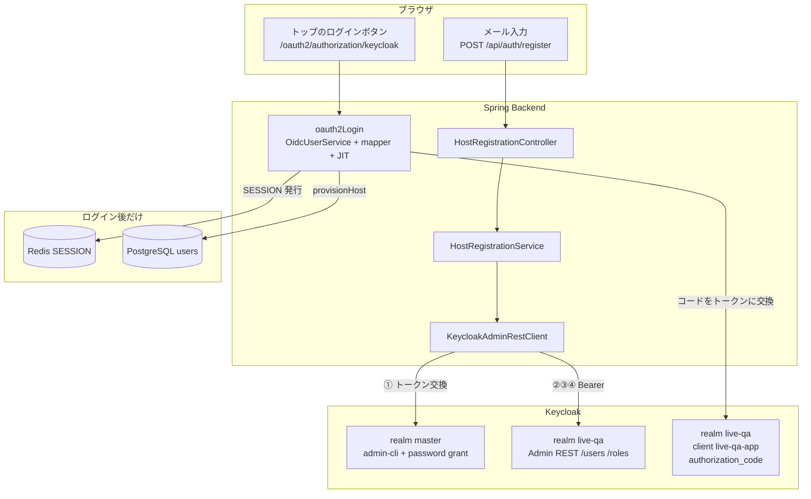
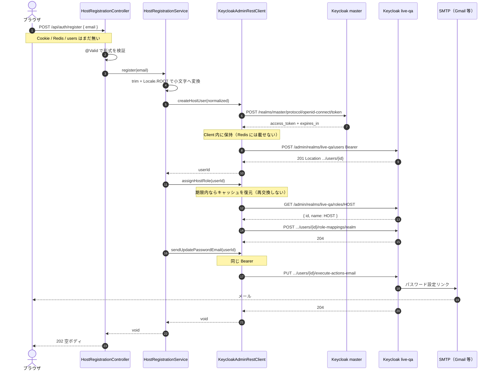
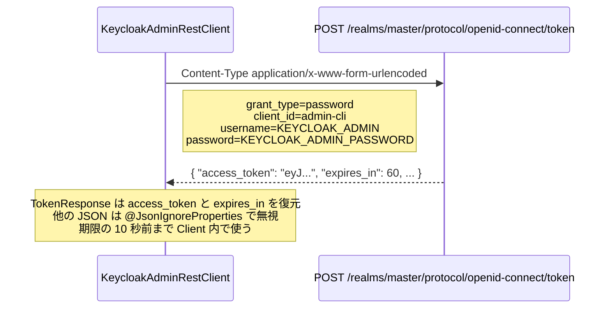
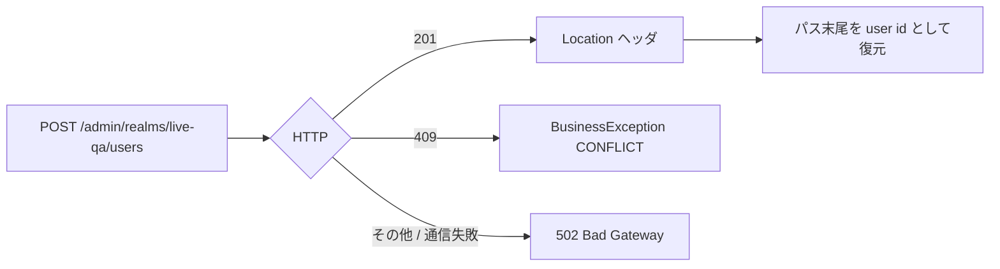
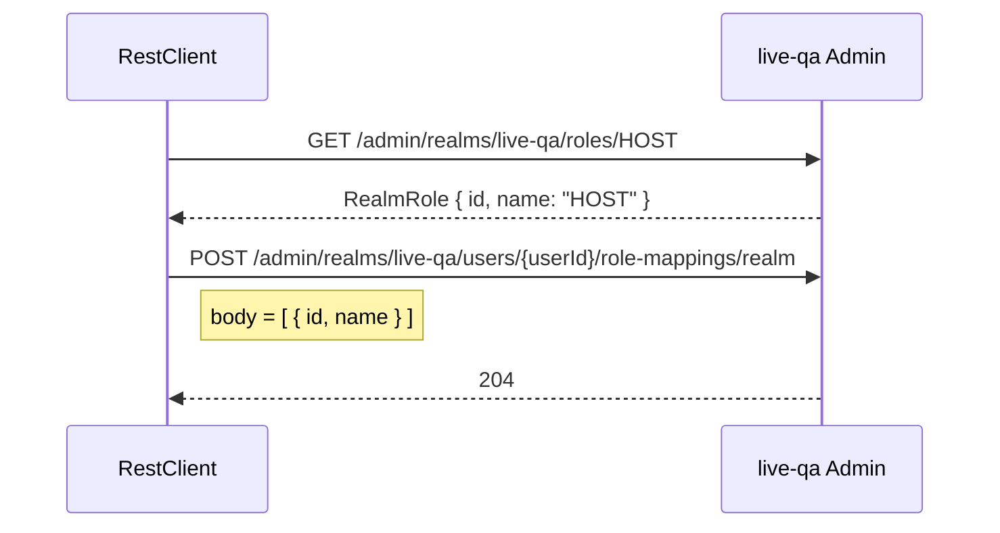
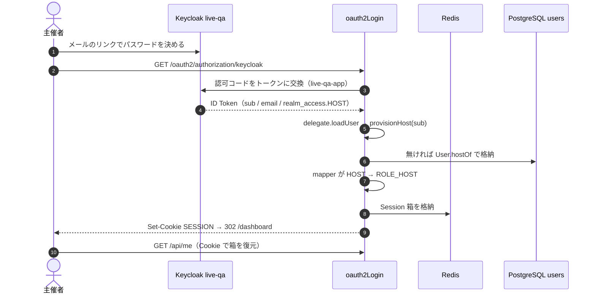
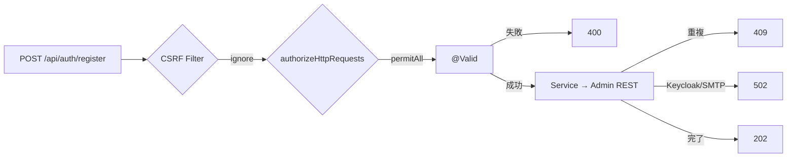

# F-01 認証・セッション

scope: Keycloak OIDC → Cookie Session（Redis）→ `/api/me` / logout / CSRF / JIT。  
正: [openapi-notes](../api/openapi-notes.md) / [architecture](../architecture.md)。  
深いカタログ（Filter 列・型）: [05-security-config.md](05-security-config.md) / [06-me-controller.md](06-me-controller.md) / [26-securityconfig-data-flow.md](26-securityconfig-data-flow.md)。  
Keycloak realm 専用 `live-qa`・URL 2種: [ops.md](ops.md)。  
**Admin REST（HOST 発行）の図解:** 「Q. Keycloak Admin REST は何をしている？」

## 到達点

| 項目 | 状態 |
|------|------|
| oauth2Login / mapper 差し込み / CSRF / Session+Redis | あり。guest POST は ignore（#104 / [f04](f04-guest.md)） |
| JIT（`provisionHost`） | あり |
| `POST /api/auth/register`（HOST メール発行） | **あり**（[#122](https://github.com/muscat2356/live-qa-app/issues/122)。フロントの入力欄は未。ローカル SMTP・専用 realm は済み） |
| `GET /api/me`（ローカル PK + `currentHost` + `@PreAuthorize HOST`） | あり |
| `POST /api/auth/logout` | あり。docker は `end_session_endpoint` を yml から載せる（[#135](https://github.com/muscat2356/live-qa-app/issues/135)） |
| ログイン後 → フロント `/dashboard` | あり（`successHandler`） |
| 401/403 JSON | SecurityConfig（Filter）。業務例外は GlobalExceptionHandler |
| `authorization-uri` / Cookie `Secure` の env 化 | **あり**（[#44](https://github.com/muscat2356/live-qa-app/issues/44) の 1-C / 3-G）。token / JWK は `keycloak:8080` のまま |
| realm JSON の秘密 | **あり**。client secret / 初期 HOST パスワードは env。JSON はプレースホルダ |

## データの流れ

```text
ブラウザ → /oauth2/authorization/keycloak
  → Keycloak ログイン → コールバックで認可コードをトークンに交換
  → delegate.loadUser（標準 OidcUserService）で OidcUser を組み立て
  → provisionHost(sub) … users を検索、無ければ User.hostOf で格納（JIT）
  → mapper が realm_access の HOST → ROLE_HOST
  → SESSION Cookie 発行（箱は Redis）→ 302 /dashboard
  → GET /api/me … Session 復元 → requireByOidcSubject → MeResponse
```

Cookie / Redis / SecurityContext の復元は以降の API でも同じ。JWT を毎リクエスト検証しない。

## 役割分担

| 層 | する | しない |
|----|------|--------|
| SecurityConfig | Filter・CSRF・EntryPoint/AccessDenied・mapper 接続 | 業務分岐 |
| UserService | JIT / 復元 / MeResponse 組み立て | `ResponseEntity` / Keycloak Admin |
| HostRegistrationService | メール正規化 → Admin Client に発行を依頼 | `ResponseEntity` / パスワード |
| KeycloakAdminClient | Admin トークン交換・User 格納・HOST 付与・設定メール発行 | ローカル `users` |
| Controller | principal または email 受け取り、`ResponseEntity` | DTO 組み立て本体 |

401/403（未ログイン・権限不足・CSRF）は **Filter**。Controller 到達後の 400/404/409 は **Advice**。形 `{ status, error, message }` は揃える。

---

## Q. JIT とは？

**ログインしたその瞬間に、必要ならローカル `users` 行を作ること。** Keycloak の `sub` は FK に直接載せない（`host_id → users.id`）。2回目以降は find だけ。displayName / email は DB に保存せずクレームから都度返す。

## Q. UserService はいつ動くか / oidcSubject はどこから？

| いつ | メソッド | 入力 |
|------|----------|------|
| ログイン・コールバック | `provisionHost` | `oidcUser.getSubject()`（ID Token の `sub`） |
| `GET /api/me` | `requireByOidcSubject` → `toMeResponse` | 同じ sub（SESSION 内 OidcUser） |

UserService は Session 箱を検証しない。箱の復元は Filter。Service は **sub → users 行**。

## Q. `delegate.loadUser` とは？

Spring 標準 `OidcUserService` への**委譲**。トークン検証・クレーム組み立ては標準に任せ、差分は JIT 1箇所。`userRequest` は自分で new しない（oauth2Login が渡す）。毎 API では走らない。

## Q. oidcUserService と mapper は両方呼ばれる？

**呼ばれる。順序は loadUser（＋JIT）のあと、Provider が mapper。** mapper を Bean にしただけでは足りない。`userAuthoritiesMapper(...)` で oauth2Login に接続する。

## Q. HOST 表示名はローカル列が要るか？

**F-01 では足さない。** 正はクレーム都度。日本語が IdP に載せられないと確定してから er-diagram / openapi を先に更新する。参加者の `questions.display_name` は別物。

## Q. ログイン後のリダイレクトは？

| 用途 | URL（開発） |
|------|-------------|
| ログイン開始（A のボタン） | `http://localhost:8081/oauth2/authorization/keycloak` |
| 成功後の着地 | `http://localhost:3000/dashboard` |
| ログアウト後 | `http://localhost:3000/` |

`{baseUrl}` は **backend オリジン**。フロントへ戻すなら設定値で分ける。Keycloak の Valid post logout redirect URIs にもフロントを許可する。

## Q. ログアウトしても SESSION が残る？（2026-08-28）

**Cookie の名前が残ることと、HOST の箱が残ることは別。** まず `GET /api/me` が 401 ならログアウトは成功。DevTools に `SESSION` があるだけでは失敗ではない。

流れ: `POST /api/auth/logout`（CSRF）→ HttpSession 無効化（Redis の HOST 箱を消す）→ Keycloak end-session へ 302 → フロント `/`。`SecurityConfig` に `deleteCookies("SESSION")` は無い。Spring Session の expire が応答に乗らない／着地後の次リクエストが空の箱を再発行すると、同じ名前の Cookie が残って見える。

見分け: Cookie の値がログアウト前と同じ UUID で Redis の `live-qa:sessions:{そのUUID}` もある → 無効化未到達。値が変わっている／`/api/me` が 401 → 再発行。

## Q. ログアウト後にログインボタンで画面を飛ばして入れる？（2026-08-28）

**原因は Keycloak の SSO が残っていること。** Spring の SESSION（Redis）を消しても、ブラウザの `localhost:8080` にある `KEYCLOAK_SESSION` / `KEYCLOAK_IDENTITY` が残ると、次の `/oauth2/authorization/keycloak` でパスワード画面を出さずコードを返す。

Compose（`SPRING_PROFILES_ACTIVE=docker`）では `application-docker.yml` が **issuer-uri を置かない**（token は `keycloak:8080`、認可は localhost）。`OidcClientInitiatedLogoutSuccessHandler` は discovery の `end_session_endpoint` だけを見る。それが無いと Keycloak の logout へ 302 せず、`/` へ戻るだけ。Redis の HOST 箱は消えるのでトップのログインボタンは出る。SSO は生きている。

確認: ログアウトの Network で Location が `.../protocol/openid-connect/logout` か。無ければこの穴。Application で `localhost:8080` の Keycloak Cookie が残っているか。ホスト `mvn`（issuer-uri あり）では end-session に飛ぶので、同じ症状なら 302 がブラウザに届いているかを見る。

採らない: ログインに `prompt=login` だけ足す。issuer-uri を docker に戻す。

**直し方（#135・実装済み）:** `app.logout.end-session-uri`（ブラウザ向け）を `EndSessionClientRegistrationRepository` が metadata に載せる。`OidcClientInitiatedLogoutSuccessHandler` はそのまま。token-uri は `keycloak` のまま。discovery に既にあるホスト `mvn` は上書きしない。

## Q. HTTPS にすると Cookie / SSO はどうなる？

**通信の中身を暗号化し、Cookie に `Secure` を付ける。** 証明書は各コンテナではなく、前段のプロキシ（Caddy など）で止めるのが無料枠向き。OIDC の `{baseUrl}` と Keycloak の redirect は `https://...` に揃える。詳細・フロント本番ビルドは [ops.md](ops.md) の「HTTPS とフロント本番」。

## Q. Cookie 跨ぎと CORS は同じ？

**別レイヤ。** Next BFF ならブラウザ↔Spring の CORS は避けられる。残るのは Cookie の転送（Set-Cookie をブラウザが覚えるか、次リクエストで Spring まで届くか）。ログインコールバックはブラウザが SESSION を直受けするので発行漏れは起きにくい。その後 Next サーバが `/api/me` を呼ぶなら Cookie を明示転送する。

## Q. CSRF は Controller にどう書く？

**書かない。** `SecurityConfig` の `CsrfFilter` が POST/PUT/PATCH/DELETE を自動検証。クライアントは Cookie `XSRF-TOKEN` の値をヘッダ `X-XSRF-TOKEN` に載せる。テストは `.with(csrf())`。`addFilters=false` のスライスは CSRF 対象外（配線だけ見る）。

## Q. `@PreAuthorize` 失敗が 500 になる？

`AuthorizationDeniedException` が catch-all に飲まれると 500。`@ExceptionHandler` を認可用に分ける。catch-all 内の if より、型ごとの Handler。

## Q. 応答の `role: UNKNOWN`？

現行は DB `users.role` を返す。ソースに `"UNKNOWN"` は無い。旧実装（authorities から探す）の名残。認可不足はだいたい **403**。IdToken に `realm_access` が無いと mapper が `ROLE_HOST` を足せない → Client scopes → `roles` → `realm roles` → **Add to ID token ON**。

## Q. 未ログインで `/dashboard` を直打ちすると `/login` で止まる？（#115）

**Next が存在しない `/login` に 302 している。** 一覧 SSR が `GET /api/events` の 401 で `redirect("/login")`。フロントにそのページは無い。正の導線はトップ `/` の Keycloak ボタン（`/oauth2/authorization/keycloak`）。専用ログインフォームは持たない。

詳細・Q&A は `/login` に行かず 401 を throw する（別経路）。改善は 401 なら `redirect("/")` に揃える。Issue: [#115](https://github.com/muscat2356/live-qa-app/issues/115)。

## Q. メールだけで主催者登録するか？（方針・2026-08-27）

**やる。Keycloak にユーザーを作り、Spring にパスワードを持たない。** scope の「自前の登録画面は持たない」は「Spring が会員マスタ＋パスワード検証を持たない」の意味。メール入力はフロント（A）、発行は `POST /api/auth/register`（B / Admin API）。

一次パスワードを `temporary: true` で入れる方式は採らない。execute-actions-email（`UPDATE_PASSWORD`）でリンクだけ送る。

realm `live-qa` は `registrationAllowed: false`。Keycloak の公開自己登録は使わない。参加者は Keycloak に作らない。公開 API なので、メールを知っている人は HOST になれる（招待コードは今は外す）。

登録は HOST のみ。ローカルで専用 realm `live-qa` を通してからクラウド（AWS EC2。正は [#44](https://github.com/muscat2356/live-qa-app/issues/44)）に載せる。登録 API は [#122](https://github.com/muscat2356/live-qa-app/issues/122)。

JSON・yml・volume は [ops.md](ops.md) の「専用 realm `live-qa`」。compose はテンプレ JSON を env で埋めてから import する。

### Q. import JSON の初期ユーザーは誰？

**開発用 HOST 1 人。** `host@example.com`、realm role `HOST`。パスワードは env `KEYCLOAK_DEV_HOST_PASSWORD`（JSON には `__KEYCLOAK_DEV_HOST_PASSWORD__` だけ）。ログインして JIT すればローカル `users` ができる。SMTP の秘密は載せない。既存 volume には入らないので、入れるときは `docker compose down -v`。本番リポでは `.env` を載せない。登録 API の人だけ使う運用でもよい。

### Q. デプロイ手順の「2. SMTP を入れて Admin からテストメール」とは？

**Keycloak が郵便を出せるようにする作業。アプリのコードではない。** パスワード設定リンクは Spring ではなく Keycloak が送る。送り先の郵便局（SMTP）が空だと、登録 API が成功してもメールは届かない。

いまの import JSON は `"smtpServer" : { }`（空）。Admin の Realm settings → Email にホスト・ポート・From・認証を書く。Save のあと **Test connection** / **Send test email** で、自分のアドレスに1通来れば 2 は完了。

ローカルと本番（AWS EC2）で同じ口（Gmail など）を使うと、載せたあとに郵便局だけ変えなくて済む。Mailhog は受け専用の素振り。クラウドが 25 番を塞いでいることが多いので **587（STARTTLS）** を使う。

### Q. Keycloak の SMTP は画面のどこに何を入れる？（2026-08-27）

**JSON には書かない。** Admin の Realm settings → Email。保存先は Keycloak の DB（volume）。`docker compose down -v` すると消えるので、作り直したら入れ直す。

1. `http://localhost:8080` → 左上 realm を **`live-qa`**
2. **Realm settings → Email**
3. 保存 → **Test connection** → **Send test email**（自分のアドレス）

Gmail の例（ローカル＝本番で同じ口にするとき）:

| 欄 | 値 |
|----|-----|
| From | その Gmail アドレス（From が違うと拒否されやすい） |
| Host | `smtp.gmail.com` |
| Port | `587` |
| Enable StartTLS | ON |
| Enable Authentication | ON |
| Username | 同じ Gmail アドレス |
| Password | **アプリパスワード**（アカウントのログインパスワードではない） |

アプリパスワード: Google アカウント → セキュリティ → 2段階認証が ON → 「アプリ パスワード」。16 文字をスペース無しで貼る。

完了の合図: テストメールが 1 通、受信箱（または迷惑メール）に来る。

よくある失敗:

| 症状 | 見ること |
|------|----------|
| Authentication failed | 普通のパスワードを入れている。アプリパスワードにする |
| Could not convert socket to TLS | 587 なのに SSL 側を ON にしている。StartTLS だけ |
| Connection refused / timeout | 25 番を使っている。587 にする。Keycloak **コンテナ**から外へ出られるか |
| テストは成功、登録メールが来ない | From 未設定。ユーザーの Email が空 |

Mailhog で受けるだけなら Host は compose のサービス名（例 `mailhog`）、Port `1025`、認証オフ。いまの `compose.yml` には Mailhog は無い。外に届く口が要るなら Gmail 側で足りる。

## 疎通（SESSION。Bearer では `/api/me` は通らない）

1. `curl -s -i http://localhost:8081/api/me` → 401  
2. ブラウザで OIDC ログイン → Cookie `SESSION`  
3. 同じ Cookie で `GET /api/me` → `id` 数値・`role: HOST`  
4. `SELECT id, oidc_subject, role FROM users;`  
5. POST は `SESSION` + `X-XSRF-TOKEN` + `Content-Type`

ホスト `mvn` 時は Keycloak が 8080 なので backend は **8081**。DB ユーザーは Compose `.env`（`live_qa_user`）に合わせる。

## テスト

| 層 | 見るもの |
|----|----------|
| `UserServiceTest` | JIT 新規/既存、require、MeResponse |
| `MeControllerTest` | HOST 200 / 非 HOST 403 / 未認証 401。本番 Security は Import しない。OAuth2Client は exclude |

```text
【EJ】静的ファクトリ … User.hostOf
【EJ】依存性注入 … UserService コンストラクタ
【EJ】不変性 … MeResponse は record
【EJ】公開面最小化 … Controller は薄く、組み立ては Service
【EJ】あえて外す … Entity は JPA で可変
```

## Q. `POST /api/auth/register` の写経単位は？（#122・2026-08-27）

**Service は Keycloak に発行を依頼するだけ。`users` は触らない。** パスワードは受け取らない。この POST では Cookie / Redis / SecurityContext は使わない（ログイン前）。

```text
POST /api/auth/register { email }
  → @Valid で形式を検証する
  → Service が trim + 小文字へ変換する
  → master の admin-cli でトークンを交換する
  → live-qa に User を格納する（201 Location から id）
  → realm role HOST を付ける
  → execute-actions-email（UPDATE_PASSWORD）を発行する
  → 202 空ボディ
  → リンクでパスワード設定 → トップのログイン → JIT
```

Admin の口はホスト `localhost:8080`、Compose は `keycloak:8080`。管理者は `.env` の `KEYCLOAK_ADMIN`。JSON に秘密を書かない。

テスト: Service は Client を Mock（成功 / 409 / 502）。Controller は 202 と 400。CSRF ignore は guest と同じ Filter スライス。HTTP 1 手ずつの図は「Q. Keycloak Admin REST は何をしている？」。

### Q. KeycloakAdminClient は oauth2Login と同じ？（#122）

**違う。** oauth2Login は主催者がブラウザでログインする道。Admin Client は Spring が **管理者**として User を作る道。トークンも別（`admin-cli` の password grant。client `live-qa-app` ではない）。

interface は契約（3メソッド）。`KeycloakAdminRestClient` が HTTP の具象。Service は「正規化して3つをこの順で呼ぶ」だけ。`@Component` が無いと DI されない。

### Q. RestClient の1回分は何をしている？（#122）

有効期限内なら同じ Bearer を付ける → Admin API を叩く。期限切れ、または Admin REST が 401 ならキャッシュを捨てて 1 回だけ再交換する。失敗は 409（重複）か 502（口が開かない）。Cookie / Redis / `users` は出ない。細かい HTTP と図は次の節。

---

## Q. Keycloak Admin REST は何をしている？（図解・#122）

**なぜ作るか:** 主催者を Spring の会員マスタにしない。パスワードも持たない。Keycloak に User を格納し、設定リンクだけ発行する。ログイン後の Session は従来どおり oauth2Login。

**役割:** Controller がメールを受け取る → Service が正規化して 3 手を順に依頼する → RestClient が Admin HTTP を叩く → 202 空を返す。

**この POST で触らないもの:** Cookie `SESSION`、Redis、PostgreSQL の `users`、SecurityContext。箱の発行は、メールのリンクでパスワードを決めたあと、トップから OIDC ログインしたとき。

### 1. 道は 2 本（混ぜない）

Keycloak の口は用途で分かれる。同じホスト `8080` でも **クライアントとトークンが別**。



| 道 | 誰が | クライアント | grant | 結果 |
|----|------|-------------|-------|------|
| **Admin REST** | Spring が管理者として | `admin-cli`（master） | password | User 格納・HOST 付与・設定メール |
| **oauth2Login** | 主催者がブラウザで | `live-qa-app`（live-qa） | authorization_code | ID Token → Session → JIT |

`live-qa-app` の client secret はログイン用。Admin の Bearer には使わない。

### 2. 層と型の正体

```text
ブラウザ
  → Filter（permitAll + CSRF ignore）… ログイン前の発行口
  → HostRegistrationController … email を受け取り、202 の箱を返す
  → HostRegistrationService … trim + 小文字へ変換し、3 メソッドをこの順で呼ぶ
  → KeycloakAdminClient（interface=契約）
  → KeycloakAdminRestClient（具象=@Component）
       RestClient … HTTP クライアント
       TokenResponse / RealmRole … 応答 JSON の必要な項目だけ（record）
```

| 型 | 正体 |
|----|------|
| `KeycloakAdminClient` | interface＝契約（3 メソッド）。Service は HTTP を知らない |
| `KeycloakAdminRestClient` | 具象。`@Component` が無いと DI されない |
| `HostRegisterRequest` | record＝不変 DTO。`@Email` / `@NotBlank` は検証のメタデータ |
| `@Value("${app.keycloak.admin.*}")` | 設定の注入。秘密は JSON に書かない |
| `RestClient` | Spring 6 の同期 HTTP。`WebClient` ではない |
| `BusinessException` | 409 / 502 を Advice が `{ status, error, message }` に変換する |

Controller は `ResponseEntity`。DTO 組み立ては無い（202 空）。パスワードはリクエストにも DB にも載せない。

### 3. 登録 1 回のシーケンス

操作語: **検証**（形式）→ **変換**（trim・小文字）→ **交換**（admin トークン）→ **格納**（User）→ **復元**（Location の id）→ **付与**（HOST）→ **発行**（設定メール）。



Spring はメール本文を作らない。Keycloak が SMTP で送る。Realm settings → Email が空だと 4 手目が 502 になる。

### 4. トークン交換（password grant）

**交換** = 管理者の username/password を、短い access_token に取り替える。主催者ログインの認可コード交換とは別。



1登録の 3手（HTTP は最大4本）で同じ Bearer を使う。`expires_in` の少し前まで Client 内に保持する。Cookie / Redis / `users` には載せない。Admin REST が 401 ならキャッシュを捨てて 1 回だけ再交換する。接続拒否・2回目の 401・空トークンは **502**。Keycloak の生エラーはクライアントに出さない。connect 3 秒 / read 5 秒。

Bearer の載せ方:

```text
Authorization: Bearer eyJ...
```

このトークンは **master の管理者**として Admin REST を叩く鍵。ブラウザの SESSION ではない。Redis にも格納しない。

### 5. User 格納と Location から id を復元



本文（パスワードなし）:

```json
{
  "username": "user@example.com",
  "email": "user@example.com",
  "enabled": true,
  "emailVerified": true
}
```

username と email は同じ正規化済み文字列。一次パスワード（`credentials` / `temporary`）は載せない。

201 の Location 例:

```text
http://keycloak:8080/admin/realms/live-qa/users/a1b2c3d4-...
                                                      ^^^^^^^^
                                                      この UUID を復元して次の 2 手に渡す
```

409 は「同じメールが既にある」。Advice が `{ status: 409, error: Conflict, message: ... }`。

### 6. realm role HOST を付ける

ロール名の文字列だけでは足りない。Keycloak は **ロール定義の id** を role-mappings に載せる。



これで IdToken の `realm_access.roles` に `HOST` が載る前提ができる。ログイン時の mapper が `ROLE_HOST` に変換する（登録 API では mapper は走らない）。

### 7. execute-actions-email（UPDATE_PASSWORD）

**発行** = パスワード設定用のワンタイムリンクを、Keycloak 経由でメールする。Spring はリンク文字列を受け取らない。

```mermaid
flowchart TB
  PUT["PUT /admin/realms/live-qa/users/{id}/execute-actions-email"]
  Q["?client_id=live-qa-app<br/>&redirect_uri=http://localhost:3000/"]
  B["body: [\"UPDATE_PASSWORD\"]"]
  PUT --> Q
  PUT --> B
  PUT --> SMTP["Keycloak → SMTP → 受信箱"]
  SMTP --> LINK["ユーザーがリンクを開く"]
  LINK --> SET["Keycloak 画面でパスワードを決める"]
  SET --> TOP["redirect_uri のトップ /"]
  TOP --> OIDC["ログインボタン → oauth2Login"]
```

`client_id` / `redirect_uri` は設定メール完了後の戻り先。oauth2Login の `{baseUrl}/login/oauth2/code/{registrationId}` とは別。完了後はフロントのトップから、いつものログイン開始 URL を踏む。

### 8. メールのあと（ここから Cookie / Redis / DB）

登録 202 の時点ではローカル `users` は無い。初回ログインで JIT。



| 時点 | Cookie SESSION | Redis | users 行 | Keycloak User |
|------|----------------|-------|----------|---------------|
| register の 202 | なし | なし | なし | あり（HOST 付き） |
| パスワード設定直後 | なし | なし | なし | あり（資格情報あり） |
| OIDC ログイン成功 | 発行 | 箱を格納 | JIT で作成 | 同じ User |

### 9. URL と設定（秘密は JSON に書かない）

| 設定 | ホスト `mvn` の既定 | Compose（profile docker） | 何のため |
|------|---------------------|---------------------------|----------|
| `app.keycloak.admin.base-url` | `http://localhost:8080` | `http://keycloak:8080` | Admin REST の向き先 |
| `realm` | `live-qa` | 同じ | User / role のテナント |
| `username` / `password` | `.env` の `KEYCLOAK_ADMIN*` | compose が backend に渡す | master のトークン交換 |
| `client-id` | `live-qa-app` | 同じ | 設定メールの `client_id`（Bearer 用ではない） |
| `redirect-uri` | `http://localhost:3000/` | 同じ | 設定完了後の戻り |

ホスト起動なのに `base-url` が `http://keycloak:8080` だと名前解決できず 502。Compose なのに `localhost:8080` だと **コンテナ内の** localhost になり、Keycloak に届かない。

SMTP は Admin 画面。import JSON の `"smtpServer": {}` は空のまま。`down -v` すると消える。

### 10. エラーと Filter

```text
400 … @Valid（空・形式不正）。Controller に入る前の Bean Validation
409 … Keycloak が同じメールで 409。Client が Conflict に変換
502 … トークン交換失敗・ロール無し・SMTP 失敗・接続拒否。生エラーは出さない
401/403 … この POST では出さない（permitAll）
CSRF 403 … ignore 済み（guest と同じ）。トークン無しでも 202 まで届く
```



### 11. 【EJ】

```text
【EJ】公開面最小化 … Service は HTTP を知らない。トークンキャッシュも Client の private
【EJ】依存性注入 … Controller / Service / RestClient はコンストラクタ（設定は @Value）
【EJ】不変性 … HostRegisterRequest / TokenResponse / RealmRole / CachedAdminToken は record
【EJ】例外 … 409 と 502 は BusinessException。Keycloak の本文は漏らさない
【EJ】あえて外す … Redis には載せない。interceptor と Clock 注入は今はやらない。Entity は登録では作らない
【EJ】あえて外す … interface は単一実装でもテスト用の契約として残す
```

### 12. 疎通（登録 API）

1. backend に `KEYCLOAK_ADMIN_PASSWORD` がある（Compose ならルート `.env`）
2. Keycloak Admin の Email テストが通っている
3. `curl -s -i -X POST http://localhost:8081/api/auth/register -H 'Content-Type: application/json' -d '{"email":"..."}'`
4. 202 → 受信箱に設定リンク → トップから OIDC → `GET /api/me` で `role: HOST`

テスト: `HostRegistrationServiceTest`（Client Mock）、`HostRegistrationControllerTest`（202/400/409）、`HostRegistrationControllerCsrfTest`（ignore）。

## Q. authorization-uri と Cookie Secure を env にする？（#44 の 1-C / 3-G）

**ブラウザが見るものだけ実行時に差し替える。箱の中は変えない。** EC2 の公開 URL を yml にベタ書きしない。

| 地図 | 誰が見る | env | デフォルト（ローカル） |
|------|----------|-----|------------------------|
| 1-C | ブラウザ（Keycloak のログイン画面へ飛ぶ） | `KEYCLOAK_AUTHORIZATION_URI` | `http://localhost:8080/realms/live-qa/protocol/openid-connect/auth` |
| 3-G | ブラウザ（SESSION Cookie） | `SESSION_COOKIE_SECURE` | `false`（HTTP）。HTTPS 本線だけ `true` |

トークン交換・JWK・Redis は `keycloak` / `redis` のまま。Compose の `environment` に載せないと、ルート `.env` はコンテナに入らない。logout の `KEYCLOAK_END_SESSION_URI`・戻り先・CORS・`KC_HOSTNAME` も同じ口。

HTTP のまま `SESSION_COOKIE_SECURE=true` にすると SESSION が乗らない。ローカル Compose は触らなくてよい（デフォルト false）。
