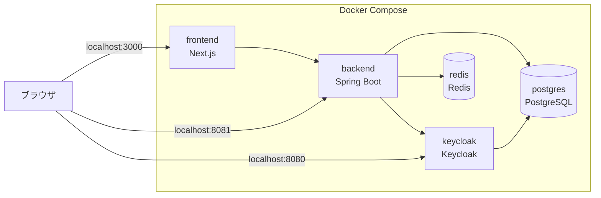
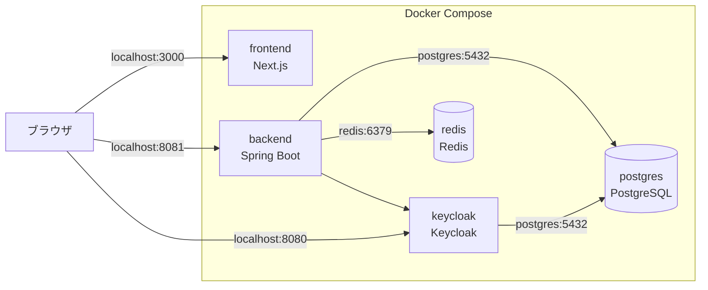
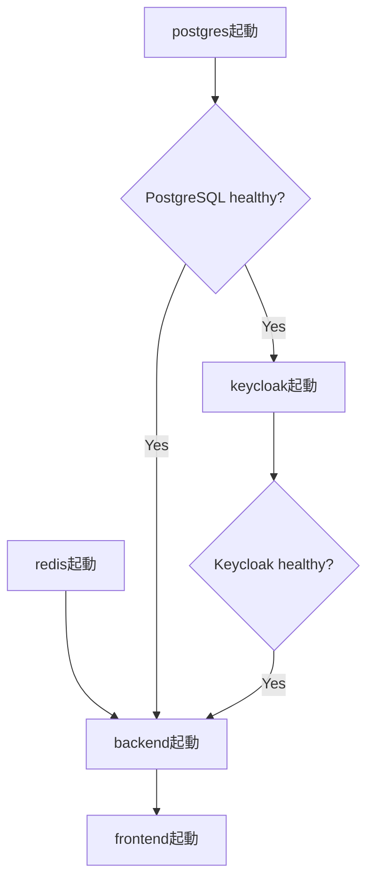

# Docker学習共有
## live-qa-appをDocker Composeで動かす

## 目次

1. 今回の学習目的
2. Dockerを使わない場合の課題
3. Dockerとは
4. コンテナと仮想マシンの違い
5. ImageとContainer
6. Dockerfileとは
7. Docker Composeとは
8. live-qa-appの全体構成
9. backend用Dockerfileの解説
10. frontend用Dockerfileの解説
11. `compose.yml`の役割
12. backendサービス
13. frontendサービス
14. PostgreSQLサービス
15. Redisサービス
16. Keycloakサービス
17. Named Volume
18. 起動順序
19. `localhost`とサービス名
20. `.env`による設定の外出し
21. 今回の構成から学んだこと

---

## 1. 今回の学習目的

今回の学習では、Dockerの基本概念を理解し、live-qa-appで必要となる複数のサービスをDocker Composeで一括起動できる開発環境を構築することを目的とした。

live-qa-appは、次の複数サービスで構成される。

- Next.js
- Spring Boot
- PostgreSQL
- Redis
- Keycloak

これらを開発者が個別にインストール・設定すると、メンバーごとにバージョンや設定が異なる可能性がある。

Dockerを利用することで、各サービスの実行環境をコードとして管理し、チーム内で同じ環境を再現できるようにする。

---

## 2. Dockerを使わない場合の課題

Dockerを使わずに開発する場合、各メンバーのPCへ以下を直接インストールする必要がある。

- Java 21
- Node.js
- PostgreSQL
- Redis
- Keycloak

この場合、次のような問題が起きる可能性がある。

### 2.1 バージョン差異

例：

- AさんはPostgreSQL 15
- BさんはPostgreSQL 16
- CさんはPostgreSQL 18

同じソースコードでも、バージョン差によって動作が変わる可能性がある。

### 2.2 設定差異

以下の設定が各PCで異なる可能性がある。

- ポート番号
- DB名
- ユーザー名
- パスワード
- KeycloakのRealm設定
- Redisの接続設定

### 2.3 セットアップの負担

新しいメンバーが参加した場合、複数のミドルウェアを一つずつインストールし、設定する必要がある。

Dockerを使うことで、必要な環境をDockerfileや`compose.yml`へ記述し、コードとして共有できる。

---

## 3. Dockerとは

Dockerは、アプリケーションとその実行に必要な環境を、コンテナとして動かすための仕組みである。

コンテナは、ホストOS（Windowsなど）の中で動く、他と分離された小さな実行環境である。

live-qa-appでは、サービスごとにコンテナを分けている。

```text
frontendコンテナ
└─ Next.js

backendコンテナ
└─ Spring Boot

postgresコンテナ
└─ PostgreSQL

redisコンテナ
└─ Redis

keycloakコンテナ
└─ Keycloak
```

サービスごとにコンテナを分けることで、役割と依存関係が明確になる。

基本的には、1つのコンテナへ複数の役割を詰め込むのではなく、サービスごとに分離する。

---

## 4. コンテナと仮想マシンの違い

Dockerコンテナと仮想マシンは、どちらも実行環境を分離する仕組みだが、分離方法が異なる。

### 4.1 仮想マシン

```text
物理PC
└─ ホストOS
   └─ Hypervisor
      ├─ ゲストOS
      │  └─ アプリ
      └─ ゲストOS
         └─ アプリ
```

仮想マシンごとに、独立したゲストOSを持つ。

### 4.2 Dockerコンテナ

```text
物理PC
└─ ホストOS
   └─ Docker Engine
      ├─ Container
      ├─ Container
      └─ Container
```

コンテナは、ホストOS（WindowsやLinux）のカーネル（CPUやメモリなどOSの中心部分）を共有しながら、それぞれ独立したプログラム（プロセス）として動作する。

OSをコンテナごとに持つ必要がないため、仮想マシンより軽量で、起動が速いという特徴がある。

ただし、コンテナはOSごと仮想化する仮想マシンとは異なり、ホストOSのカーネルを共有して動作する仕組みである。

---

## 5. ImageとContainer

### 5.1 Image

Imageは、アプリケーションを実行するために必要なOS・ライブラリ・設定・プログラムなどをあらかじめまとめた、構築済みの実行環境である。

Image自体は実行されず、Imageから生成したコンテナが実際に動作する。

例：

```text
postgres:16
redis:7-alpine
quay.io/keycloak/keycloak:26.0
```

PostgreSQLのImageには、PostgreSQL本体や必要なライブラリ、基本設定などが含まれる。

Imageには次の特徴がある。

- コンテナを起動するための元となる。
- Imageは複数のLayer（部品）を積み重ねて構成されている。
  （例：Layer1：Java21、Layer2：作業ディレクトリ作成、Layer3：ソースコードコピー、Layer4：Mavenでビルド）
- 同じImageから複数のContainerを生成できるため、Containerが壊れても同じImageから新しく作り直すことができる。
- Image自体は基本的に変更せず、変更が必要な場合は新しいImageを作成する。

### 5.2 Container

Containerは、Imageをもとに実際に起動した実行環境である。

```text
Image
  ↓ docker run / docker compose up
Container
```

たとえば、

```text
postgres:16
```

というImageから、PostgreSQLを実行するContainerが起動する。

理解のためにJavaへ例えると、次のように考えられる。

```text
Image     ≒ クラス（設計図）
Container ≒ 生成されたインスタンス
```

ただし、完全に同じ概念ではなく、あくまでイメージをつかむための例えである。

---

## 6. Dockerfileとは

Dockerfileは、Docker Imageを作成するための命令を記述するファイルである。

DockerはDockerfileを上から順番に処理し、Imageを構築する。

主な命令は次のとおり。
### BackendのDockerfile例

```dockerfile
FROM eclipse-temurin:21-jdk AS build
WORKDIR /app

COPY .mvn/ .mvn/
COPY mvnw pom.xml ./
COPY src ./src

RUN chmod +x mvnw
RUN ./mvnw clean package -DskipTests

FROM eclipse-temurin:21-jre
WORKDIR /app

COPY --from=build /app/target/*.jar app.jar

EXPOSE 8080

ENTRYPOINT ["java", "-jar", "app.jar"]
```

各命令の役割は次のとおりである。

| 命令 | 今回の役割 |
|------|-----------|
| `FROM` | ベースとなるJava21のImageを指定する。今回はビルド用JDKと実行用JREを使用している。 |
| `WORKDIR` | コンテナ内の作業ディレクトリを`/app`に設定する。 |
| `COPY` | Maven設定やソースコードをImageへコピーする。 |
| `RUN` | Mavenでアプリケーションをビルドし、実行用Jarファイルを作成する。 |
| `EXPOSE` | Spring Bootが利用する8080番ポートを公開する。 |
| `ENTRYPOINT` | コンテナ起動時に`java -jar app.jar`を実行し、Spring Bootを起動する。 |

このようにDockerfileには、「どのようなImageを作るか」を上から順番に記述する。

DockerfileはImageの作り方を定義するファイルであり、Containerそのものを直接作る設定ではない。

---

## 7. Docker Composeとは

Docker Composeは、複数のContainerとその設定を、1つのYAMLファイルで定義・管理する仕組みである。

live-qa-appでは、次のサービスを定義している。

```yaml
services:
  backend:
  frontend:
  postgres:
  redis:
  keycloak:
```

Composeを使わない場合は、各Containerを個別に起動しなければならない。

```bash
docker run ...
docker run ...
docker run ...
docker run ...
docker run ...
```

さらに、次の設定も個別に指定する必要がある。

- ネットワーク
- ポート
- 環境変数
- Volume
- 起動順序
- healthcheck

Composeを使うことで、これらを`compose.yml`へ宣言し、次のコマンドで一括起動できる。

```bash
docker compose up -d --build
```

DockerfileとComposeの役割は異なる。

```text
Dockerfile
└─ 1つのImageをどのように作るか

compose.yml
└─ 複数のContainerをどのような設定・関係で動かすか
```

---

## 8. live-qa-appの全体構成



### 各サービスの役割

| Service | 役割 |
|---|---|
| frontend | Next.jsによる画面表示 |
| backend | Spring BootによるREST API・WebSocket |
| postgres | アプリデータとKeycloakデータの保存 |
| redis | Spring Sessionの保存 |
| keycloak | SSO・OIDC認証 |

---

## 9. backend用Dockerfileの解説

使用しているDockerfileは次のとおり。

```dockerfile
FROM eclipse-temurin:21-jdk AS build
WORKDIR /app

COPY .mvn/ .mvn/
COPY mvnw pom.xml ./
COPY src ./src

RUN chmod +x mvnw
RUN ./mvnw clean package -DskipTests

FROM eclipse-temurin:21-jre
WORKDIR /app
COPY --from=build /app/target/*.jar app.jar

EXPOSE 8080
ENTRYPOINT ["java", "-jar", "app.jar"]
```

### 9.1 処理の全体像

このDockerfileは、2段階に分けてImageを作成している。

```text
第1段階
JDKを使ってSpring Bootアプリをビルドする

                 ↓

第2段階
完成したJARだけをJRE環境へコピーして実行する
```

複数の`FROM`を使ってImageを作成する方法を、**マルチステージビルド**という。

### 9.2 ビルド用Image

```dockerfile
FROM eclipse-temurin:21-jdk AS build
```

Java 21のJDKがあらかじめインストールされたImageを利用する。

このImageを基に、ソースコードのコピーやGradleによるBuildを行い、アプリケーション用のImageを作成する。

JDKはJavaプログラムの開発・ビルドを行うための環境である。

`AS build`によって、このステージへ`build`という名前を付けている。

後半では次のように参照している。

```dockerfile
COPY --from=build ...
```

### 9.3 作業ディレクトリ

```dockerfile
WORKDIR /app
```

コンテナ内の作業ディレクトリを`/app`へ設定する。

以降の`COPY`や`RUN`は、基本的に`/app`を基準として実行される。

### 9.4 ビルドに必要なファイルのコピー

```dockerfile
COPY .mvn/ .mvn/
COPY mvnw pom.xml ./
COPY src ./src
```

ビルドに必要なMaven Wrapper、設定ファイル、ソースコードをコンテナ内へコピーする。

以前、backendの実装がまだ配置されていない状態でBuildした際は、次のエラーが発生した。

```text
"/src": not found
```

これはDocker自体の故障ではなく、コピー対象の`src`ディレクトリが存在しなかったことが原因である。

### 9.5 Spring Bootのビルド

```dockerfile
RUN chmod +x mvnw
RUN ./mvnw clean package -DskipTests
```

`mvnw`へ実行権限を付与した後、Maven Wrapperを利用してSpring Bootアプリケーションをビルドする。

ビルドが完了すると、実行可能なJARファイルが生成される。

### 9.6 実行用Image

```dockerfile
FROM eclipse-temurin:21-jre
```

ここから、完成したJARを実行するためのImage作成が始まる。

前半のビルドステージではJDKを使ってJARを作成したが、ここからの実行ステージでは、Java 21のJREがあらかじめインストールされたImageを利用する。

完成済みのJARを実行するだけであれば、コンパイラなどを含むJDKは必要なく、Javaの実行環境であるJREで足りる。

つまり、2つ目の`FROM`は、ビルド用Imageの続きを作るのではなく、JREを基に別の新しいImageを作り始める命令である。

### 9.7 JARのコピー

```dockerfile
COPY --from=build /app/target/*.jar app.jar
```

ビルドステージで作成したJARを、実行用ステージへコピーする。

```text
buildステージ
/app/target/xxxxx.jar

        ↓

実行ステージ
/app/app.jar
```

### 9.8 ポート

```dockerfile
EXPOSE 8080
```

Spring Bootがコンテナ内の8080番ポートを利用することを示している。

ただし、`EXPOSE`だけではホストPCからアクセスできない。

`compose.yml`側でポートを公開する必要がある。

```yaml
ports:
  - "8081:8080"
```

これは、

- コンテナ内：8080番
- ホストPC：8081番

を対応付ける設定である。

### 9.9 起動処理

```dockerfile
ENTRYPOINT ["java", "-jar", "app.jar"]
```

Container起動時に、次のコマンドを実行する。

```bash
java -jar app.jar
```

これにより、Spring Bootアプリケーションが起動する。

### 9.10 マルチステージビルドのメリット

```text
ビルドステージ
- JDK
- Maven Wrapper
- Javaソース
- ビルド途中のファイル

実行ステージ
- JRE
- app.jar
```

主なメリットは次のとおり。

- **最終Imageのサイズを小さくできる。**  
  JDKやMavenなど実行時に不要なものを含めないため、Imageが軽量になり、起動やダウンロードが速くなる。

- **ソースコードを実行用Imageへ残さずに済む。**  
  実行に必要な`app.jar`のみを含めるため、Imageを軽量化できるほか、ソースコードが外部へ見られるリスクを低減できる。

- **Mavenやコンパイラなど、実行時に不要なものを除外できる。**  
  実行環境をシンプルに保つことができ、管理しやすく、セキュリティ面でも有利である。

- **ビルド環境と実行環境の役割が明確になる。**  
  ビルドはアプリケーションを作成する役割、実行はアプリケーションを起動する役割と分離できるため、構成を理解しやすく、保守性も向上する。

---

## 10. frontend用Dockerfileの解説

使用しているDockerfileは次のとおり。

```dockerfile
FROM node:22-alpine
WORKDIR /app

COPY package*.json ./
RUN npm install
COPY . .

EXPOSE 3000
CMD ["npm", "run", "dev"]
```

### 10.1 ベースImage

```dockerfile
FROM node:22-alpine
```

Node.js 22を含むImageを利用する。

`alpine`は、Alpine Linuxをベースとした軽量なImageであり、Imageサイズを小さくできる。

### 10.2 作業ディレクトリ

```dockerfile
WORKDIR /app
```

frontendコンテナ内の作業ディレクトリを`/app`へ設定する。

以降の`COPY`や`RUN`は、基本的に`/app`を基準として実行される。

### 10.3 package関連ファイル

```dockerfile
COPY package*.json ./
```

`package.json`などの、アプリケーションが利用する依存パッケージ（外部ライブラリ）を管理するためのファイルをコンテナへコピーする。

### 10.4 依存パッケージのインストール

```dockerfile
RUN npm install
```

`package.json`をもとに、Next.jsなどの依存パッケージをコンテナ内へインストールする。

インストールしたパッケージは、コンテナ内の`node_modules`へ配置される。

```text
/app/node_modules
```

処理の流れは次のとおり。

```text
① package.json（依存パッケージの情報が書かれたファイル）をコンテナへコピー
          ↓
② npm installを実行
   （package.jsonを読み取り、依存パッケージをnode_modulesへ配置）
          ↓
③ ソースコードをコンテナへコピー
```

この順番にすることで、ソースコードだけを変更した場合は`package.json`が変わらないため、Dockerは前回の`npm install`の結果（キャッシュ）をそのまま再利用できる。

その結果、毎回依存パッケージをインストールし直す必要がなくなり、Build時間を短縮できる。

```text
package.jsonが変更されていない
        ↓
npm installのLayerを再利用
        ↓
Build時間を短縮
```

### 10.5 ソースコードのコピー

```dockerfile
COPY . .
```

frontendディレクトリ内のソースコードを、コンテナ内の`/app`へコピーする。

### 10.6 ポート

```dockerfile
EXPOSE 3000
```

Next.jsの開発サーバーがコンテナ内の3000番ポートを利用することを示している。

### 10.7 起動処理

```dockerfile
CMD ["npm", "run", "dev"]
```

Container起動時に、次のコマンドを実行する。

```bash
npm run dev
```

これにより、Next.jsの開発サーバーが起動する。

### 10.8 backendとの違い

| 項目 | backend | frontend |
|---|---|---|
| ベースImage | Java 21 JDK / JRE | Node.js 22 Alpine |
| ビルド方式 | マルチステージ | 1ステージ |
| 実行対象 | app.jar | Next.js開発サーバー |
| 起動コマンド | `java -jar app.jar` | `npm run dev` |
| ポート | 8080 | 3000 |

backendは、ソースコードから実行用の`app.jar`を作成して起動する。

一方、frontendは、ソースコードをそのままNext.jsで起動する。

---

## 11. `compose.yml`の役割

`compose.yml`は、複数のコンテナを、どのような設定・順序・接続関係で起動するかを定義するファイルである。

今回のlive-qa-appでは、次の5サービスを管理している。

```yaml
services:
  backend:
  frontend:
  postgres:
  redis:
  keycloak:
```

全体像は次のようになる。



Docker Composeは、プロジェクト用のネットワークを作成する。

各サービスは同じネットワークへ参加し、コンテナ間ではIPアドレスではなく、`postgres`や`redis`などのサービス名で接続できる。

---

## 12. backendサービス

```yaml
backend:
  container_name: Live-qa-backend
  build: ./backend
  environment:
    SPRING_PROFILES_ACTIVE: docker
    SPRING_DATASOURCE_URL: jdbc:postgresql://postgres:5432/${POSTGRES_DB}
    SPRING_DATASOURCE_USERNAME: ${POSTGRES_USER}
    SPRING_DATASOURCE_PASSWORD: ${POSTGRES_PASSWORD}
    SPRING_DATA_REDIS_HOST: redis
    SPRING_DATA_REDIS_PORT: 6379
    KEYCLOAK_CLIENT_ID: ${KEYCLOAK_CLIENT_ID:-live-qa-app}
    KEYCLOAK_CLIENT_SECRET: ${KEYCLOAK_CLIENT_SECRET:-live-qa-dev-secret}
  ports:
    - "8081:8080"
  depends_on:
    postgres:
      condition: service_healthy
    redis:
      condition: service_started
    keycloak:
      condition: service_healthy
```

### 12.1 `container_name`

```yaml
container_name: Live-qa-backend
```

起動するContainerへ固定名を付ける。

例：

```bash
docker logs Live-qa-backend
docker exec -it Live-qa-backend sh
```

固定名（container_name）は、人がコンテナを識別・操作しやすくするために付ける名前である。

固定名を付けない場合、Composeがプロジェクト名・サービス名・連番から自動生成する。

一方、コンテナ同士が通信する場合は、固定名ではなくComposeのサービス名（backend、postgresなど）を利用する。

### 12.2 `build`

```yaml
build: ./backend
```

`build`を指定すると、Dockerは`./backend`ディレクトリ内のDockerfileに書かれた命令を上から順番に実行し、backend用のImageを作成する。

```text
compose.yml
      │
build: ./backend
      │
Dockerfile
      │
Dockerが命令を順番に実行
      │
backend Image
      │
backend Container
```

今回のCompose.ymlでは、Imageを用意する方法として`build`と`image`の2種類を使用している。

```text
build
└─ Dockerfileから新しくImageを作成する

image
└─ Docker Hubなどに公開されている既存のImageを利用する
```

今回のプロジェクトでは、backendとfrontendは自分たちでDockerfileを作成しているため`build`を利用している。

一方、PostgreSQL・Redis・Keycloakは公式Imageを利用しているため`image`を利用している。

### 12.3 Spring Profile

```yaml
SPRING_PROFILES_ACTIVE: docker
```

Spring Profileは、環境ごとに設定ファイルを切り替える機能である。

`SPRING_PROFILES_ACTIVE: docker`を指定すると、Spring Bootは共通設定である`application.yml`を読み込み、その後、Docker環境用の`application-docker.yml`を読み込む。

```text
application.yml
        ＋
application-docker.yml
```

```text
application.yml
        ↑
共通設定（ローカル・Docker共通）

application-docker.yml
        ↑
Docker環境専用の設定
```

これにより、Docker環境専用のDB接続先などを、共通設定とは別に管理できる。

例えば、DB接続先を次のように切り替えられる。

```text
ローカル環境
localhost:5432

Docker環境
postgres:5432
```

### 12.4 PostgreSQL接続

```yaml
SPRING_DATASOURCE_URL: jdbc:postgresql://postgres:5432/${POSTGRES_DB}
```

URLを分解すると次のようになる。

```text
jdbc:postgresql://postgres:5432/${POSTGRES_DB}
│                  │        │         │
│                  │        │         └ DB名
│                  │        └ PostgreSQLのポート
│                  └ Composeのサービス名
└ PostgreSQL JDBC接続
```

backendコンテナから見た`localhost`は、backendコンテナ自身を指す。

PostgreSQLは別コンテナなので、サービス名の`postgres`を使う。

### 12.5 Redis接続

```yaml
SPRING_DATA_REDIS_HOST: redis
SPRING_DATA_REDIS_PORT: 6379
```

backendからRedisへ接続する。

Redisは、データをメモリ上で高速に管理するデータベースである。

live-qaでは、Spring Sessionの保存先としてRedisを利用している。

Spring Sessionとは、ログインしたユーザーのセッション情報（ログイン状態やユーザー情報など）を管理する仕組みである。

このセッション情報をRedisへ保存することで、backendコンテナが再起動してもログイン状態を維持できる。

```text
主催者
   │
ログイン
   │
Keycloak
   │
認証成功
   │
Spring Session
（セッション作成）
   │
Redis
（セッション保存）
```

```yaml
HOST: redis
```

`SPRING_DATA_REDIS_HOST`に指定している`redis`は、Compose.ymlで定義したRedisサービス名である。

そのため、backendコンテナは`redis`サービスへ接続する。

### 12.6 Keycloakクライアント設定

```yaml
KEYCLOAK_CLIENT_ID: ${KEYCLOAK_CLIENT_ID:-live-qa-app}
KEYCLOAK_CLIENT_SECRET: ${KEYCLOAK_CLIENT_SECRET:-live-qa-dev-secret}
```

Keycloakへ登録されたクライアントIDとSecretをbackendへ渡す。

```text
${KEYCLOAK_CLIENT_ID:-live-qa-app}
```

`${KEYCLOAK_CLIENT_ID:-live-qa-app}`は、環境変数`KEYCLOAK_CLIENT_ID`が設定されていればその値を使用し、設定されていない場合は`live-qa-app`をClient IDとして利用する。

### 12.7 ポート

```yaml
ports:
  - "8081:8080"
```

`ports`は、ホストPCとコンテナのポートを対応付ける設定である。

書式は次のとおり。

```text
ホスト側ポート:コンテナ側ポート
```

今回の場合は、

```text
ホストPC
localhost:8081
      │
      ▼
backendコンテナ
8080
```

となる。

ブラウザはコンテナの中へ直接アクセスできないため、一度ホストPCの8081番ポートへアクセスする。

Dockerがその通信をbackendコンテナの8080番ポートへ転送する。

そのため、ホストPCからアクセスするURLは次のとおりである。

```text
http://localhost:8081
```

一方、コンテナ同士は、Compose.ymlで定義したサービス名を使って通信する。

| アクセスするコンテナ | 接続先 |
|------------------|-------------------------|
| frontend → backend | `http://backend:8080` |
| backend → PostgreSQL | `postgres:5432` |
| backend → Redis | `redis:6379` |
| backend → Keycloak | `http://keycloak:8080` |

これは、各コンテナから見た`localhost`は自分自身を指すためである。

#### 補足：`http://`が付くものと付かないもの

接続先は、通信方式によって書き方が異なる。

| 通信先 | 通信方式 | 接続例 |
|--------|----------|---------|
| backend | HTTP | `http://backend:8080` |
| Keycloak | HTTP | `http://keycloak:8080` |
| PostgreSQL | PostgreSQLプロトコル | `postgres:5432` |
| Redis | Redisプロトコル | `redis:6379` |

HTTP通信を行うWebアプリケーションへ接続する場合は、`http://`を付けてアクセスする。

一方、PostgreSQLやRedisはWebサーバーではなく、専用の通信方式（プロトコル）で接続するため、`http://`は付かない。

#### 覚え方

- ブラウザで開くもの → `http://`が付く
- ブラウザで開かないもの（DBなど） → `http://`は付かない

### 12.8 起動条件

```yaml
depends_on:
  postgres:
    condition: service_healthy
  redis:
    condition: service_started
  keycloak:
    condition: service_healthy
```

`depends_on`は、backendを起動する前に、他のサービスがどの状態になれば起動してよいかを定義する。

今回のbackendは、PostgreSQL・Redis・Keycloakへ接続するため、これらが利用可能になってから起動する。

利用できる起動条件は次のとおり。

```text
service_started
└─ コンテナが起動したらOK

service_healthy
└─ healthcheckが成功し、実際に利用できる状態になるまで待つ
```

`healthcheck`は、サービスが正常に利用できる状態かどうかを確認する仕組みである。

例えば、PostgreSQLはコンテナが起動していても、データベースの初期化が終わるまでは接続できない。

そのため、backendはhealthcheckが成功し、利用可能な状態になるまで待機してから起動する。

今回の構成では次のようになる。

| サービス | 起動条件 | 理由 |
|----------|----------|------|
| PostgreSQL | `service_healthy` | DBが利用可能になるまで待つため |
| Redis | `service_started` | healthcheckを定義していないため、コンテナが起動したらOK |
| Keycloak | `service_healthy` | ログイン機能が利用可能になるまで待つため |

---

## 13. frontendサービス

```yaml
frontend:
  container_name: Live-qa-frontend
  build: ./frontend
  ports:
    - "3000:3000"
  volumes:
    - ./frontend:/app
    - /app/node_modules
  depends_on:
    - backend
```

### 13.1 Image作成

```yaml
build: ./frontend
```

`frontend/Dockerfile`からNext.js用のImageを作成する。

### 13.2 ポート

```yaml
ports:
  - "3000:3000"
```

ホストPCから次のURLでアクセスする。

```text
http://localhost:3000
```

### 13.3 Bind Mount

```yaml
volumes:
  - ./frontend:/app
```

Bind Mountとは、ホストPC上のディレクトリとコンテナ内のディレクトリをつなぐ仕組みである。

今回の設定では、ホスト側の`./frontend`ディレクトリと、frontendコンテナ内の`/app`ディレクトリをマウントしている。

```text
ホストPC                   frontendコンテナ

./frontend      ⇔      /app
```

マウントすると、ホストPCとコンテナで同じファイルを共有できる。

そのため、ホストPC側でソースコードを編集すると、その変更がfrontendコンテナ内にも即座に反映される。

コピーするのではなく、同じファイルを共有する仕組みである。

その結果、VSCodeでソースコードを編集すると、コンテナを作り直さなくてもNext.jsの開発サーバーが変更を検知し、ブラウザへすぐ反映される。

### 13.4 `node_modules`用Volume

```yaml
- /app/node_modules
```

`node_modules`は、`npm install`によってインストールされたライブラリ（Next.jsやReactなど）を保存するディレクトリである。

frontendでは、ソースコードをホストPCと共有するため、`./frontend:/app`のBind Mountを利用している。

しかし、Bind Mountすると、コンテナ内の`/app`にはホスト側の`./frontend`が表示されるため、Image作成時にインストールした`node_modules`が見えなくなってしまう。

そこで、`/app/node_modules`をDocker Volumeとして保持することで、Bind Mountの影響を受けずにライブラリを利用できるようにしている。

```text
/app
├─ ソースコード   ← Bind Mount（ホストPCと共有）
└─ node_modules   ← Docker Volume
```

このように、ソースコードはホストPCと共有し、`node_modules`はDocker Volumeへ保持することで、それぞれの役割を両立している。

### 13.5 `depends_on`

```yaml
depends_on:
  - backend
```

frontendを起動する前に、backendのContainerを起動する。

frontendは起動した直後にbackendへ通信するわけではないので、backendのHTTP APIが完全に利用可能になるまで待つわけではない。

---

## 14. PostgreSQLサービス

```yaml
postgres:
  image: postgres:16
  environment:
    POSTGRES_DB: ${POSTGRES_DB}
    POSTGRES_USER: ${POSTGRES_USER}
    POSTGRES_PASSWORD: ${POSTGRES_PASSWORD}
    KC_DB_NAME: ${KC_DB_NAME}
    KC_DB_USER: ${KC_DB_USER}
    KC_DB_PASSWORD: ${KC_DB_PASSWORD}
  ports:
    - "5432:5432"
  volumes:
    - postgres_data:/var/lib/postgresql/data
    - ./docker/keycloak/init:/docker-entrypoint-initdb.d
  healthcheck:
    test: ["CMD-SHELL", "pg_isready -U ${POSTGRES_USER} -d ${POSTGRES_DB}"]
    interval: 5s
    timeout: 5s
    retries: 5
```

### 14.1 Image

```yaml
image: postgres:16
```

公開済みのPostgreSQL 16 Imageを利用する。

### 14.2 初期設定

```yaml
POSTGRES_DB: ${POSTGRES_DB}
POSTGRES_USER: ${POSTGRES_USER}
POSTGRES_PASSWORD: ${POSTGRES_PASSWORD}
```

初めてPostgreSQLコンテナを起動したときに、`.env`で指定したDB名・ユーザー名・パスワードを使ってデータベースを作成する。

この設定は、データベースがまだ存在しない初回起動時のみ利用される。

一度データベースが作成されると、その内容はVolumeへ保存される。

そのため、あとから`.env`を書き換えてコンテナを再起動しても、既存のデータベースの設定は自動では変更されない。

### 14.3 Keycloak用変数

```yaml
KC_DB_NAME: ${KC_DB_NAME}
KC_DB_USER: ${KC_DB_USER}
KC_DB_PASSWORD: ${KC_DB_PASSWORD}
```

Keycloakは、ユーザー情報や認証情報を保存するために、PostgreSQL内の専用データベースを利用する。

そのため、Keycloak用のDB名・ユーザー名・パスワードを環境変数として定義している。

これらは、PostgreSQL公式Imageが利用する標準変数ではなく、今回のプロジェクトで独自に定義した環境変数である。

PostgreSQL公式Imageでは、次のような標準変数を利用してデータベースを作成する。

```text
POSTGRES_DB
POSTGRES_USER
POSTGRES_PASSWORD
```

これらの変数名はPostgreSQL公式Imageがあらかじめ決めているため、基本的に変更できない。

一方、`KC_DB_NAME`などは、`docker/keycloak/init`配下に配置した初期化スクリプトで利用するために定義している。

初期化スクリプトとは、PostgreSQLコンテナの初回起動時に実行される処理を記述したファイルである。

この初期化スクリプトが`KC_DB_NAME`・`KC_DB_USER`・`KC_DB_PASSWORD`を読み取り、Keycloak用のデータベースとユーザーを作成している。

```text
.env
  │
  ├─ KC_DB_NAME
  ├─ KC_DB_USER
  └─ KC_DB_PASSWORD
  │
  ▼
docker/keycloak/init
（初期化スクリプト）
  │
  ▼
Keycloak用DB・ユーザーを作成
```

### 14.4 ポート

```yaml
ports:
  - "5432:5432"
```

ホスト側のDBクライアントなどから、次の接続先を利用できる。

```text
localhost:5432
```

backendコンテナからは次を使う。

```text
postgres:5432
```

### 14.5 データ永続化

```yaml
- postgres_data:/var/lib/postgresql/data
```

PostgreSQLコンテナ内のデータベースを、`postgres_data`というNamed Volumeへ保存する設定である。

通常、コンテナを削除すると、コンテナ内に保存されていたデータベースの内容も削除される。

しかし、データベースをNamed Volumeへ保存することで、コンテナを削除してもデータベースの内容を保持できる。

例えば、

```bash
docker compose down
```

を実行すると、コンテナは削除されるが、Named Volumeは削除されない。

そのため、次回コンテナを起動しても、以前のデータベースをそのまま利用できる。

一方、

```bash
docker compose down -v
```

を実行すると、Named Volumeも削除される。

その結果、保存されていたデータベースも削除され、次回起動時は新しいデータベースが作成される。

> **補足**  
> Flywayにより、Spring Boot起動時にデータベースのテーブルが自動作成され、さらにNamed Volumeにより、コンテナを削除してもデータベースの内容を保持できる。

### 14.6 Named Volume

```yaml
volumes:
  postgres_data:
```

`volumes`は、Dockerが管理するNamed Volumeを定義する設定である。

Named Volumeは、Dockerが管理する永続データ領域であり、コンテナとは独立して管理される。

今回の構成では、`postgres_data`という名前のNamed Volumeを定義している。

このNamed Volumeは、PostgreSQLサービスから次のように利用している。

```yaml
postgres:
  volumes:
    - postgres_data:/var/lib/postgresql/data
```

この設定により、PostgreSQLコンテナ内のデータベースは、`postgres_data`へ保存される。

そのため、PostgreSQLコンテナを削除しても、データベースのテーブルや保存されているデータを保持できる。

### 14.7 初期化スクリプト

```yaml
- ./docker/keycloak/init:/docker-entrypoint-initdb.d
```

ホストPCの`docker/keycloak/init`には、Keycloak用のデータベースやユーザーを作成する初期化スクリプトが配置されている。

このホストPCの`docker/keycloak/init`ディレクトリを、PostgreSQLコンテナ内の`/docker-entrypoint-initdb.d`へマウントする。

PostgreSQL公式Imageは、初回起動時にPostgreSQLコンテナ内の`/docker-entrypoint-initdb.d`内のスクリプトを自動で実行する。

そのため、PostgreSQLの初回起動時に、Keycloak用のデータベースとユーザーが自動で作成される。

なお、この初期化スクリプトは、データベースがまだ存在しない初回起動時のみ実行される。

### 14.8 healthcheck

```yaml
healthcheck:
  test: ["CMD-SHELL", "pg_isready -U ${POSTGRES_USER} -d ${POSTGRES_DB}"]
  interval: 5s
  timeout: 5s
  retries: 5
```

`healthcheck`は、PostgreSQLが接続可能な状態になったかを確認する設定である。

今回の設定では、`pg_isready`コマンドを使用し、PostgreSQLが接続を受け付けられる状態かを確認している。

接続可能になるまでは一定間隔で確認を繰り返し、利用可能になると`healthy`状態となる。

各設定の意味は次のとおり。

```text
interval: 5s
└─ 5秒ごとに接続可能か確認する

timeout: 5s
└─ 1回の確認を最大5秒で打ち切る

retries: 5
└─ 5回連続で失敗するとunhealthyとなる
```

この`healthcheck`の結果は、`depends_on`の`service_healthy`で利用される。

そのため、backendコンテナは、PostgreSQLが接続可能な状態になってから起動する。

---

## 15. Redisサービス

```yaml
redis:
  image: redis:7-alpine
  ports:
    - "6379:6379"
```

Redisは、データをメモリ上で高速に管理するデータベースである。

今回の構成では、Spring Sessionの保存先としてRedisを利用している。

そのため、ログイン後に作成されたセッション情報はRedisへ保存される。

```text
ブラウザ
  SESSION Cookie
       ↓
backend
       ↓
Redis
  セッション情報
```

ホストPCからは次のアドレスでRedisへ接続できる。

```text
localhost:6379
```

backendコンテナからは、Composeのサービス名を利用して次のアドレスで接続する。

```text
redis:6379
```

今回の構成では、RedisにNamed Volumeを設定していない。

そのため、Redisコンテナを削除すると、保存されていたセッション情報も削除される。

開発環境では、再ログインすると新しいセッションが作成されるため、この構成としている。

---

## 16. Keycloakサービス

```yaml
keycloak:
  image: quay.io/keycloak/keycloak:26.0
  command: ["start-dev", "--import-realm"]
  environment:
    KC_HEALTH_ENABLED: "true"
    KC_BOOTSTRAP_ADMIN_USERNAME: ${KEYCLOAK_ADMIN}
    KC_BOOTSTRAP_ADMIN_PASSWORD: ${KEYCLOAK_ADMIN_PASSWORD}
    KC_DB: postgres
    KC_DB_URL: jdbc:postgresql://postgres:5432/${KC_DB_NAME}
    KC_DB_USERNAME: ${KC_DB_USER}
    KC_DB_PASSWORD: ${KC_DB_PASSWORD}
    KC_HOSTNAME: http://localhost:8080
    KC_HOSTNAME_STRICT: "false"
    KC_HOSTNAME_BACKCHANNEL_DYNAMIC: "true"
  healthcheck:
    test: ["CMD-SHELL", "exec 3<>/dev/tcp/127.0.0.1/9000; printf 'GET /health/ready HTTP/1.1\\r\\nHost: localhost\\r\\nConnection: close\\r\\n\\r\\n' >&3; grep -q '\"status\": \"UP\"' <&3"]
    interval: 10s
    timeout: 5s
    retries: 30
    start_period: 40s
  volumes:
    - ./keycloak:/opt/keycloak/data/import
  ports:
    - "8080:8080"
  depends_on:
    postgres:
      condition: service_healthy
```

## 16. Keycloakサービス

```yaml
keycloak:
  image: quay.io/keycloak/keycloak:26.0
  command: ["start-dev", "--import-realm"]
  environment:
    KC_HEALTH_ENABLED: "true"
    KC_BOOTSTRAP_ADMIN_USERNAME: ${KEYCLOAK_ADMIN}
    KC_BOOTSTRAP_ADMIN_PASSWORD: ${KEYCLOAK_ADMIN_PASSWORD}
    KC_DB: postgres
    KC_DB_URL: jdbc:postgresql://postgres:5432/${KC_DB_NAME}
    KC_DB_USERNAME: ${KC_DB_USER}
    KC_DB_PASSWORD: ${KC_DB_PASSWORD}
    KC_HOSTNAME: http://localhost:8080
    KC_HOSTNAME_STRICT: "false"
    KC_HOSTNAME_BACKCHANNEL_DYNAMIC: "true"
  healthcheck:
    test: ["CMD-SHELL", "exec 3<>/dev/tcp/127.0.0.1/9000; printf 'GET /health/ready HTTP/1.1\\r\\nHost: localhost\\r\\nConnection: close\\r\\n\\r\\n' >&3; grep -q '\"status\": \"UP\"' <&3"]
    interval: 10s
    timeout: 5s
    retries: 30
    start_period: 40s
  volumes:
    - ./keycloak:/opt/keycloak/data/import
  ports:
    - "8080:8080"
  depends_on:
    postgres:
      condition: service_healthy
```

### 16.1 Image

```yaml
image: quay.io/keycloak/keycloak:26.0
```

Keycloak 26.0の公式Imageを利用する。

今回のプロジェクトでは、Keycloak用のDockerfileは作成せず、公開されている公式Imageをそのまま利用している。

そのため、Compose起動時に`quay.io`からImageを取得し、Keycloakコンテナを作成する。

### 16.2 開発モード

```yaml
command: ["start-dev", "--import-realm"]
```

`command`は、Keycloakコンテナの起動時に実行するコマンドを指定する設定である。

今回の構成では、`start-dev`を指定し、Keycloakを開発モードで起動している。

開発モードでは、開発しやすい簡易的な設定で起動できる。

本番環境では、TLSやプロキシなどの本番向け設定が別途必要となる。

`--import-realm`については、次節で説明する。

### 16.3 Realm import

```text
--import-realm
```

Realmとは、Keycloakにおけるユーザー・ロール・クライアント設定などをまとめて管理する単位である。

今回の構成では、`--import-realm`を指定することで、Keycloak起動時にRealm設定を自動で読み込む。

Realm設定の読み込み先は、Keycloakコンテナ内の次のディレクトリである。

```text
/opt/keycloak/data/import
```

そのため、毎回手動でRealmを設定する必要がない。

### 16.4 Realm import用Volume

```yaml
volumes:
  - ./keycloak:/opt/keycloak/data/import
```

ホストPCの`./keycloak`ディレクトリを、Keycloakコンテナ内の`/opt/keycloak/data/import`へマウントする。

ホストPCの`./keycloak`には、Realm設定を保存したJSONファイルが配置されている。

16.3で説明した`--import-realm`は、Keycloakコンテナ内の`/opt/keycloak/data/import`に配置されたJSONファイルを読み込み、Realm設定を登録する。

```text
ホストPC
./keycloak
      │
      │ マウント
      ▼
Keycloakコンテナ
/opt/keycloak/data/import
      │
      ▼
Realm設定を読み込む
```

なお、同じ名前のRealmが既にデータベースへ存在する場合は、起動時のimportはスキップされる。

### 16.5 管理者

```yaml
KC_BOOTSTRAP_ADMIN_USERNAME: ${KEYCLOAK_ADMIN}
KC_BOOTSTRAP_ADMIN_PASSWORD: ${KEYCLOAK_ADMIN_PASSWORD}
```

Keycloakへ最初にログインする管理者アカウントを設定する。

今回の構成では、管理者名とパスワードを環境変数から読み込んでいる。

そのため、初回起動時に管理者ユーザーが作成される。

### 16.6 DB接続

```yaml
KC_DB: postgres
KC_DB_URL: jdbc:postgresql://postgres:5432/${KC_DB_NAME}
KC_DB_USERNAME: ${KC_DB_USER}
KC_DB_PASSWORD: ${KC_DB_PASSWORD}
```

Keycloakは、ユーザー・ロール・クライアントなどの認証に関する情報をデータベースへ保存する。

今回の構成では、PostgreSQL内に用意したKeycloak専用のデータベースへ接続する。

```text
Keycloak
      │
      ▼
postgres:5432
      │
      ▼
Keycloak専用DB
```

アプリケーション用DBとKeycloak用DBは、同じPostgreSQLコンテナ内に存在するが、DB名やユーザーを分けて管理している。

### 16.7 アクセスURL（hostname）

```yaml
KC_HOSTNAME: http://localhost:8080
KC_HOSTNAME_STRICT: "false"
KC_HOSTNAME_BACKCHANNEL_DYNAMIC: "true"
```

Keycloak自身へ、ブラウザからどのURLでアクセスされるかを伝える設定である。

今回の構成では、ブラウザからアクセスするURLとして次を指定している。

```text
http://localhost:8080
```

一方、コンテナ同士でKeycloakへ接続する場合は、Composeのサービス名を利用する。

```text
http://keycloak:8080
```

```text
ブラウザからアクセス
http://localhost:8080

コンテナ間でアクセス
http://keycloak:8080
```

`KC_HOSTNAME_STRICT: "false"`は、開発環境で`KC_HOSTNAME`へ設定したURL以外からのアクセスも許可する設定である。

（例：`http://localhost:8080`以外の`http://127.0.0.1:8080`やIPアドレスからのアクセスなど）

本番環境では、設定したURL以外からのアクセスを許可しないよう、`true`へ変更することが一般的である。

### 16.8 ポート

```yaml
ports:
  - "8080:8080"
```

ホストPCの8080番ポートと、Keycloakコンテナの8080番ポートを接続する設定である。

書式は次のとおり。

```text
ホスト側ポート:コンテナ側ポート
```

今回の場合は、次のように通信が転送される。

```text
ブラウザ
http://localhost:8080
        │
        ▼
Keycloakコンテナ
8080
```

そのため、ホストPCから次のURLでKeycloakへアクセスできる。

```text
http://localhost:8080
```

> **補足**  
> backendとKeycloakは、どちらもコンテナ内では8080番ポートを利用している。そのため、ホストPC側ではbackendを`localhost:8081`、Keycloakを`localhost:8080`として公開している。

### 16.9 healthcheck

```yaml
KC_HEALTH_ENABLED: "true"

healthcheck:
  test: ["CMD-SHELL", "exec 3<>/dev/tcp/127.0.0.1/9000; printf 'GET /health/ready HTTP/1.1\\r\\nHost: localhost\\r\\nConnection: close\\r\\n\\r\\n' >&3; grep -q '\"status\": \"UP\"' <&3"]
```

`healthcheck`は、Keycloakが実際に利用可能な状態になったかを確認する設定である。

まず、次の設定によってHealth Endpointを有効にしている。

```yaml
KC_HEALTH_ENABLED: "true"
```

Health Endpointとは、Keycloakの状態を確認するための専用URLである。

```text
/health/ready
```

このURLへアクセスすると、Keycloakの状態を表すJSONが返される。

準備が完了している場合の例：

```json
{
  "status": "UP",
  "checks": []
}
```

`"status": "UP"`であれば、Keycloakの初期化が完了し、リクエストを処理できる状態である。

今回の`healthcheck`は、このHealth Endpointを利用して、Keycloakが利用可能な状態か確認している。

`healthcheck`のコマンドはKeycloakコンテナ内で実行される。

そのため、`exec 3<>/dev/tcp/127.0.0.1/9000`の`127.0.0.1`は、ホストPCではなくKeycloakコンテナ自身を表している。

```text
Keycloakコンテナ
├─ Keycloak本体
└─ healthcheck
        │
        ▼
127.0.0.1:9000/health/ready
        │
        ▼
{
  "status": "UP"
}
        │
        ▼
healthy
```

`healthcheck`では、次の3つの処理を順番に行っている。

1. `exec`で、Keycloakコンテナ自身（`127.0.0.1`）の9000番ポートへ通信を開始する。
2. `printf`で、Health Endpoint（`/health/ready`）へHTTPリクエストを送信する。
3. `grep`で、返されたJSONに`"status": "UP"`が含まれているか確認する。

今回のレビューでは、大文字の`UP`を確認する必要があることが分かった。

小文字の`up`では一致しないため、Keycloakが利用可能でも`healthcheck`が失敗し、`unhealthy`となる可能性がある。

### 16.10 healthcheckの待機設定

```yaml
interval: 10s
timeout: 5s
retries: 30
start_period: 40s
```

`healthcheck`を実行する間隔や、失敗した場合の扱いを設定する。

Keycloakは、起動後にPostgreSQLへの接続やRealm importなどの初期化処理を行うため、利用可能な状態になるまで時間がかかる。

この初期化が完了する前に`unhealthy`と判定されないよう、PostgreSQLサービスより長めの`healthcheck`待機時間を設定している。

各設定の意味は次のとおり。

```text
interval: 10s
└─ 10秒ごとに利用可能か確認する

timeout: 5s
└─ 1回の確認を最大5秒で打ち切る

retries: 30
└─ 30回連続で失敗するとunhealthyとなる

start_period: 40s
└─ 起動直後40秒間の失敗は、retriesの失敗回数に数えない
```

この`healthcheck`の結果は、backendサービスの`depends_on`にある`keycloak: service_healthy`で利用される。

そのため、backendコンテナは、Keycloakが利用可能な状態（`healthy`）になるまで待機し、その後起動する。

### 16.11 起動条件

```yaml
depends_on:
  postgres:
    condition: service_healthy
```

`depends_on`は、Keycloakを起動する前に、PostgreSQLがどの状態になれば起動してよいかを定義する。

Keycloakは、認証に関する情報をPostgreSQLへ保存するため、PostgreSQLが利用可能になってから起動する必要がある。

```text
PostgreSQL起動
      │
      ▼
healthcheck成功
      │
      ▼
service_healthy
      │
      ▼
Keycloak起動
```

`service_healthy`は、PostgreSQLコンテナが起動しただけではなく、`healthcheck`が成功し、実際に接続できる状態になるまで待つ設定である。

---

## 17. 起動順序

今回の構成では、各サービスが次の順番で起動する。



処理の流れは次のとおり。

```text
PostgreSQL起動
      ↓
PostgreSQL healthy
      ↓
Keycloak起動
      ↓
Realm import
      ↓
Keycloak healthy
      ↓
backend起動
      ↓
frontend起動
```

今回の構成では、`depends_on`と`healthcheck`を組み合わせることで、必要なサービスが利用可能になってから次のサービスを起動している。

重要なのは、次の2つは意味が異なるという点である。

```text
コンテナが起動した
```

```text
コンテナ内のサービスが利用可能になった
```

例えば、PostgreSQLやKeycloakは、コンテナが起動しても、データベース接続や初期化処理が終わるまでは利用できない。

そのため、`healthcheck`によって利用可能な状態を確認し、`service_healthy`になってからbackendを起動している。

---

## 18. `localhost`とサービス名

Dockerでは、アクセスする場所によって`localhost`の意味が変わる。

### 18.1 ホストPCからアクセス

ホストPCから各サービスへアクセスする場合は、`localhost`と公開したポート番号を利用する。

| サービス | 接続先 |
|----------|--------|
| frontend | http://localhost:3000 |
| backend | http://localhost:8081 |
| Keycloak | http://localhost:8080 |
| PostgreSQL | localhost:5432 |
| Redis | localhost:6379 |

### 18.2 コンテナ間でアクセス

コンテナ同士が通信する場合は、`localhost`ではなくComposeのサービス名を利用する。

今回の構成では、各コンテナは次の接続先を利用する。

```text
backend
├─ PostgreSQL → postgres:5432
├─ Redis      → redis:6379
└─ Keycloak   → keycloak:8080

Keycloak
└─ PostgreSQL → postgres:5432

frontend
└─ backend    → backend:8080
```

各コンテナにとっての`localhost`は、そのコンテナ自身を表す。

```text
backend内のlocalhost
= backend自身

postgres内のlocalhost
= postgres自身
```

そのため、別のコンテナへ接続する場合は、Composeで定義したサービス名を指定する。

例えば、backendからPostgreSQLへ接続する場合は、

```text
postgres:5432
```

を利用する。

一方、ブラウザからbackendへアクセスする場合は、

```text
http://localhost:8081
```

を利用する。

HTTP通信を行うWebアプリケーションは`http://`から始まるURLでアクセスし、PostgreSQLやRedisなどのデータベースはホスト名とポート番号で接続する。

---

## 19. `.env`による設定の外出し

Composeでは、環境変数を利用して設定値を読み込むことができる。

今回の構成では、データベース名やユーザー名、パスワードなどを`.env`ファイルから読み込んでいる。

```yaml
POSTGRES_DB: ${POSTGRES_DB}
POSTGRES_USER: ${POSTGRES_USER}
POSTGRES_PASSWORD: ${POSTGRES_PASSWORD}
```

例えば、`.env`には次のような値を定義する。

```env
POSTGRES_DB=live_qa
POSTGRES_USER=live_qa_user
POSTGRES_PASSWORD=********

KC_DB_NAME=keycloak
KC_DB_USER=keycloak_user
KC_DB_PASSWORD=********
```

そのため、同じComposeファイルを利用したまま、環境ごとに異なる設定値を利用できる。

主なメリットは次のとおり。

- 環境ごとに設定値を切り替えられる
- パスワードをComposeへ直接書かずに済む
- `.env.example`で必要な設定項目だけを共有できる
- Composeファイルを複数環境で再利用しやすい

なお、`.env`にはパスワードなどの機密情報を記載するため、通常はGitの管理対象外とする。

代わりに、値を空にした`.env.example`を共有し、各開発者が自分の`.env`を作成する。

また、本番環境では`.env`だけではなく、Secret管理サービスなどを利用することが一般的である。
